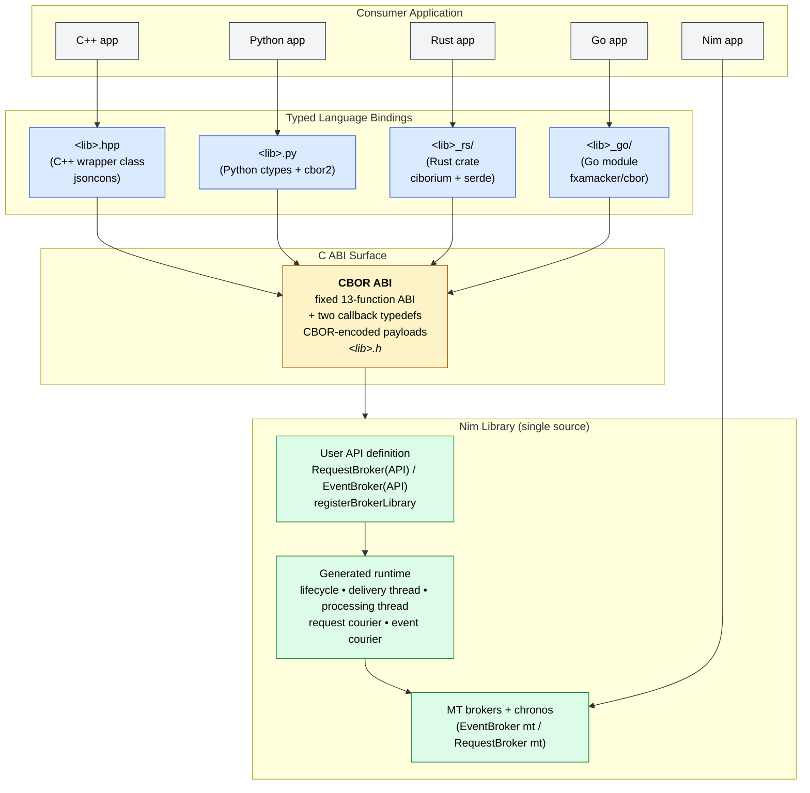
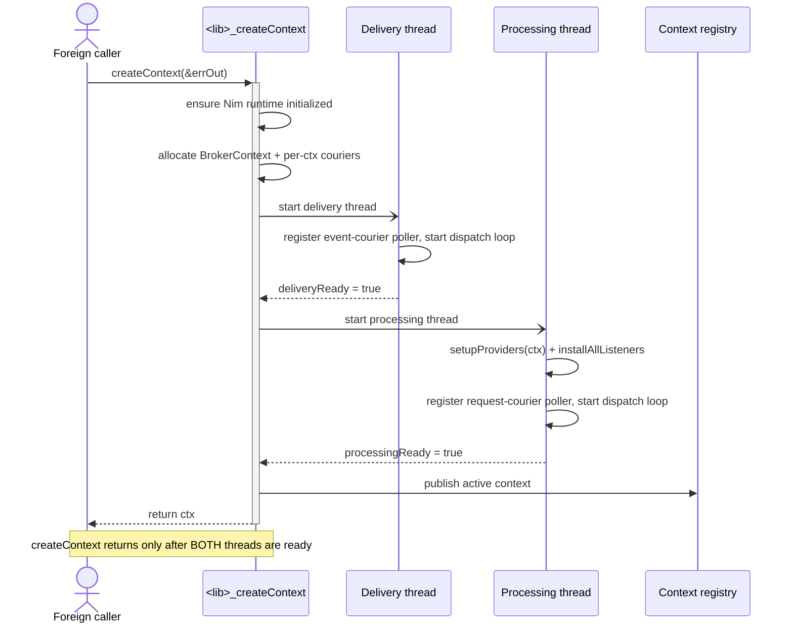
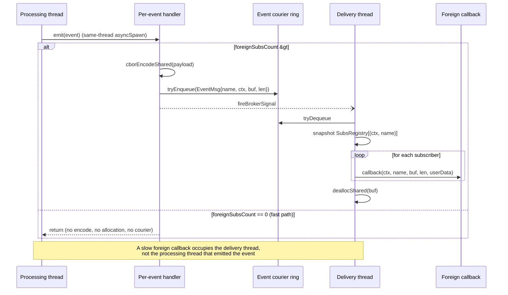
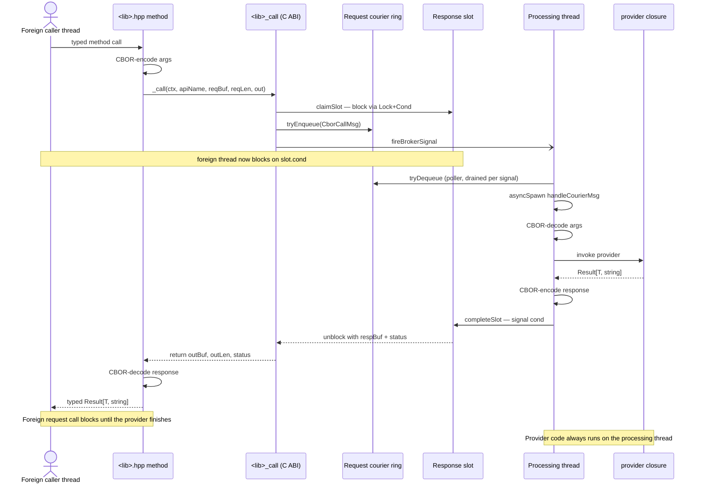
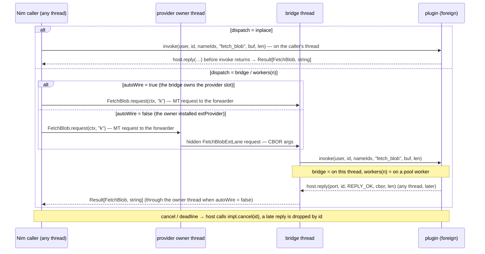

# Broker FFI API

Single Pure Nim library interface to be used from other Nim apps/modules or from foreign languages through a C ABI.

## Table of Contents

- [Broker FFI API](#broker-ffi-api)
  - [Table of Contents](#table-of-contents)
  - [Overview](#overview)
    - [Layered Architecture](#layered-architecture)
  - [Code Structure](#code-structure)
    - [Source Layout](#source-layout)
    - [Module Dependency Graph](#module-dependency-graph)
    - [Codegen Module Responsibilities](#codegen-module-responsibilities)
      - [Language outputs](#language-outputs)
    - [Compile-Time Data Flow](#compile-time-data-flow)
  - [Type Auto-Resolution](#type-auto-resolution)
    - [Usage](#usage)
    - [How It Works](#how-it-works)
    - [What Is Auto-Discovered](#what-is-auto-discovered)
    - [Constraints](#constraints)
  - [Building Blocks](#building-blocks)
    - [1. `RequestBroker(API)`](#1-requestbrokerapi)
    - [2. `EventBroker(API)`](#2-eventbrokerapi)
    - [3. `registerBrokerLibrary`](#3-registerbrokerlibrary)
    - [4. How to build with it](#4-how-to-build-with-it)
      - [Required Nim flags](#required-nim-flags)
      - [ABI strategy flag](#abi-strategy-flag)
      - [Optional language wrapper flags](#optional-language-wrapper-flags)
      - [Diagnostic flags](#diagnostic-flags)
      - [Worked examples](#worked-examples)
      - [Why `--nimMainPrefix` matters (POSIX)](#why---nimmainprefix-matters-posix)
      - [External dependencies for wrappers](#external-dependencies-for-wrappers)
      - [Convenience nimble tasks](#convenience-nimble-tasks)
  - [Lifecycle Model](#lifecycle-model)
    - [Module initialisation](#module-initialisation)
    - [Per-context creation](#per-context-creation)
    - [Post-create configuration](#post-create-configuration)
      - [Dynamic provider registration via `InitializeRequest`](#dynamic-provider-registration-via-initializerequest)
    - [Shutdown](#shutdown)
  - [Threading Architecture](#threading-architecture)
    - [Processing thread](#processing-thread)
    - [Delivery thread](#delivery-thread)
    - [Why there are two threads](#why-there-are-two-threads)
    - [Startup ordering](#startup-ordering)
    - [Event behavior](#event-behavior)
    - [Request behavior](#request-behavior)
  - [Requirements on `InitializeRequest` and `ShutdownRequest`](#requirements-on-initializerequest-and-shutdownrequest)
  - [Authoring a Broker FFI Library](#authoring-a-broker-ffi-library)
    - [Minimal structure](#minimal-structure)
    - [`setupProviders(ctx)` convention](#setupprovidersctx-convention)
    - [Batch request inputs](#batch-request-inputs)
    - [Event callback ABI](#event-callback-abi)
    - [Data ownership for request results](#data-ownership-for-request-results)
    - [Doc comments in generated surfaces](#doc-comments-in-generated-surfaces)
  - [Generated Foreign Surfaces](#generated-foreign-surfaces)
    - [C API](#c-api)
      - [Schema verification (`<lib>_verifySchema`)](#schema-verification-lib_verifyschema)
      - [Async requests (`<lib>_callAsync`)](#async-requests-lib_callasync)
    - [C++ wrapper](#c-wrapper)
    - [Python wrapper](#python-wrapper)
  - [Operational Expectations](#operational-expectations)
    - [What `mylib_createContext()` guarantees](#what-mylib_createcontext-guarantees)
    - [What it does not guarantee](#what-it-does-not-guarantee)
    - [Callback behavior](#callback-behavior)
    - [Provider behavior](#provider-behavior)
  - [EXTAPI — consuming external plugin APIs](#extapi--consuming-external-plugin-apis)
    - [Declaring an EXTAPI plugin (Nim side)](#declaring-an-extapi-plugin-nim-side)
    - [Dispatch modes and capabilities](#dispatch-modes-and-capabilities)
    - [Wiring a source](#wiring-a-source)
    - [Switching, fallback and mocking (Nim side)](#switching-fallback-and-mocking-nim-side)
    - [Raw CBOR tunnel](#raw-cbor-tunnel)
    - [The C ABI — `broker_ext.h`](#the-c-abi--broker_exth)
    - [Generated surfaces](#generated-surfaces)
    - [Ownership](#ownership)
    - [Failures](#failures)
    - [Platform support](#platform-support)
    - [Examples](#examples)
  - [Future Work](#future-work)
    - [Typed C surface](#typed-c-surface)
    - [Adding a new language surface](#adding-a-new-language-surface)
  - [Type Mapping Reference](#type-mapping-reference)
    - [The two layers that matter](#the-two-layers-that-matter)
    - [Cheat-sheet (high level)](#cheat-sheet-high-level)
    - [Composite example](#composite-example)
    - [Event callback signatures](#event-callback-signatures)
  - [Related Documents](#related-documents)

## Overview

The Broker FFI API is the shared-library integration layer built on top of
`RequestBroker(API)`, `EventBroker(API)`, and `registerBrokerLibrary`.

It is intended for cases where a Nim component should be consumed from foreign
languages while still using nim-brokers internally for typed request/response
and event delivery.

Foreign interface generation is activated with __-d:BrokerFfiApi__ at compile time.
> __In abscence of that flag__, the broker macros still work but Event/RequestBroker definitions just fall back to MultiThread brokers without emitting any FFI codegen or C exports.
> __Still usable from Nim.__

Typical consumers are:

- C++/Rust/Go applications through the generated wrapper class
- Python applications through the generated ctypes wrapper

The FFI API solution provides:

- a fixed 13-function CBOR C ABI — 11 core functions, the async
  `<lib>_callAsync` gate, and the `<lib>_verifySchema` wrapper/library
  schema check (see `## C API` below) — that every
  library exports identically — same shape regardless of how many
  request / event brokers are declared
- a generated library lifecycle API (`<lib>_initialize`,
  `<lib>_createContext`, `<lib>_shutdown`, `<lib>_version`)
- a generated C header (`<lib>.h`) declaring the CBOR ABI + the
  per-library event and async-response callback typedefs
- a generated C++ wrapper header (`<lib>.hpp`) with typed methods that
  CBOR-encode / decode internally (always emitted)
- an optional generated Python wrapper module (`<lib>.py`)
- an optional generated Rust wrapper crate (`<lib>_rs/`)
- an optional generated Go wrapper module (`<lib>_go/`)


The FFI API is designed around a per-library-context runtime model. Each call to
`<lib>_createContext()` creates one independent broker context with its own worker
threads and broker registrations.

### Layered Architecture

A single Nim API definition — one library or module written once with
`RequestBroker(API)`, `EventBroker(API)`, and `registerBrokerLibrary` —
compiles into a fixed CBOR C ABI plus an idiomatic typed wrapper for
each supported language. Consumer code talks to the typed wrapper; the
CBOR encode / decode is contained inside the wrapper.



**Key invariants of the layering:**

| Layer | Per-library count | What it does |
|-------|-------------------|--------------|
| Nim source | 1 | declares brokers + providers; mode-agnostic |
| C ABI / `<lib>.h` | 1 | fixed 13-function CBOR ABI + event and async-response callback typedefs |
| Language wrapper | 1 per language | typed methods; CBOR encode / decode internally |
| Consumer code | 1 | uses the typed wrapper; sees no CBOR |

The CBOR ABI offers a stable, narrow C surface and a self-describing
wire format. The typed wrapper layer hides the CBOR encode / decode
from application code, so consumers work against an idiomatic
language-native interface.

---

## Code Structure

The FFI API system is split into focused modules, each owning one concern.

### Source Layout

The FFI API codegen lives under `brokers/internal/`. It is split into a
mode-agnostic core (schema, type resolution, lifecycle) and the
CBOR-mode codegen layer (one module per output language plus shared
codec helpers).

```
brokers/
  api_library.nim                  registerBrokerLibrary — lifecycle,
                                   processing + delivery threads,
                                   request courier wiring, event courier
                                   wiring, file orchestration
  internal/
    api_schema.nim                 Compile-time type registry
                                   (ApiTypeEntry, gApiTypeRegistry)
    api_type_resolver.nim          Two-phase external-type auto-resolution
    api_type.nim                   Deprecated ApiType shim (warns; use
                                   plain Nim types)
    api_common.nim                 Re-export hub + runtime memory helpers
                                   (alloc/free across the ABI)

    # CBOR-mode broker codegen
    api_request_broker_cbor.nim    CBOR RequestBroker(API) codegen +
                                   per-method adapter (envelope
                                   encode / decode)
    api_event_broker_cbor.nim      CBOR EventBroker(API) codegen +
                                   per-event entry registration

    # CBOR runtime helpers
    api_cbor_codec.nim             BrokerCbor flavor, encode / decode
                                   helpers, distinct / enum bindings
    api_cbor_descriptor.nim        Stable runtime descriptor types for
                                   the discovery API
    api_cbor_subs_registry.nim     Shared-heap registry of foreign event
                                   subscribers (lock-protected; safe
                                   under --mm:refc)
    api_cbor_courier.nim           Request-side courier ring + per-call
                                   response slots (foreign _call →
                                   processing thread)
    api_cbor_event_courier.nim     Event-side courier ring
                                   (fire-and-forget; processing thread →
                                   delivery thread)

    # CBOR language codegen (one module per output surface)
    api_codegen_cbor_h.nim         Fixed 13-function CBOR C header
    api_codegen_cbor_hpp.nim       jsoncons-backed C++ wrapper
    api_codegen_cbor_py.nim        cbor2-backed Python wrapper
    api_codegen_cbor_rust.nim      ciborium + serde-backed Rust crate
    api_codegen_cbor_go.nim        fxamacker/cbor-backed Go module
    api_codegen_cbor_cddl.nim      <lib>.cddl schema emission
    api_codegen_cmake.nim          <lib>Config.cmake package emission

    # Multi-thread broker runtime (the FFI API runtime builds on these)
    mt_broker_common.nim           Shared MT runtime (thread id/gen,
                                   dispatch loop, signal helpers)
    mt_event_broker.nim            EventBroker(mt) macro
    mt_request_broker.nim          RequestBroker(mt) macro

    helper/
      broker_utils.nim             Shared AST parsing
                                   (parseSingleTypeDef, parseTypeDefs)
```

### Module Dependency Graph

```
helper/broker_utils.nim       (no API deps)
        |
api_schema.nim -- api_type_resolver.nim
        |
        +--> CBOR codegen
                api_cbor_codec.nim
                api_cbor_descriptor.nim
                api_cbor_subs_registry.nim
                api_cbor_courier.nim
                api_cbor_event_courier.nim
                api_codegen_cbor_{h,hpp,py,rust,go,cddl}.nim
                api_codegen_cmake.nim
        |
api_common.nim   (re-exports schema + type resolver +
                  runtime memory helpers)
        |
        +--> api_request_broker_cbor.nim
        +--> api_event_broker_cbor.nim
        |
api_library.nim   (lifecycle, two threads per context,
                   request + event courier wiring,
                   file orchestration via generate*File procs)
```

**Key rules:**

- CBOR is the only FFI codegen surface; activate it with
  `-d:BrokerFfiApi`. The historical native-codegen path was retired
  along with the `BrokerFfiMode` selector.
- Language codegen modules (C, C++, Python, Rust, Go, ...) have no
  dependencies on each other. Each owns its accumulators and type
  mapping procs. 
  - Adding a new language surface means adding one new module  with no changes to the existing ones.
- `api_library.nim` is the only module that knows about every output and
  drives file emission at the end of macro expansion.

### Codegen Module Responsibilities

Each language codegen module owns:

1. **Type mapping procs** — convert Nim types to the target language
   (`nimTypeToCOutput`, `nimTypeToCpp`, `nimTypeToCtypes`,
   `nimTypeToRust`, `nimTypeToGo`, `toCFieldType`, ...).
2. **Compile-time accumulators** — `{.compileTime.}` `seq[string]` buffers
   that collect code fragments during macro expansion.
3. **File generator** — reads accumulators and writes the output file
   (`generateCHeaderFile`, `generateCppHeaderFile`, `generatePythonFile`,
   `generateRustCrate`, `generateGoModule`, ...).

#### Language outputs

| Module | Output file(s) | Notes |
|--------|----------------|-------|
| `api_codegen_cbor_h.nim` | `<lib>.h` | Fixed 13-function C ABI + event and async-response callback typedefs. Always emitted. |
| `api_codegen_cbor_hpp.nim` | `<lib>.hpp` | C++ wrapper backed by jsoncons. Always emitted. |
| `api_codegen_cbor_py.nim` | `<lib>.py` | Python wrapper backed by `cbor2`. Opt-in via `-d:BrokerFfiApiGenPy`. |
| `api_codegen_cbor_rust.nim` | `<lib>_rs/Cargo.toml`, `src/lib.rs` | Rust crate using `ciborium` + `serde` (per-method `__Env<T>` envelope). Opt-in via `-d:BrokerFfiApiGenRust`. |
| `api_codegen_cbor_go.nim` | `<lib>_go/go.mod`, `<lib>.go`, `<lib>_cbor.go` | Go module using `github.com/fxamacker/cbor/v2`. Opt-in via `-d:BrokerFfiApiGenGo`. |
| `api_codegen_cbor_cddl.nim` | `<lib>.cddl` | CDDL schema for the CBOR surface; also returned by `<lib>_getSchema()` at runtime. Always emitted. |
| `api_codegen_cmake.nim` | `<lib>Config.cmake` | CMake package config exposing `mylib::mylib` (C) and `mylib::mylib_cpp` (C++) IMPORTED targets. Always emitted. |

The shared CBOR runtime helpers (`api_cbor_codec.nim`,
`api_cbor_descriptor.nim`, `api_cbor_subs_registry.nim`,
`api_cbor_courier.nim`, `api_cbor_event_courier.nim`) are imported by
the broker codegen modules (`api_request_broker_cbor.nim`,
`api_event_broker_cbor.nim`) and by `api_library.nim`'s lifecycle
codegen, but not by the language-specific codegen modules — those
only read from the schema registry.

### Compile-Time Data Flow

```
1. User defines plain Nim types (DeviceInfo, AddDeviceSpec)

2. Broker macros expand:
   a. discoverExternalTypes() scans AST for non-primitive types
   b. emitAutoRegistrations() emits autoRegisterApiType(T) calls
   c. Deferred codegen macro emitted (runs after registrations)

3. autoRegisterApiType(T) typed macro expands (runs first):
   a. getTypeImpl() extracts fields
   b. Recursion for nested object types
   c. Registers in gApiTypeRegistry
   d. Appends to per-language CBOR codegen accumulators (C, C++, Python,
      Rust, Go, CDDL)

4. Deferred broker codegen (api_request_broker_cbor /
   api_event_broker_cbor) expands after step 3:
   a. lookupFfiStruct() succeeds — registry populated
   b. Generates the per-method / per-event adapter that
      CBOR-encodes / decodes the typed Nim payload at the ABI edge
   c. Registers the entry in gApiCborRequestEntries /
      gApiCborEventEntries for api_library.nim to wire later

5. registerBrokerLibrary macro:
   a. Generates lifecycle code (createContext, shutdown,
      processing + delivery threads, request courier + event courier
      allocation / shutdown, per-event listener installers including the
      atomic-counter fast path and dropAllListeners cleanup hook)
   b. Generates _call dispatch case statement, _subscribe / _unsubscribe
      C exports, _listApis / _getSchema discovery exports
   c. Calls file generators:
      - generateCborHeaderFile()  → <libName>.h
      - generateCborHppFile()     → <libName>.hpp
      - generateCborPyFile()      → <libName>.py        (opt-in)
      - generateCborRustCrate()   → <libName>_rs/...    (opt-in)
      - generateCborGoModule()    → <libName>_go/...    (opt-in)
      - generateCborCddlFile()    → <libName>.cddl
      - generateCmakeConfigFile() → <libName>Config.cmake
```

---

## Type Auto-Resolution

External types referenced in broker macros are automatically discovered and
registered at compile time. No separate `ApiType` registration macro is needed.

### Usage

Define types as plain Nim objects before the broker macro:

```nim
type DeviceInfo* = object
  deviceId*: int64
  name*: string
  online*: bool

RequestBroker(API):
  type ListDevices = object
    devices*: seq[DeviceInfo]
  proc signature*(): Future[Result[ListDevices, string]] {.async.}
```

`DeviceInfo` is auto-discovered from the `seq[DeviceInfo]` field and
auto-registered. The C++ struct + jsoncons traits, the Python
`@dataclass`, the Rust `#[derive(Serialize, Deserialize)]` struct, the
Go struct with `cbor` tags, and the CDDL schema entry are all
generated automatically.

### How It Works

The auto-resolution uses a two-phase approach to work within Nim's macro system
constraints:

**Phase 1 — Discovery (untyped context)**:
`discoverExternalTypes(body)` scans the raw AST for non-primitive type
references in type fields, proc parameters, and type aliases.

**Phase 2 — Resolution (typed macro)**:
`autoRegisterApiType(T: typed)` receives a resolved type symbol, introspects its
fields via `getTypeImpl()`, recursively resolves nested object types, and
registers everything in the compile-time type registry.

The **deferred codegen pattern** ensures proper ordering: auto-registration macro
calls are emitted before the broker codegen macro, so the type registry is
populated when the codegen needs to look up fields.

### What Is Auto-Discovered

- `seq[T]` in type fields: `devices: seq[DeviceInfo]` → discovers `DeviceInfo`
- `seq[T]` in proc parameters: `proc signature*(items: seq[AddDeviceSpec])` → discovers `AddDeviceSpec`
- Plain custom type fields: `info: DeviceInfo` → discovers `DeviceInfo`
- Type aliases: `type MyEvent = ExternalType` → discovers `ExternalType`
- Nested objects: if `DeviceInfo` has `address: Address`, `Address` is recursively resolved

### Constraints

- External types must be defined **before** the broker macro call site (standard
  Nim compilation order)
- All `API` broker must be known and imported where the `registerBrokerLibrary` macro is used!
- Only `object` types can be fully introspected. Enums, distinct types, etc.
  pass through without field registration.

---

## Building Blocks

The FFI API layer is composed from three parts.

### 1. `RequestBroker(API)`

Defines a request type that is exported as a C ABI function.

Example:

```nim
RequestBroker(API):
  type GetDevice = object
    deviceId*: int64
    name*: string

  proc signature*(deviceId: int64): Future[Result[GetDevice, string]] {.async.}
```

This generates:

- a per-method adapter on the Nim side that CBOR-decodes the args,
  invokes the provider closure, and CBOR-encodes the response — wired
  into the per-library `<lib>_call` dispatch case statement
- a typed wrapper method on every emitted language surface (C++ /
  Python / Rust / Go) that CBOR-encodes the args, calls `<lib>_call`,
  and CBOR-decodes the response into the typed `Result<T, String>`
- a runtime entry in `<lib>_listApis()` / `<lib>_getSchema()` so the
  CBOR ABI is discoverable from foreign code without prior knowledge

The C ABI itself stays fixed at 11 functions regardless of how many
request brokers a library declares — the per-method routing lives
inside `<lib>_call(apiName, ...)`.

### 2. `EventBroker(API)`

Defines an event type that can be subscribed to from foreign code.

Example:

```nim
EventBroker(API):
  type DeviceDiscovered = object
    deviceId*: int64
    name*: string
```

This generates:

- a C callback typedef
- `on<EventType>(ctx, callback, userData)`
- `off<EventType>(ctx, handle)`
- generated wrapper registration methods in C++ and Python

### 3. `registerBrokerLibrary`

This macro ties the API request and event brokers into a complete shared
library surface.

Example:

```nim
registerBrokerLibrary:
  name: "mylib"
  version: "0.1.0"
  initializeRequest: InitializeRequest
  shutdownRequest: ShutdownRequest
```

This generates:

- `mylib_createContext()`
- `mylib_shutdown(ctx)`
- memory management interface
- the library context registry
- the delivery and processing threads
- aggregate event registration routing
- generated C and C++ headers

### 4. How to build with it

This subsection collects, in one place, every compile-time switch and runtime
toolchain requirement for producing a Broker FFI library. Most projects only
need a handful of these flags; the rest are wrapper opt-ins or diagnostic
toggles.

#### Required Nim flags

| Flag | Purpose |
|------|---------|
| `--threads:on` | The FFI API runtime spawns a delivery and a processing thread per context. |
| `--app:lib` | Produce a shared library (`.so` / `.dylib` / `.dll`) instead of an executable. |
| `--mm:orc` *or* `--mm:refc` | Both are supported on every platform. ORC is the recommended default; refc is CI-green across Linux / macOS / Windows with one Windows-specific caveat documented in [LIMITATION.md](LIMITATION.md) §2.2 (don't allocate from `RegisterWaitForSingleObject` callbacks). |
| `--nimMainPrefix:<libname>` | POSIX only. Must match the `name:` field of `registerBrokerLibrary` (see "Why it matters" below). On Windows the flag is intentionally **omitted** — using it triggers a Nim codegen bug under the LLVM toolchain. |
| `--path:.` | Make the project root visible so `import brokers/...` resolves. |
| `--outdir:build` | Keep `.so` and generated wrapper artifacts out of the source tree. |

#### ABI strategy flag

CBOR is the only supported FFI mode; activate the codegen with
`-d:BrokerFfiApi`.

| Flag | Selects | Generated C ABI shape | Wire format |
|------|---------|-----------------------|-------------|
| `-d:BrokerFfiApi` | CBOR ABI | Fixed 13-function ABI + event and async-response callback typedefs. | CBOR-encoded payloads. |

The historical `-d:BrokerFfiApiNative` (native typed-C export ABI) and
the transitional `-d:BrokerFfiApiCBOR` alias have been removed.

#### Optional language wrapper flags

C and C++ headers are always emitted. The remaining language wrappers
are opt-in.

| Flag | Generates | Output relative to `--outdir` |
|------|-----------|-------------------------------|
| `-d:BrokerFfiApiGenPy` | `<lib>.py` (ctypes + cbor2) | `<lib>.py` |
| `-d:BrokerFfiApiGenRust` | `<lib>_rs/` Cargo crate (ciborium + serde) | `<lib>_rs/Cargo.toml`, `src/lib.rs` |
| `-d:BrokerFfiApiGenGo` | `<lib>_go/` Go module (fxamacker/cbor) | `<lib>_go/go.mod`, `<lib>.go`, `<lib>_cbor.go` |

The CMake package config (`<lib>Config.cmake`) and, in CBOR mode, the
`<lib>.cddl` schema are emitted unconditionally next to the `.h`/`.hpp`.

#### Diagnostic flags

| Flag | Effect |
|------|--------|
| `-d:brokerDebug` | Dump every macro-generated AST to stdout during compilation. Useful when investigating codegen output. |
| `-d:release` | Standard Nim release build. The repository's CI matrix exercises the FFI API under both debug and release. |

#### Worked examples

Minimal build of `examples/ffiapi/nimlib/mylib.nim` (CBOR is the only mode):

```sh
nim c \
  -d:BrokerFfiApi \
  --threads:on --app:lib --mm:orc \
  --path:. --outdir:examples/ffiapi/nimlib/build_cbor \
  --nimMainPrefix:mylib \
  examples/ffiapi/nimlib/mylib.nim
```

Same source compiled with all four wrapper languages emitted:

```sh
nim c \
  -d:BrokerFfiApi \
  -d:BrokerFfiApiGenPy -d:BrokerFfiApiGenRust -d:BrokerFfiApiGenGo \
  --threads:on --app:lib --mm:orc \
  --path:. --outdir:examples/ffiapi/nimlib/build_cbor \
  --nimMainPrefix:mylib \
  examples/ffiapi/nimlib/mylib.nim
```

Inspect the AST that the macros produce:

```sh
nim c -d:brokerDebug -d:BrokerFfiApi \
      --threads:on --app:lib --path:. --outdir:build \
      --nimMainPrefix:mylib examples/ffiapi/nimlib/mylib.nim
```

#### Why `--nimMainPrefix` matters (POSIX)

`--nimMainPrefix:<libname>` renames the library's `NimMain` (an exported,
default-visibility symbol) to `<libname>NimMain`. Without it, two Nim shared
libraries in one process both export `NimMain`; on Linux a library's own
load-time call to it can then bind to the other library's copy (ELF symbol
interposition, worse with `RTLD_GLOBAL`). macOS two-level namespaces bind
each library to its own copy, but keep the prefix there too.

With `--noMain` the generated `<lib>_initialize` imports and calls
`<libname>NimMain` (see [Module initialisation](#module-initialisation)), so
there a prefix that does not match the `name:` field of
`registerBrokerLibrary` fails to link. A default build does not reference the
symbol.

On Windows the flag is omitted intentionally (see `nimMainPrefixFlag` in
[brokers.nimble](../brokers.nimble) and [LIMITATION.md](LIMITATION.md) §3.1).

#### External dependencies for wrappers

| Wrapper | Dependency | How to get it |
|---------|------------|---------------|
| C++ | `jsoncons` headers under `vendor/jsoncons/include` | `nimble fetchVendor` (or `git submodule update --init --recursive`) |
| Python | `cbor2` package | `pip install --user cbor2` |
| Rust | `ciborium` + `serde` + `serde_json` + `serde_bytes` | Cargo fetches them automatically. |
| Go | `github.com/fxamacker/cbor/v2` | `go mod tidy` fetches it during the build. |

#### Convenience nimble tasks

The repository ships ready-made tasks that already pass every flag above.
They are the easiest way to reproduce a working build.

- `nimble buildFfiExample` — build the CBOR shared library
- `nimble runFfiExampleCpp` / `runFfiExamplePy` / `runFfiExampleRust` /
  `runFfiExampleGo` — rebuild + run the matching consumer against the
  CBOR library
- `nimble testApi` — CBOR codec round-trips, library lifecycle,
  event subscribe, discovery API, and the typemappingtestlib parity
  matrix across `--mm:orc` / `--mm:refc` × debug / release
- `nimble runTypeMapTestLibCpp` / `…Py` / `…Rust` / `…Go` —
  per-language parity matrices. Run them **sequentially**: they share one
  Nim cache and output `.dylib`, so concurrent runs clobber each other's
  object files and surface as spurious "Undefined symbols" link errors.
  Each iterates both memory managers by default; override with
  `MM=orc` / `MM=refc` to run a single one.
- `nimble runFfiBenchEventStress` — Part D-4/D-5 event dispatch stress
  drivers (mixed audience / no-foreign / no-nim / shutdown drain /
  slow-callback non-blocking proof)
- `nimble runFfiBenchEvent` — Part D-6 event-dispatch microbenchmark

---

## Lifecycle Model

The FFI API exposes a single public creation entry point.

### Module initialisation

A library's module initialiser (`<libname>NimMain`: `system` init, every
module's `DatInit` / `Init`, then all top-level code, including broker and
plugin registration) runs **exactly once per process, when the library is
loaded**. Nim's `--app:lib` codegen (`compiler/cgen.nim`, `PosixCDllMain` /
`WinCDllMain`) emits the loader hook that runs it:

| Platform | Build | Who runs `<libname>NimMain` | When |
| --- | --- | --- | --- |
| macOS, Linux | `--app:lib` | `NimMainInit`, an `__attribute__((constructor))` (`NIM_POSIX_INIT` in `nimbase.h`) | `dlopen` / process start, on the loading thread |
| Windows | `--app:lib` | `DllMain(DLL_PROCESS_ATTACH)` | `LoadLibrary` / process start, under the loader lock |
| macOS, Linux | `--app:lib --noMain` | `<lib>_initialize` (first call) | first `_initialize` |
| Windows | `--app:lib --noMain` | nobody (unsupported) | — |

`<lib>_initialize` therefore calls `<libname>NimMain` only under `--noMain`.
Its remaining work is per-thread foreign-GC registration and the lazy
context registry; it is idempotent and runs no module code.

The same holds under `--mm:refc` and `--mm:orc`: the loader hook is emitted
by the codegen independently of the memory manager.

**History.** `_initialize` used to call `<libname>NimMain` on POSIX in every
build, on the assumption that only Windows' `DllMain` runs it automatically.
Every POSIX library therefore ran its module initialiser twice: at load and
again at the first `_initialize`. The EXTAPI example registered its plugin
twice. What the second run does differs by memory manager:

| Effect of the second run | `--mm:orc` | `--mm:refc` |
| --- | --- | --- |
| Top-level `var x = @[…]` / `initTable()` | raw overwrite, no destructor: the first run's payload leaks | `asgnRef` overwrite: the first run's object becomes garbage and is collected |
| Type info and GC roots | — | `DatInit` re-runs; `nimRegisterGlobalMarker` registers every global marker a second time |
| `system` module init | re-runs | re-runs |
| Top-level `initLock(...)` | `pthread_mutex_init` on a live mutex: undefined behaviour | same |
| Counters and registries (`fetchAdd`, `seq.add`) | applied twice | applied twice |

Gated by `test/test_api_module_init_once.nim` (in `nimble testApi`), which
loads `test/initoncelib/initoncelib.nim` as a real shared library and checks
its module-run counter after load, `_initialize` (twice), `_createContext`
and `_shutdown`, under orc and refc, with and without `--noMain` (POSIX).

### Per-context creation

`<lib>_createContext()` creates one independent library instance.

Responsibilities:

- ensure the Nim runtime is initialized once per process
- allocate a fresh `BrokerContext`
- start the delivery thread
- start the processing thread
- wait until both threads report readiness
- publish the context in the library registry

The startup handshake is synchronous from the caller point of view. When
`<lib>_createContext()` returns a context, the delivery side and processing side
are already ready for use.

This is why the examples do not need a post-create sleep.

The C ABI surface for context creation is:

```c
uint32_t <lib>_createContext(const char** errOut);
```

On success it returns a non-zero context id and leaves `*errOut`
untouched. On failure it returns 0 and writes a heap-allocated
diagnostic cstring to `*errOut` — the caller MUST release it with
`<lib>_freeBuffer(errOut)` (cstrings emitted by the runtime live in
the same shared-heap arena as response buffers). The C++ / Python /
Rust / Go wrappers wrap this into their idiomatic `Result` /
exception / `Result<T, String>` surface and free the error string
automatically.

Sequence overview:



### Post-create configuration

`InitializeRequest` is the request broker type used for configuration
after the context exists.

Typical responsibilities:

- load configuration files
- initialize thread-local provider state
- register additional providers lazily
- validate environment or external dependencies

#### Dynamic provider registration via `InitializeRequest`

In `setupProviders(ctx)`, the `InitializeRequest` and `ShutdownRequest`
providers must both be registered on the context — but only one of them is part
of the public API surface:

| Broker | Who calls it | Foreign surface |
|---|---|---|
| `InitializeRequest` | the **consumer**, explicitly, after `_createContext` | `lib.initializeRequest(...)` → `<lib>_call(ctx, "initialize_request", ...)` |
| `ShutdownRequest` | `<lib>_shutdown(ctx)` itself | none — not published as a request |

`InitializeRequest` is not auto-invoked: `_createContext(errOut)` has no payload
parameter, and initialization normally needs arguments. Skipping it is a loud
failure rather than a silent one, since the library is fully alive at that point
and providers written the usual way refuse work until it has run.

`ShutdownRequest` is the mirror image: the consumer cannot usefully own it (the
wrappers tear down from a destructor), so the library owns it and the hook is
kept off the public surface entirely — see [Shutdown](#shutdown).

`InitializeRequest` can also be used as a dynamic registration point
for additional providers — call `setProvider` on the other broker
types from inside the `InitializeRequest` provider closure. This
enables configuration-driven provider registration without baking the
choice into `setupProviders`.


### Shutdown

`ShutdownRequest` is the broker request type for orderly application-level
teardown.

`<lib>_shutdown(ctx)` first invokes `ShutdownRequest` on the processing thread,
then stops the delivery and processing threads and marks the context inactive in
the registry.

Foreign callers only need to call `<lib>_shutdown(ctx)`.

#### Where the provider runs in the teardown sequence

The invocation sits at a deliberate point in `<lib>_shutdown` (issue #49):

1. mark the context inactive — no new `_call` / `_callAsync` / `_subscribe` enters
2. drain in-flight `_call`s (bounded) — the system goes quiescent
3. **invoke the declared `shutdownRequest` provider** ← here
4. hand any event it emitted to the delivery thread (bounded)
5. set the shutdown flag, join the delivery thread, then the processing thread
6. free the subscription registry and the couriers

Step 3 is routed as a reserved-apiName control message (`__shutdown_request`)
through the same courier `__release_instance` uses, for two reasons:

| Constraint | Why |
|---|---|
| Must run on the **processing thread** | The provider's MT broker bucket is keyed by that thread's identity; a call from the foreign caller's thread would address the wrong bucket. |
| Must run while **both threads are alive** | If the provider emits an event as its last act, the delivery thread has to still be there to fan it out. Hence before the shutdown flag, not after. |

The declaration must carry exactly one **zero-argument** signature, since
`_shutdown` has no payload to supply. The reserved control name never appears in
`_listApis`, `_getSchema`, or the CDDL. See
[the hook is author-only](#the-hook-is-author-only-not-part-of-the-api) below for
the full surface rules.

#### Failure, timeout, and idempotency

Teardown never aborts because a user provider misbehaved. A provider that returns
`err`, raises, or exceeds its budget is logged with a chronicles `warn` and the
flag / join / free sequence proceeds unchanged. `<lib>_shutdown` still returns
`0`: it reports transport teardown, not application teardown, and a non-zero
return would make every wrapper's RAII path treat a completed shutdown as a
failure.

The timeout is enforced on the **processing thread**, racing the provider against
a chronos timer, because the blocked `_shutdown` side waits on an unbounded
condition variable. The response slot is therefore completed on every path,
including expiry, so a hung provider cannot stall teardown.

#### The hook is author-only, not part of the API

`ShutdownRequest` exists to give the **library author** a place to tidy up when a
context goes down. Publishing the same provider as an ordinary request would only
let a foreign caller tear application state down mid-life and then keep using the
library, so it is not published at all:

- absent from `_listApis`, `_getSchema`, and the CDDL;
- no method on the C++, Python, Rust, or Go wrapper;
- `<lib>_call(ctx, "shutdown_request", ...)` returns `-4` (unknown apiName), as
  does `_callAsync`;
- the reserved control names (`__shutdown_request`, `__release_instance`) are
  refused on both call entry points — `_shutdown` and `_releaseInstance` enqueue
  them onto the courier themselves and never come through `_call`.

Consequently the declaration must have **exactly one zero-argument signature**.
An argument-based slot is a compile error: it could never be invoked, and it
would additionally rename the zero-arg slot's wire name (`shutdown_request`
becomes `shutdown_request_zero`), breaking callers of the original.

The payload type itself is still emitted in the shared-types section of the
generated header and CDDL, since types come from the type registry rather than
from the request list.

If you need a teardown-adjacent operation the *consumer* drives — a flush, a
drain, a checkpoint — declare a separate `RequestBroker(API)` for it. That keeps
the caller-driven operation and the library's own teardown hook distinct, instead
of overloading one provider with both roles.

#### Configuration

```nim
registerBrokerLibrary:
  name: "mylib"
  initializeRequest: InitializeRequest
  shutdownRequest: ShutdownRequest
  shutdownRequestTimeoutMs: 2000 # default 5000; 0 = infinite
```

| Key | Default | Meaning |
|---|---|---|
| `shutdownRequestTimeoutMs` | `5000` | Processing-thread bound on the provider. `0` = infinite (a hung provider then blocks teardown — only for providers you control). |

`initializeRequest` has **no** symmetric auto-invocation: `_createContext` takes
only an `errOut` parameter, so there is nowhere to pass a configuration payload
without an ABI change. Call it explicitly after `_createContext`.

---

## Threading Architecture

Each created library context owns two threads.

### Processing thread

Purpose:

- hosts API request providers
- runs `setupProviders(ctx)` during startup
- serves requests for `RequestBroker(API)` types

This is the thread on which provider closures execute.

### Delivery thread

Purpose:

- consumes the per-context **event courier ring**
- invokes foreign callback trampolines for API event delivery
- isolates foreign callback runtime from request providers — a slow or
  reentrant callback blocks the delivery thread, never the processing
  thread

This is the thread that invokes C callbacks and the callback trampolines used by
the generated C++ and Python wrappers.

### Why there are two threads

The split keeps foreign-callback fan-out off the provider thread. A
foreign callback that sleeps 100 ms would block any request providers
sharing the same thread (and would deadlock if the callback re-entered
the library via `<lib>_call`). Running fan-out on a dedicated delivery
thread eliminates both hazards.

Benefits:

- event callback dispatch is isolated from request execution
- request providers can keep request-local state on the processing thread
- a reentrant `<lib>_call` from inside a foreign callback is serviced on
  the processing thread (no self-deadlock)
- shutdown ordering is predictable

See `doc/CBOR_Round2_PartD_EventCourier.md` for the design rationale and
`doc/bench_baseline.md` § "Event dispatch — Part D-6" for per-emit cost
numbers across the three dispatch lanes.

### Startup ordering

The generated create function starts the threads in this order:

1. delivery thread
2. processing thread

The delivery thread is started first so its event-courier signal handle
is published before any provider can emit an event. The create function
waits for:

- delivery thread readiness after its broker dispatch loop is running
  and the event-courier poller is registered
- processing thread readiness after `setupProviders(ctx)` completes
  and the per-event listeners are installed

The sequence above is the reason `create()` behaves synchronously even
though the implementation starts two background threads internally.

### Event behavior

Foreign subscribe / unsubscribe — `<lib>_subscribe(ctx, eventName, cb,
userData)` / `<lib>_unsubscribe(ctx, eventName, handle)` — write
directly into a shared-heap subscription registry from the foreign
caller's thread. No request broker is involved on the registration
path. Each successful subscribe bumps a per-event atomic counter that
the emit-side uses as a fast-path discriminator.

When the Nim side emits an API event:

- the per-event listener (registered on the **processing** thread by
  `installAllListenersIdent`) fires via the MT EventBroker's same-thread
  direct `asyncSpawn` fast path
- the listener loads the per-event `foreignSubsCount` atomic. **If
  zero (the 90 % production case), the listener returns immediately**
  — no CBOR encode, no allocation, no courier touch.
- otherwise the listener CBOR-encodes the payload once into a
  shared-heap buffer, enqueues an `EventMsg(eventName, ctx, buf,
  bufLen)` into the per-context event-courier ring, and fires the
  delivery thread's broker dispatch signal
- the delivery thread polls the courier ring, snapshots the foreign
  subscriber list for `(ctx, eventName)`, invokes each callback
  synchronously, then `deallocShared`s the buffer
- Nim listeners (registered via `<Event>.listen(...)` from Nim code
  inside the library) keep going through the standard MT EventBroker
  paths unchanged — same-thread direct `asyncSpawn` or cross-thread
  typed-slab marshalling



`<EventType>.dropAllListeners(ctx)` from Nim code fires a companion
hook (registered by the per-event installer) that also clears the
foreign-subscriber registry for `(ctx, eventName)` and resets the
`foreignSubsCount` atomic, so foreign subs cannot orphan when user Nim
code drops listeners.

### Request behavior

API request brokers route every `<lib>_call(...)` from a foreign thread
through the per-context **request courier** (`api_cbor_courier.nim`).
Properties:

- Single C ABI entry point: `<lib>_call(ctx, apiName, reqBuf, reqLen,
  outBuf, outLen, outStatus)`. The typed wrapper methods (per-request
  in `<lib>.hpp` / `<lib>.py` / Rust / Go) CBOR-encode their args, call
  `_call`, then CBOR-decode the response.
- The foreign thread claims one of N response slots (lock + cond),
  enqueues a POD `CborCallMsg{apiName, reqBuf, reqLen, slotIdx}` into
  the shared-heap MPSC ring, fires the processing thread's broker
  dispatch signal, then blocks on the slot's condvar.
- The processing thread's `brokerDispatchLoop` coroutine wakes on the
  signal, drains the ring, dispatches each message on a chronos
  `asyncSpawn`. The async handler CBOR-decodes, calls the typed
  provider closure, CBOR-encodes the result, and writes it into the
  slot — which signals the cond and unblocks the caller.
- One provider exists per request broker type per broker context.
- Buffer ownership: every shared-heap buffer crossing the ABI is
  allocated by Nim (`<lib>_allocBuffer` on the foreign side, or
  `allocShared0` on the processing thread for responses) and freed by
  Nim (`<lib>_freeBuffer` on the foreign side after the wrapper
  decodes the response).



See [Multi-Thread RequestBroker](MultiThread_RequestBroker.md) for the lower
level request-routing behavior that the FFI API builds on.

---

## Requirements on `InitializeRequest` and `ShutdownRequest`

`registerBrokerLibrary` requires that the types named in `initializeRequest:` and
`shutdownRequest:` exist at compile time, and that `shutdownRequest:` declares
exactly one zero-argument signature (it is the author-only teardown hook
`<lib>_shutdown` invokes). The legacy `destroyRequest:` alias is
still accepted for compatibility.
You can name you Initialized and Shutdown brokers as you like. The macro just registers them.

It does not itself force those providers to be registered. A missing
`ShutdownRequest` provider is not fatal: `<lib>_shutdown` invokes it, the broker
answers "no provider", and the teardown logs a `warn` and continues.

In practice:

- `InitializeRequest.setProvider(ctx, ...)` and `ShutdownRequest.setProvider(ctx, ...)`should be installed in `setupProviders`:exclamation:
  - These are stands for constrtuctor and destructor of the library context, so they should be registered on the processing thread during startup :exclamation:

For other API request brokers, lazy registration is allowed.

For example, a library may:

- register `InitializeRequest` and `ShutdownRequest` during startup
- use `InitializeRequest.request(...)` to install additional API broker providers

This works because `InitializeRequest` executes on the processing thread, which is
the correct owner thread for `setProvider` on API request brokers.

The main limitation is that a provider can only be registered once per broker
type per context unless it is cleared first.

---

## Authoring a Broker FFI Library

### Minimal structure

```nim
import brokers/[event_broker, request_broker, broker_context, api_library]

RequestBroker(API):
  type InitializeRequest = object
    initialized*: bool

  proc signature*(configPath: string): Future[Result[InitializeRequest, string]] {.async.}

RequestBroker(API):
  type ShutdownRequest = object
    status*: int32

  proc signature*(): Future[Result[ShutdownRequest, string]] {.async.}

EventBroker(API):
  type StatusChanged = object
    label*: string

var gProviderCtx {.threadvar.}: BrokerContext

proc setupProviders(ctx: BrokerContext) =
  gProviderCtx = ctx

  discard InitializeRequest.setProvider(
    ctx,
    proc(configPath: string): Future[Result[InitializeRequest, string]] {.closure, async.} =
      return ok(InitializeRequest(initialized: true))
  )

  discard ShutdownRequest.setProvider(
    ctx,
    proc(): Future[Result[ShutdownRequest, string]] {.closure, async.} =
      return ok(ShutdownRequest(status: 0))
  )

registerBrokerLibrary:
  name: "mylib"
  initializeRequest: InitializeRequest
  shutdownRequest: ShutdownRequest
```

### `setupProviders(ctx)` convention

If a proc named `setupProviders(ctx: BrokerContext)` exists, the generated
library startup calls it automatically on the processing thread.

That proc is the main hook for:

- registering request providers
- capturing thread-local state
- remembering the active provider context
- installing lazily created providers if desired

`(API)` brokers ride the multi-thread lane, so the `BrokerScope` overloads
(`setProvider(scope, …)`, `provideIt(scope)`, …; see `USAGEGUIDE.md` §
"BrokerScope") are available here too. They are a Nim-side registration
helper only: nothing on the FFI surface, headers or wrappers changes.

### Batch request inputs

For request parameters that need to cross the foreign-function boundary
as a collection, prefer `seq[T]` where `T` is a plain Nim object type
defined before the broker macro.

Example:

```nim
type AddDeviceSpec* = object
  name*: string
  deviceType*: string
  address*: string

RequestBroker(API):
  type AddDevice = object
    devices*: seq[DeviceInfo]
    success*: bool

  proc signature*(devices: seq[AddDeviceSpec]):
    Future[Result[AddDevice, string]] {.async.}
```

Why this shape is preferred:

- The type auto-resolution system discovers `AddDeviceSpec` from the
  proc parameter and registers it in `gApiTypeRegistry`. Each language
  wrapper then emits a typed representation of the item — a C++ struct
  with `JSONCONS_ALL_MEMBER_TRAITS`, a Python `@dataclass`, a Rust
  `#[derive(Serialize, Deserialize)]` struct, a Go struct with cbor
  tags — so consumer code passes a `vector<AddDeviceSpec>` /
  `list[AddDeviceSpec]` / `Vec<AddDeviceSpec>` / `[]AddDeviceSpec`
  directly without touching CBOR by hand.
- On the wire the batch becomes a single CBOR array nested inside the
  request envelope; the Nim adapter CBOR-decodes the whole batch into
  `seq[AddDeviceSpec]` before invoking the provider. No per-item C
  ABI crossing.

In contrast, literal tuple sequences are not a good fit for the
codegen because tuple items do not participate in the type registry
that drives the per-language typed representations.

Current limitation:

- `RequestBroker(API)` supports at most two signature categories for a
  broker type: one zero-argument signature and one argument-bearing
  signature. When both exist they get distinct apiNames (the
  zero-arg variant gets a `_query` / `_default` suffix; the
  arg-bearing variant gets a `_with_args` suffix — see
  `api_request_broker_cbor.nim` `zeroApiSuffix` / `argApiSuffix`).
- The zero-argument form is auto-generated only when no signatures
  are declared at all.
- If you need to add a batch form such as
  `AddDevice(devices: seq[AddDeviceSpec])`, and the broker already
  has another argument-bearing signature, replace that signature or
  model the variants as separate request broker types.

### Event callback ABI

Every event in a library shares the **same** C-level callback typedef
— the typed event signature lives only in the language wrappers, not
at the C ABI. The C-level shape is:

```c
typedef void (*<lib>EventCallback)(
    uint32_t ctx,
    const char* eventName,
    const void* payloadBuf,
    int32_t payloadLen,
    void* userData);
```

Registration is one shared C export, parameterized by `eventName`:

```c
uint64_t <lib>_subscribe(
    uint32_t ctx,
    const char* eventName,
    <lib>EventCallback cb,
    void* userData);

int32_t  <lib>_unsubscribe(
    uint32_t ctx,
    const char* eventName,
    uint64_t handle);
```

The parameters:

- `ctx` tells the callback which library instance emitted the event.
- `eventName` is the snake_case wire name of the broker (e.g.
  `device_discovered`); the receiver dispatches on it to find the
  right typed decoder.
- `payloadBuf` / `payloadLen` carry the CBOR-encoded payload. The
  buffer is owned by the Nim runtime and is valid only for the
  duration of the callback — copy if you need to keep it.
- `userData` is an opaque pointer the foreign caller supplied during
  `_subscribe`; the Nim runtime stores it and passes it back
  unchanged. It is the standard hook for per-subscription routing /
  ownership tokens.

The language wrappers (C++/Python/Rust/Go) generate per-event typed
handler signatures on top of this shared C callback. For
`DeviceDiscovered { deviceId: int64; name, deviceType, address:
string }` the C++ wrapper exposes:

```cpp
lib.onDeviceDiscovered([](Mylib& self,
                          int64_t deviceId,
                          std::string_view name,
                          std::string_view deviceType,
                          std::string_view address) {
    // ...
});
```

Under the hood the wrapper registers a single C trampoline whose body
CBOR-decodes `payloadBuf` into a `DeviceDiscovered` POD struct, then
unpacks the fields and forwards to the user lambda. Python / Rust /
Go follow the same pattern with their respective idioms.

### Data ownership for request results

Every `void*` crossing the C ABI is allocated by Nim and freed by Nim:

- **Request buffer** (`reqBuf` in `<lib>_call`): allocated by the
  caller via `<lib>_allocBuffer(size)`, ownership transfers into the
  call; the Nim processing thread frees it after copying the bytes
  off.
- **Response buffer** (`outBuf` returned from `<lib>_call`): allocated
  by the Nim processing thread (`allocShared0`); ownership transfers
  to the foreign caller. The caller MUST call `<lib>_freeBuffer(buf)`
  after decoding the response.
- **Event payload buffer** (`payloadBuf` in the event callback):
  allocated by the Nim processing thread; valid only inside the
  callback. The runtime frees it after the synchronous fan-out
  completes — do NOT call `_freeBuffer` on it.

The generated C++, Python, Rust, and Go wrappers hide all of this
automatically: they call `_freeBuffer` after CBOR-decoding the
response, and the event-callback trampoline keeps `payloadBuf` alive
only for the duration of the user closure. Pure-C consumers calling
the raw ABI must follow the rules above explicitly.

### Doc comments in generated surfaces

`##` doc comments written **inside** a broker body are captured at macro
expansion time and propagated into every artifact the codegen emits. Write the
documentation once, in Nim; the C header, the C++/Python/Rust/Go wrappers, the
CDDL schema and the runtime descriptor all carry it.

```nim
RequestBroker(API):
  ## Query device liveness.
  type GetHealth = object
    ok*: bool ## True when all subsystems run.
    code*: int32 ## Machine-readable status code.

  ## Read the current health snapshot.
  proc signature*(deviceId: int64): Future[Result[GetHealth, string]] {.async.}

EventBroker(API):
  ## Emitted periodically while the library runs.
  type Heartbeat = object
    seqNo*: int64 ## Monotonic heartbeat counter.

SignalBroker(API):
  ## One-way nudge consumed by the library.
  type Nudge = object
    reason*: string ## Why the nudge was sent.
```

| Artifact | Rendering |
|----------|-----------|
| `<lib>.h` | the doc text under each entry of the documented `apiNames` block |
| `<lib>.hpp` | `/** … */` on structs, fields, enums, aliases, request/signal methods and event callback surfaces |
| `<lib>.py` | dataclass and method docstrings, `#` comments on fields, folded into the `on_<event>` docstring |
| `<lib>_rs/src/lib.rs` | `///` on generated types, fields and methods |
| `<lib>_go/<lib>.go` | `//` on generated types, fields and methods |
| `<lib>.cddl` | `;` comment lines on the request / event / signal rules, shared type rules and object rule members |
| `<lib>_getSchema()` | the `doc` field of every `ApiRequestInfo` / `ApiEventInfo` / `ApiSignalInfo` / `ApiTypeInfo` / `ApiFieldInfo` record |

`<lib>_listApis()` is deliberately unaffected — it stays a lightweight list of
names; the documented view is `_getSchema`.

Accepted positions: above the `type`, trailing on a field, above the
`proc signature` (or above the `proc` of a proc-sugar broker; dual-slot brokers
document each signature separately), and inside the `registerBrokerLibrary`
body. A `##` above the macro call itself is a plain module doc comment and is
**not** captured.

Two limits worth knowing:

- External types auto-resolved from a signature (a plain Nim `object` / `enum`
  / `distinct` declared outside any broker body) are registered without their
  doc text.
- Request argument names carry no per-argument doc; document them in the
  signature's doc block instead.

[examples/ffiapi/nimlib/mylib.nim](../examples/ffiapi/nimlib/mylib.nim)
documents its whole surface and is the reference for what the generated files
look like.

---

## Generated Foreign Surfaces

### C API

Every library exposes the **same fixed CBOR ABI**, plus per-library
callback typedefs: **13 functions** in total. The core is **11 synchronous
functions**; a **12th**,
`<lib>_callAsync`, adds a fire-and-forget request gate whose response is
delivered later via a foreign callback (see
[Async requests](#async-requests-lib_callasync) below), and a **13th**,
`<lib>_verifySchema`, lets a wrapper detect that it was generated against a
different wire schema (see
[Schema verification](#schema-verification-lib_verifyschema)). The C ABI is
intentionally narrow — typed methods live in the language wrappers
above. Pure-C consumers see only the raw CBOR ABI; the typed-C surface
is on the deferred work list (see `doc/CBOR_Refactoring.md` §10).

```c
// Fixed across all libraries:
const char*   <lib>_version(void);                                   // owned by Nim; do not free
int32_t       <lib>_initialize(void);                                // once-per-process Nim init
uint32_t      <lib>_createContext(const char** errOut);              // returns ctx id, 0 on error
int32_t       <lib>_shutdown(uint32_t ctx);                          // tear down ctx + threads
void*         <lib>_allocBuffer(int32_t size);                       // Nim-side allocShared0
void          <lib>_freeBuffer(void* buf);                           // Nim-side deallocShared
int32_t       <lib>_call(                                            // request dispatch
                  uint32_t ctx,
                  const char* apiName,
                  void* reqBuf, int32_t reqLen,
                  void** outBuf, int32_t* outLen);
uint64_t      <lib>_subscribe(                                       // event subscribe
                  uint32_t ctx,
                  const char* eventName,
                  <lib>EventCallback cb,
                  void* userData);
int32_t       <lib>_unsubscribe(                                     // event unsubscribe
                  uint32_t ctx,
                  const char* eventName,
                  uint64_t handle);
int32_t       <lib>_listApis(void** outBuf, int32_t* outLen);        // discovery: CBOR list of methods
int32_t       <lib>_getSchema(void** outBuf, int32_t* outLen);       // discovery: CDDL schema bytes

// 12th function — fire-and-forget async request (response via callback):
int32_t       <lib>_callAsync(
                  uint32_t ctx,
                  const char* apiName,
                  void* reqBuf, int32_t reqLen,
                  uint64_t reqId,                                    // echoed back; logging/cancel id
                  uint32_t timeoutMs,                                // 0 = infinite; N = ms
                  <lib>_response_cb_t cb,
                  void* userData);                                   // opaque; passed back verbatim

// 13th function — wrapper/library schema check (allocation-free, stateless):
int32_t       <lib>_verifySchema(const char wrapperHash[32],         // may be NULL
                                 char       libHashOut[33]);         // may be NULL
#define <LIB>_SCHEMA_HASH     "<32 lowercase hex>"
#define <LIB>_SCHEMA_HASH_LEN 32

// Per-library typedefs (one declaration per library, generated):
typedef void (*<lib>EventCallback)(
    uint32_t ctx,
    const char* eventName,
    const void* payloadBuf, int32_t payloadLen,
    void* userData);

typedef void (*<lib>_response_cb_t)(
    void* userData,
    uint64_t reqId,
    int32_t status,
    const void* respBuf, int32_t respLen);

// Generated policy default for the async timeout (ms):
#define <LIB>_DEFAULT_ASYNC_TIMEOUT_MS 30000u
```

Wire format: every payload buffer is CBOR. `apiName` and `eventName`
are NUL-terminated ASCII strings selected from the discovery API. The
typed wrapper layer (`<lib>.hpp` / `.py` / Rust / Go) is what most
consumers actually use.

### Schema verification (`<lib>_verifySchema`)

A **detection** tool, not an enforcement gate: it reports when a generated
wrapper and the loaded library disagree on the wire schema (e.g. a stale
`.hpp` / `.py` / crate / Go module against a rebuilt `.so`). No other entry
point consults the result.

**Fingerprint.** `registerBrokerLibrary` reduces the library's ABI to a
canonical text and hashes it with FNV-1a-128 into 32 lowercase hex chars
(`brokers/internal/api_schema_hash.nim`). The same compile-time value is
burned into the library, `<lib>.h` (`<LIB>_SCHEMA_HASH`), every generated
wrapper, the CDDL banner (`; schema-hash: …`), and the `schemaHash` field of
`_listApis` / `_getSchema`.

| Changes the fingerprint | Does not change it |
|---|---|
| request / event / signal added, removed, renamed | doc comments |
| arg, field, response type (incl. `T` ↔ `Option[T]`, container shape, array size) | provider / listener bodies, internal fixes |
| object field added, removed, renamed | object field order (CBOR maps are keyed by name) |
| enum value added, removed, renumbered, renamed | the `version:` string |
| type renamed (nominal) | capacity / timeout knobs, `mainClass`, adapter identifiers |
| interface membership, `returnsInterface` | alias / distinct spelling (wire-transparent) |
| `BrokerFfiWireVersion` bump (codec-convention change in nim-brokers) | Nim / nim-brokers upgrades without a codec change |

**Call contract.**

| Situation | Return | `libHashOut` (if non-NULL) |
|---|---|---|
| first 32 bytes equal | `0` (`ApiStatusOk`) | library hash + NUL |
| mismatch, opt-out env set | `1` (`ApiStatusSchemaSkipped`) | library hash + NUL |
| mismatch | `-14` (`ApiStatusSchemaMismatch`) | library hash + NUL |
| `wrapperHash == NULL` | `-1` | library hash + NUL |

The library builds no message; the caller formats one from its own hash,
`libHashOut`, and `<lib>_version()`. The call reads exactly 32 bytes and
writes exactly 33, touches no Nim heap, GC state, or threadvar, so it is safe
before `<lib>_initialize`, without a context, and from any thread, identically
under `--mm:refc` and `--mm:orc`.

**Opt-out.** Set `BROKERS_FFI_SKIP_SCHEMA_CHECK` (all libraries) or
`<LIB>_SKIP_SCHEMA_CHECK` (one library; upper-cased, `-` → `_`) to any value
other than `0`. A mismatch then returns `1`, which wrappers treat as success.
The variable is read on every call (POSIX `getenv`, Windows
`GetEnvironmentVariableA` — the OS block, so values set later from Go, Rust,
or Python are seen). Set it before loading the wrapper: POSIX `getenv`
racing `setenv` is undefined behaviour.

**Wrappers check automatically.** C++ `createContext()`, Python
`create_context()`, Rust `create_context()`, and Go `CreateContext()` call
`<lib>_verifySchema` with their own burned-in literal (never the `.h` macro,
so a swapped `.so` + `.h` with a stale wrapper is still caught) and return a
`schema mismatch: <lib> <version> has <libHash>, wrapper has <wrapperHash>`
error on `-14`. Each wrapper exposes its value: `<Lib>::schemaHash()`,
`<Lib>.schema_hash()`, `<Lib>::schema_hash()` / `SCHEMA_HASH`,
`<pkg>.SchemaHash`.

**Pure C** opts in explicitly:

```c
char libHash[MYLIB_SCHEMA_HASH_LEN + 1];
if (mylib_verifySchema(MYLIB_SCHEMA_HASH, libHash) < 0)
    fprintf(stderr, "schema mismatch: header %s, library %s\n", MYLIB_SCHEMA_HASH, libHash);
```

`test/typemappingtestlib/test_typemappingtestlib.nim` pins a golden
fingerprint so accidental canonicalisation drift is caught; bump
`BrokerFfiWireVersion` (`brokers/internal/api_common.nim`) whenever a codec
convention changes.

### Async requests (`<lib>_callAsync`)

`<lib>_call` is **synchronous**: it posts the request to the processing
thread and **blocks the calling foreign thread** on a condition variable
until the response is ready. That is simple and gives the lowest single-
request latency, but it parks one OS thread per in-flight request — so
throughput is capped by how many threads the caller is willing to block.

`<lib>_callAsync` is the **fire-and-forget** sibling. It enqueues the
request and **returns immediately** (`0` on success); the response is
delivered later by invoking `cb` on the library's **event delivery
thread** — the *same* thread that fans out event callbacks, never the
processing thread that runs providers. A single caller thread can issue
many async requests back-to-back and let the callbacks land as results
arrive (pipelining), without a thread blocked per request.

```c
// Issue (returns 0 immediately on success):
int32_t rc = mylib_callAsync(ctx, "get_device", reqBuf, reqLen,
                             /*reqId=*/42, /*timeoutMs=*/0,
                             on_response, my_corr_ptr);

// Delivered later, on the delivery thread:
void on_response(void* userData, uint64_t reqId, int32_t status,
                 const void* respBuf, int32_t respLen) {
    // userData == my_corr_ptr (verbatim); decode respBuf if status == 0
}
```

**Correlation — `userData`.** `userData` is an opaque `void*` the library
**never interprets**; it is handed back verbatim in the callback. This is
how the caller matches a response to its originating request (e.g. a heap-
boxed continuation / promise / closure handle), so the library keeps no
`reqId → continuation` map. `reqId` is carried only for the caller's
logging / cancellation / idempotency.

**Threading & reentrancy.** Because `cb` runs on the delivery thread (not
the processing thread), it is safe to call back into the library from
inside `cb` — including `<lib>_callAsync` again — without deadlock.
Calling the **synchronous** `<lib>_call` from inside `cb` is also safe but
blocks the delivery thread (head-of-line stalls other callbacks); prefer
`<lib>_callAsync` from within a callback. Callbacks for one context are
serialized (one delivery thread per context).

**Buffer ownership.** `reqBuf` follows the same rule as `<lib>_call`:
allocate it with `<lib>_allocBuffer`; ownership transfers into the library
on a successful (`0`) return, and the library frees it. On any negative
return the library frees `reqBuf` and the callback does **not** fire.
`respBuf` is **library-owned and valid only for the duration of the
callback** — copy out anything you need; do **not** free it (this differs
from `<lib>_call`, where the caller frees the response via
`<lib>_freeBuffer`).

**Back-pressure.** In-flight async requests are bounded **per context** at a
fixed window — `<LIB>_ASYNC_QUEUE_DEPTH` (default 64, set via
`asyncTimeoutMs`'s sibling `asyncQueueDepth:` in `registerBrokerLibrary`). The
async window is independent of the synchronous `<lib>_call` slot pool, so an
async flood cannot starve blocking callers. When the window is full
`<lib>_callAsync` returns `-6` (EAGAIN) and the **callback does not fire** —
slow down and retry, or drop. A slot is held from a successful issue until its
callback returns (success, `-4`, `-10`, `-11`, **or** `-12`), so a client can
size a bounded send window to `<LIB>_ASYNC_QUEUE_DEPTH`, increment an
outstanding counter on a `0` return, and decrement it in the callback
regardless of status.

**Timeout — exactly-once delivery.** `timeoutMs` is **dispatch-scoped**:
`0` = infinite (no timeout); `N` = `N` milliseconds. If the provider
exceeds the budget, the callback fires **exactly once** with `status ==
-12` and a `NULL` `respBuf`, the in-flight slot is released, and the
provider is best-effort-cancelled. A late provider result is discarded —
**the callback never fires twice, and never after a timeout**. The policy
default is `<LIB>_DEFAULT_ASYNC_TIMEOUT_MS` (30 s), configurable per
library via `asyncTimeoutMs:` in `registerBrokerLibrary`; the raw ABI
itself stays pure mechanism (`0` = infinite). Caveat: a provider stuck in
a *blocking* (non-chronos) call cannot be cancelled — `-12` still fires
once, but that provider keeps running until shutdown.

**Status codes** (passed to `cb` as `status`, or returned by
`<lib>_callAsync` as a negative `rc` when the callback will not fire):

| Value | Meaning | Callback fires? |
|------:|---------|-----------------|
| `0`   | success; `respBuf` holds the CBOR response envelope | yes |
| `-2`  | `apiName` NULL or too long | no (rc) |
| `-3`  | `reqLen` negative or > 64 MiB | no (rc) |
| `-4`  | unknown `apiName`; `respBuf` holds a UTF-8 message | yes |
| `-5`  | unknown / torn-down `ctx` | no (rc) |
| `-6`  | EAGAIN — too many async calls in flight | no (rc) |
| `-7`  | `cb` is NULL | no (rc) |
| `-10` | internal dispatch failure | yes |
| `-11` | library shut down before the response was delivered | yes |
| `-12` | request timed out (provider exceeded `timeoutMs`) | yes |

The typed wrappers expose this as a per-method async sibling — e.g. C++
`int32_t lib.getDeviceAsync(id, cb, timeout = <default>)` where
`timeout` is a `std::chrono::milliseconds` (`<= 0ms` = infinite) and `cb`
receives a decoded `Result<GetDevice>`. The wrapper mirrors the raw ABI
contract: the method **returns `int32_t`** — `0` = queued (`cb` fires exactly
once later; runtime statuses `-4/-10/-11/-12` surface as `Result::err(...)`),
and any **negative** return means NOT queued and `cb` does **not** fire
(`asyncAgain` = `-6` EAGAIN → retry; `asyncBadContext` = `-5`; `asyncNoCallback`
= `-7`; `asyncEncodeFailed` = `-1`). The class also exposes
`static constexpr uint32_t asyncQueueDepth` so a client can size its bounded
window without hardcoding the value. (`reqId` is not part of the typed surface
— correlation is via the closure/future; the wrapper feeds an internal counter
to the ABI for logging.) This keeps a transient `-6` cheap (no allocation
consumed, no error callback) so backpressure is a simple retry loop:

```cpp
int32_t rc;
do {
    rc = lib.getDeviceAsync(id, on_done, 2000ms);
    if (rc == Lib::asyncAgain) std::this_thread::sleep_for(1ms);  // window full
} while (rc == Lib::asyncAgain);
if (rc == 0) ++outstanding;   // accepted — on_done fires once; --outstanding there
```

The C++ wrapper also ships a **`std::future`-returning sibling** for every
request method — `std::future<Result<T>> <method>Future(args…, timeout =
<default>)` — so callers get a future without hand-rolling the bridge:
`auto r = lib.getDeviceFuture(id).get();`. It is implemented on top of
`<method>Async` via a shared `std::promise` (fulfilled by the delivery-thread
callback when queued, or inline on a negative `rc`), so it parks **no** thread
per call — unlike wrapping the blocking sync method in `std::async`. It is
also **backpressure-aware**: past the window the issuing call blocks briefly
on an internal `std::counting_semaphore` instead of failing, so pipelining any
number of futures just works. See
[cpp_async_with_std_future.md](cpp_async_with_std_future.md).

The Python, Rust, and Go wrappers expose the same response through each
language's native async machinery instead of a raw callback (the underlying
ABI is identical):

| Wrapper | Async surface | Backpressure (`-6`) | Bridge |
|---------|---------------|---------------------|--------|
| **Rust** | `async fn <m>_async(&self,…, timeout_ms: Option<u32>) -> std::result::Result<T, AsyncError>` (`.await`, composes with `?`; `timeout_ms` in ms, `None` = lib default) | `Err(AsyncError::Again)` — matchable; `is_again()` | **runtime-agnostic** `futures_channel::oneshot` — works under tokio, smol, async-std, or `futures::executor::block_on`; no runtime dependency |
| **Go** | `<M>Context(ctx, args) (T, error)` — blocking, ctx-aware (the `database/sql QueryContext` idiom); `ctx` deadline → library timeout, `ctx` cancel → early `ctx.Err()`; fan-out via goroutines | returns `ErrAsyncAgain` (`errors.Is`-able) | buffered raw chan via `cgo.Handle`; decode inline on the caller's goroutine (no per-call goroutine) |
| **Python** | `async def <m>_async(self,…, timeout: float \| None = None) -> Result[T]` (`await`; seconds, `None` = lib default, `inf` = infinite) | **awaits** an internal `asyncio.Semaphore(depth)` — `gather(*many)` pipelines past the window transparently; `AsyncAgainError` only for cross-process contention | `asyncio.Future` + `loop.call_soon_threadsafe` |

Per-call deadlines, idiomatically: **Rust** composes the runtime's timer
(`tokio::time::timeout(d, lib.foo_async(...))` — the library default still
guards the in-flight slot); **Go** uses the `ctx` deadline; **Python** passes
`timeout=` seconds; **C++** passes `std::chrono::milliseconds`. A library-side
timeout surfaces as `AsyncError::TimedOut` / a Go error / a raised
`TimeoutError` / `Result::err("request timed out")` respectively.

The Rust async methods deliberately use **std `Result`** with a typed
`AsyncError` enum (`Again` / `TimedOut` / `ShutDown` / `Provider(String)` /
`Codec(String)` / `Framework(i32)`, `Display` + `std::error::Error`) instead of
the wrapper's cross-language `Result<T>`, so backpressure and timeouts are
`match`-able and calls compose with `?` / `.await?`. (Sync methods keep the
wrapper `Result<T>` for cross-language parity.)

`-12`/`-11` and provider errors surface as the language's error
(`AsyncError::TimedOut`/`ShutDown`/`Provider` / Go `error` / Python
`TimeoutError` / `Result.err`). Each wrapper exposes the
window size as a constant (`ASYNC_QUEUE_DEPTH` / `AsyncQueueDepth` /
`ASYNC_QUEUE_DEPTH`) and the default timeout (`DEFAULT_ASYNC_TIMEOUT_MS` /
`DefaultAsyncTimeoutMs` / `DEFAULT_ASYNC_TIMEOUT_MS`). See the worked async
sections in `rust_example`, `go_example`, and `python_example`.

**Cancellation — dropping a handle does NOT cancel the request.** Dropping a
Rust future, cancelling a Python task, letting a `std::future` die, or
cancelling a Go `ctx` stops the *waiting*, never the *work*: the Nim-side
request keeps running and its in-flight slot is reclaimed when the response or
the library timeout fires. Abandonment is leak-free in every wrapper (the
boxed per-call state is freed by the response trampoline), but callers who
need the slot back promptly should rely on the timeout. `reqId` is threaded
through the entire ABI and is the intended handle for a future
`<lib>_cancelAsync(ctx, reqId)`, which wrappers could then wire to
Drop / task-cancel / ctx-cancel to make cancellation real.

### C++ wrapper

The C++ wrapper is generated as a separate `.hpp` file that includes the C
header via `#pragma once` and `#include "<libName>.h"`. This keeps the pure C
declarations separate from the C++ layer.

Current lifecycle shape:

- inert `Mylib lib;`
- `lib.createContext()` for per-context creation
- `lib.shutdown()` for shutdown
- request wrapper methods such as `initializeRequest(...)`, `listDevices()`, and
  `getDevice(...)`
- event wrapper methods such as `onDeviceDiscovered(...)` and
  `offDeviceDiscovered(...)`

The generated header now includes a compact comment block directly above the
wrapper class so users can scan the public surface without reading the full
implementation.

Example extract from the generated `mylib.hpp`:

```cpp
// Quick C++ wrapper interface summary (names only)
// class Mylib {
// public:
//   createContext();
//   validContext() const;
//   operator bool() const;
//   shutdown();
//   ctx() const;
//   initializeRequest(configPath);
//   addDevice(devices);
//   removeDevice(deviceId);
//   getDevice(deviceId);
//   listDevices();
//   DeviceStatusChangedCallback(owner, deviceId, name, online, timestampMs);
//   onDeviceStatusChanged(fn);
//   offDeviceStatusChanged(handle = 0);
//   DeviceDiscoveredCallback(owner, deviceId, name, deviceType, address);
//   onDeviceDiscovered(fn);
//   offDeviceDiscovered(handle = 0);
// };
```

The generated event machinery no longer uses class-static callback registries.
Instead it emits:

- a reusable `EventDispatcher<Owner, Traits, ...>` template
- one traits struct per API event type
- one dispatcher instance per event type inside each generated wrapper object

This design keeps event callback ownership attached to a single wrapper
instance, which avoids the cross-instance callback corruption that a shared
static callback registry would cause.

Public C++ event callbacks are owner-aware. The first callback argument is a
reference to the wrapper instance that owns the context.

Example:

```cpp
uint64_t handle = lib.onDeviceDiscovered(
    [](Mylib& owner,
       int64_t deviceId,
       std::string_view name,
       std::string_view deviceType,
       std::string_view address) {
        std::printf("ctx=%u name=%.*s\n",
                    owner.ctx(),
                    (int)name.size(),
                    name.data());
    }
);
```

The generated dispatcher catches and swallows exceptions from user callbacks so
that no exception crosses the C callback boundary.

The generated wrapper is intentionally non-copyable and non-movable. The event
dispatcher passes its own address through the C ABI as `userData`, so wrapper
and dispatcher addresses must remain stable for the lifetime of the
registration.

If a foreign application needs many library instances in a container, the
recommended pattern is `std::unique_ptr<Mylib>` in a standard container rather
than storing `Mylib` values directly.

Example:

```cpp
Mylib lib;
auto created = lib.createContext();
if (!created.ok()) {
    return 1;
}

auto res = lib.initializeRequest("/opt/devices.yaml");
if (!res.ok()) {
    std::fprintf(stderr, "%s\n", res.error().c_str());
}
```

### Python wrapper

When Python generation is enabled, a ctypes wrapper module is emitted.

The Python wrapper mirrors the C++ lifecycle shape closely:

- `Mylib()` loads the library but starts without a context
- `createContext()` performs per-context creation explicitly
- `validContext()` and truthiness reflect whether a live context exists
- `shutdown()` is exposed for explicit teardown

The generated Python module now also includes a compact comment summary above
the wrapper class so the available methods and callback shapes are visible at a
glance.

Example extract from the generated `mylib.py`:

```python
# Quick Python wrapper interface summary (names only)
# class Mylib:
#   __enter__()
#   __exit__()
#   createContext()
#   create_context()
#   validContext()
#   valid_context()
#   __bool__()
#   shutdown()
#   ctx
#   initializeRequest(configPath)
#   initialize_request(configPath)
#   addDevice(devices)
#   add_device(devices)
#   removeDevice(deviceId)
#   remove_device(deviceId)
#   getDevice(deviceId)
#   get_device(deviceId)
#   listDevices()
#   list_devices()
#   DeviceStatusChangedCallback(owner, device_id, name, online, timestamp_ms)
#   onDeviceStatusChanged(callback)
#   on_device_status_changed(callback)
#   offDeviceStatusChanged(handle = 0)
#   off_device_status_changed(handle = 0)
#   DeviceDiscoveredCallback(owner, device_id, name, device_type, address)
#   onDeviceDiscovered(callback)
#   on_device_discovered(callback)
#   offDeviceDiscovered(handle = 0)
#   off_device_discovered(handle = 0)
```

For events, the generated Python wrapper still hides the low-level `ctx` and
`userData` ABI parameters, but it now exposes ownership at the wrapper level:
Python callbacks receive the owning `Mylib` instance as their first argument,
followed by decoded event payload values. The wrapper keeps the underlying
ctypes trampoline alive internally until shutdown.

Example:

```python
from mylib import Mylib

with Mylib() as lib:
  lib.createContext()

  res = lib.initializeRequest("/opt/devices.yaml")
  print(res.configPath)

  handle = lib.onDeviceDiscovered(
      lambda owner, deviceId, name, deviceType, address:
          print(owner.ctx, deviceId, name, deviceType, address)
  )
  lib.offDeviceDiscovered(handle)
```

---

## Operational Expectations

### What `mylib_createContext()` guarantees

When `mylib_createContext()` succeeds:

- the event registration provider is already installed
- the processing thread already ran `setupProviders(ctx)`
- API requests and event listener registration can be used immediately

### What it does not guarantee

It does not guarantee that every API broker has a provider unless your
`setupProviders(ctx)` registered them.

If a generated request export is called before its broker has a provider, it
returns a normal broker error result rather than crashing.

### Callback behavior

Foreign event callbacks should be treated as non-blocking callback code.

Recommended practice:

- do lightweight work in the callback
- hand off expensive processing to your own queue or thread
- avoid blocking the delivery thread for long periods
- treat `userData` lifetime as owned by the foreign side; unregister the
  listener before destroying the object referenced by that pointer

For generated C++ wrappers, `userData` is managed internally by the dispatcher.
For generated Python wrappers, the ownership signal is surfaced as the first
callback argument (`owner: Mylib`) while raw `userData` remains hidden. For
direct C consumers, `userData` is the natural place to store callback state or
an owning object pointer.

### Provider behavior

Request providers run on the processing thread and may be async. That means:

- multiple requests can be interleaved across await points
- provider code should protect mutable shared state if reentrancy matters
- shutting down external resources should account for in-flight work

---

## EXTAPI — consuming external plugin APIs

`(API)` publishes a Nim API to foreign code. **EXTAPI is the inverse**: a
broker declared `(EXTAPI[<plugin>])` is *provided* by external code (a
C / C++ / Rust / Go plugin, a plain C library, another nim-brokers library, or
a Python host app) and *consumed* from Nim with the ordinary verbs —
`request`, `listen`, `signal`. Nim callers never see the difference: an
unwired EXTAPI broker fails exactly like an unprovided broker, and every call
keeps the MT lane's timeout and cancellation.

The design record (alternatives, decisions, phasing) is
[`doc/design/EXTAPI_PLAN.md`](design/EXTAPI_PLAN.md). This chapter is the
user-facing reference.



Requirements: `--threads:on` and `-d:BrokerFfiApi`. Without
`-d:BrokerFfiApi` an EXTAPI broker **degrades to `(mt)`**: it compiles, it is
callable and mockable from Nim, it is just not bindable from foreign code, and
`registerExtPlugin` is a no-op.

### Declaring an EXTAPI plugin (Nim side)

```nim
import brokers/[request_broker, event_broker, signal_broker, ext_plugin]

RequestBroker(EXTAPI[storage], autoWire = false):
  type FetchBlob = object
    data*: seq[byte]
  proc signature*(key: string): Future[Result[FetchBlob, string]] {.async.}

RequestBroker(EXTAPI[storage]):
  type Compact = object
    freed*: int64
  proc signature*(level: int32): Future[Result[Compact, string]] {.async.}

EventBroker(EXTAPI[storage]):      # emitted by the plugin
  type BlobEvicted = object
    key*: string
    reason*: string

SignalBroker(EXTAPI[storage]):     # one-way, Nim → plugin
  type CompactHint = object
    urgency*: int32

registerExtPlugin(storage, version = "1.0.0")
```

Each broker is a normal multi-thread broker with an extra source. The
**wire name** is the snake_case type name (`FetchBlob` → `fetch_blob`); a
dual-slot request gets `_<suffix>` from its signature names (`_zero` /
`_args` by default; `_arg` for the proc-sugar form).

Broker annotation kwargs (`RequestBroker(EXTAPI[p], …)`; the `(mt)`
capacity kwargs such as `requestTimeoutMs`, `queueDepth` are accepted too):

| Kwarg | Values | Default | Meaning |
|---|---|---|---|
| `dispatch` | `bridge` / `workers(n)` / `inplace` | plugin default (`bridge`) | which thread calls the plugin — see below |
| `autoWire` | `true` / `false` | plugin default (`true`) | `true`: a plugin's `provide` installs the forwarder as the broker's provider; `false`: the Nim owner wires it explicitly (`extProvider` / `extFallback`) |
| `importc` | `"c_symbol"` | — | K1 short form: the broker *is* this C function (single signature) |
| `dynlib` | string or Nim const | — | K1 / K2: library pattern, resolved lazily at `ExtPlugin.load` |
| `importLib` | `"peerlib"` | — | K2: the names come from another nim-brokers library (needs `dynlib`) |

`registerExtPlugin(p, …)` kwargs:

| Kwarg | Values | Default | Meaning |
|---|---|---|---|
| `version` | string | `"0.1.0"` | plugin version, burned into the generated wrappers |
| `dispatch` | as above | `bridge` | default for brokers that do not set one |
| `autoWire` | `true` / `false` | `true` | default for brokers that do not set one |
| `load` | `eager` / `manual` | `manual` | K1 / K2 only: `eager` loads on `ExtHost.start()` for `DefaultBrokerContext` |

Compile-time rejections: a plugin mixing foreign brokers with native imports;
a K2 plugin importing from more than one peer library; raw pointer arguments
(`ptr`, `pointer`, `openArray`, `cstring`) outside `dispatch = inplace`;
duplicate wire names; Table keys other than `string` in the generated
wrappers.

### Dispatch modes and capabilities

| Mode | Plugin invoked on | Plugin must advertise | Use for |
|---|---|---|---|
| `bridge` | the shared bridge thread | `CAP_NONBLOCKING` (return promptly, reply later from any thread) | async plugins (the default) |
| `workers(n)` | a thread of the plugin's host-owned worker pool | nothing | blocking plugin code |
| `inplace` | the **caller's** thread, synchronously | `CAP_REPLY_INLINE` (reply before `invoke` returns) | cheap pure functions; raw pointer arguments |

`provide` checks the port's caps against the broker's mode and returns
`BROKER_EXT_DISPATCH_MISMATCH` (-18) when they cannot work together, so a
blocking plugin can never stall the bridge.

**The mode is per broker.** `registerExtPlugin(p, dispatch = …)` sets the
plugin's default (`bridge` when omitted); each broker overrides it with its own
`dispatch = …`. One plugin can mix all three modes, and every call is routed
by its own name's mode — requests and signals alike (events go plugin → Nim
and have no mode):

```nim
RequestBroker(EXTAPI[codec], importc = "codec_crc", dynlib = codecLib, dispatch = inplace): ...
RequestBroker(EXTAPI[codec], dynlib = codecLib, dispatch = workers(2)): ...
RequestBroker(EXTAPI[codec], dynlib = codecLib): ...   # plugin default: bridge
```

**One worker pool per plugin, shared by its `workers` names.** It is started
by `ExtHost.start()` (or the first `<lib>_extHost()`) and sized to the largest
`n` among the plugin's `workers` names (and the plugin default, if that is
`workers(n)`). The queue is one FIFO: `workers(2)` on one name and
`workers(4)` on another give one pool of 4 that both share, so `n` sizes the
pool — it is not a per-name concurrency cap or isolation boundary. A plugin
with no `workers` name starts no pool.

**Caps are per port, checked per name at `provide`.** A port that serves both
`inplace` and `bridge` names must advertise
`CAP_NONBLOCKING | CAP_REPLY_INLINE`; `workers` names are served by any port.
You need a second port only when the wrapper style you implement with fixes a
single cap:

| Implementation | Port caps | Serves | `inplace` + `bridge` names on one port |
|---|---|---|---|
| C, hand-written `broker_ext_impl` | what you set | per caps | yes, set both bits (an `inplace` invoke that returns without replying fails the call: `EXTAPI: inplace impl returned without reply`) |
| C++ `I<Plugin>` (C1) | `NONBLOCKING` | `bridge`, `workers` | no — a second port with `I<Plugin>Sync` for the `inplace` names |
| C++ `I<Plugin>Sync` (C2) | `REPLY_INLINE` | `inplace`, `workers` | no — a second port with `I<Plugin>` for the `bridge` names |
| C++ `Builder` (C3) | `NONBLOCKING`, `Builder::caps(…)` overrides | per caps | yes with `.caps(NONBLOCKING \| REPLY_INLINE)`, if the `inplace` closures reply before returning |
| Rust `<Plugin>` trait (R1) / `Builder` | `NONBLOCKING` | `bridge`, `workers` | no — a second port with `<Plugin>Sync` for the `inplace` names |
| Rust `<Plugin>Sync` (R2) | `REPLY_INLINE` | `inplace`, `workers` | no — a second port with R1 / `Builder` for the `bridge` names |
| Go `<Plugin>` / `Funcs` | `NONBLOCKING` (a goroutine per call) | `bridge`, `workers` | no — Go cannot serve `inplace` names; implement those in C |
| Python `Port` / `Builder` | `NONBLOCKING \| REPLY_INLINE` | all | yes — sync handlers reply inline on `inplace` names and run on a thread pool for the others |

Two ports of one plugin on the same context are fine: each provides its own
subset of the names (a name has one source port per context; a second
`provide` of it returns `BROKER_EXT_ALREADY_PROVIDED`, -16).

### Threads and isolation across contexts

The EXTAPI host is one per process, whatever the number of broker / library
contexts: one bridge thread, and one worker pool per plugin that has a
`workers` name. Contexts multiply ports, not threads. In lib mode with `N`
library contexts:

| Thread | Count | Started by | Stopped by |
|---|---|---|---|
| `(API)` delivery thread | `N` (one per context) | `<lib>_createContext()` | that context's `<lib>_shutdown(ctx)` |
| `(API)` processing thread | `N` (one per context) | `<lib>_createContext()` | that context's `<lib>_shutdown(ctx)` |
| EXTAPI bridge thread | 1 | first `<lib>_extHost()` / `ExtHost.start()` | last context's `<lib>_shutdown` / `ExtHost.stop()` |
| plugin worker pool | largest `workers(n)` of that plugin, per plugin | same as the bridge | same as the bridge; joined for up to the join bound, a worker stuck in `invoke` is leaked (see "Wiring a source") |

E.g. three contexts, plugin A `bridge`-only, plugin B `workers(2)`:
3 × 2 + 1 + 2 = 9 threads.

**Isolation is per port — routing and lifecycle, not execution.** A port is
one `(plugin, context)`:

| Isolated per port | |
|---|---|
| who serves the context's calls | each port has its own `broker_ext_impl` / `user`; a call on ctx X reaches only the port providing it on X |
| names served | `provide` / `withdraw` act on one port |
| lifecycle | closing a port (or `<lib>_shutdown(ctx)`) fails only that port's pending calls; generation-checked handles drop a stale port's replies |
| plugin state | per port as far as the plugin keeps it per `impl` / `user` — the generated wrappers create one state per `open` / `Builder` |

| Shared by every context | Consequence |
|---|---|
| the bridge thread | a slow `bridge` handler delays the `bridge` names of all contexts |
| a plugin's worker pool | one FIFO (capacity 4096) across contexts: one context can occupy every worker or fill the queue (`EXTAPI: worker queue full`) |
| the inplace reply slots (256 per process) and the signal ring (4096) | a burst on one context can exhaust them for the others (`EXTAPI: too many concurrent inplace calls`, `EXTAPI: signal queue full`) |
| the plugin library | loaded once per process: a crash or deadlock in plugin code reaches every context |

Only `inplace` names run on per-context threads (the caller's — usually that
context's processing thread). There is no per-context worker pool or bridge;
put contexts that must not contend in separate processes.

### Wiring a source

| Situation | Nim side | Foreign side |
|---|---|---|
| **Exe mode** — Nim program loads a plugin library | `ExtHost.start()`, then `ExtHost.loadPlugin(path)` (`dlopen` / `LoadLibrary`; the library stays loaded for the process lifetime) | exports `int32_t broker_ext_plugin_entry(const broker_ext_host*)`, opens a port, provides names |
| **Lib mode** — foreign app hosts a Nim library and implements the plugin in-process | `exportExtHost("<lib>")` in the library | calls `<lib>_extHost()` after `createContext()` (the first call starts the bridge and the worker pools, and hands the host's lifetime to the library) and opens ports on `lib.ctx()`. `<lib>_shutdown(ctx)` closes the ports opened on `ctx`; shutting down the library's last context stops the host — see "Lib-mode teardown" below. Under refc each calling foreign thread is registered with the GC once and never unregistered — call it from long-lived threads |
| **K1 native import** — a plain C library | `ExtPlugin.load(name, ctx)`; `ExtPlugin.loadError(name)` reports missing libraries / symbols, which stay unprovided | nothing: plain `extern "C"` exports |
| **K2 peer import** — another nim-brokers library | `ExtPlugin.load(name, ctx)`: one peer context per host context, schema compared per name | nothing: the peer's own `(API)` surface (`_callAsync` / `_subscribe` / `_call`) |

`ExtHost.stop()` closes every port, fails pending calls (a call still queued
for a worker is dropped, never invoked — at most once), clears auto-wired
providers, stops the worker pools, shuts K2 peer contexts down and stops the
bridge. It returns `Result[void, string]`, `err` in two cases:

- called on the bridge or a worker thread (it would join itself, e.g. from
  inside a plugin `invoke`) — the host is left **running**;
- a worker thread is still inside a foreign `invoke` after
  `ExtHost.stop(joinTimeout)` (default `5.seconds`, `ZeroDuration` waits
  forever) — that worker is **leaked** and the host is stopped all the same
  (foreign calls return `SHUTDOWN`, `start` works again). Its pool stays
  allocated while the thread runs; a later `start` / `stop` joins and frees it
  once it has left `invoke`. `ExtHost.leakedWorkers()` counts the ones not
  reaped yet. When the stuck `invoke` returns, its `reply` gets `SHUTDOWN`
  (or `STALE` after a restart) and the port's last `release(user)` runs on
  that worker thread. The bridge thread has no bound: a `bridge`-mode
  `invoke` that blocks breaks `CAP_NONBLOCKING`, and `stop` waits for it.

`start` / `stop` are safe to race from any thread — exactly one caller starts
the bridge.

#### Lib-mode teardown

In lib mode the library's context lifecycle drives the host; the foreign app
never calls a stop function.

| Step of `<lib>_shutdown(ctx)` | EXTAPI effect | Thread |
|---|---|---|
| 1. in-flight `_call` drain, then the `shutdownRequest` hook | none — the hook can still call plugins | caller / processing |
| 2. **per-context close** (before `shutdownFlag` is set and the threads are joined) | the bridge closes every port bound to `ctx` (plugin-opened and K1 / K2 synthetic): withdraws its names, clears the providers it auto-wired on `ctx`, fails pending calls with `EXTAPI: port closed` (a call still queued for a worker is dropped, never invoked); the plugin's `release(user)` runs. Then the K2 peer contexts that served `ctx` are shut down | bridge (control op; caller blocks on it), then caller |
| 3. delivery + processing threads joined, context freed | — | caller |
| 4. **last context gone** (the library has no live context left) | if `<lib>_extHost()` started the host: `ExtHost.stop()` — bridge and worker pools joined, remaining ports (e.g. on `DefaultBrokerContext`) closed. A worker still in a foreign `invoke` after `exportExtHost("<lib>", workerJoinTimeoutMs = 5000)` (0 = wait forever) is leaked and logged (`warn`); `_shutdown` still returns `0` | caller |

Rules and consequences:

- Ports must be opened on a library context. After step 2 the port id is
  `STALE`; a late `reply` on it is dropped. Opening another port on a
  shut-down context is not detected — don't.
- A plugin call stuck in an unresponsive plugin is failed only at step 2, so
  it is bounded by the 5 s in-flight drain of step 1 (same as any hung
  provider).
- After step 4 every table function returns `SHUTDOWN` until the app calls
  `<lib>_extHost()` again (after a new `createContext()`), which restarts the
  host; the table pointer stays the same.
- Calling `<lib>_extHost()` before the first `createContext()` works, but the
  host then lives until a context has been created and shut down. Do not race
  `<lib>_extHost()` against the last `_shutdown`.
- A host the library author started with `ExtHost.start()` (not through
  `<lib>_extHost()`) gets step 2 but not step 4: its owner stops it.
- `_shutdown` called on the bridge or a worker thread (from inside a plugin
  `invoke`): step 2 runs inline on the bridge / is posted from the worker; the
  step 4 stop is refused and logged, the host keeps running.

| | refc | orc |
|---|---|---|
| hooks | `api_library` reads two `nimcall` pointers in `mt_broker_common` (`gApiLibCtxCloseHook`, `gApiLibIdleHook`) set by the EXTAPI runtime's module initialiser — no GC'd state crosses threads | same |
| caller thread | `_shutdown` registers the foreign thread with the GC first (`ensureForeignThreadGc`); the stop joins Nim threads from it | no registration needed |

Regression test: `test/test_api_ext_lib_teardown.nim` (library
`test/extteardownlib/`, `-d:extTestHooks` bridge / worker start and exit
counters), in `nimble testApi` under orc and refc.

### Switching, fallback and mocking (Nim side)

An EXTAPI broker's Nim implementation is just an MT provider, so the usual
owner-only verbs apply (`setProvider`, `replaceProvider`, `withMockProvider`,
`clearProvider`). Each EXTAPI broker additionally generates:

| Generated proc | Returns | Behaviour |
|---|---|---|
| `T.extProvider(ctx)` (requests) | provider closure | forwards every call to whichever port provides the name on `ctx` (bridge / workers / inplace, timeout-aware) |
| `T.extHandler(ctx)` (signals) | handler closure | forwards to the plugin; a drop is logged (`chronicles` warn) |
| `T.extFallback(ctx, nimImpl)` | provider / handler closure | per call: the plugin when one provides the name, otherwise `nimImpl` |
| `T.extAvailable(ctx)` | `bool` | whether a port currently provides the name on `ctx` |

Dual-slot requests get the `NoArgs` variants (`extProviderNoArgs`, …).
Switching is gapless: `replaceProvider` takes effect between messages, so a
load generator sees no `"no provider"` error across switches (gated by
`test/test_ext_switching.nim` and scenario 2 of the examples).

**Who owns the slot.** With `autoWire = true` (the default) the bridge thread
installs the forwarder when a source provides the name, so the **bridge thread
owns the broker's slot** on that context. The owner-only verbs then refuse
other threads: `replaceProvider` / `setProvider` return `err`, `clearProvider`
is a logged no-op, `withMockProvider` trips its owner `doAssert` — and for a
dual-slot request the other slot is owned by the bridge too. Declare the
broker with **`autoWire = false`** for anything the Nim side will reprovide,
fall back from or mock: the thread that calls `setProvider` owns it, and
`extProvider` / `extFallback` / `withMockProvider` all work (also for K1
imports, raw-pointer short form included). The reverse case — a Nim provider
installed before a plugin provides the name — keeps the Nim provider; the
plugin stays reachable through `extProvider` / `extFallback`, and the runtime
logs `EXTAPI: provided name not auto-wired` at `warn`.

```nim
# Owner thread: prefer the plugin, fall back to Nim, switch at runtime.
discard FetchBlob.setProvider(ctx, FetchBlob.extFallback(ctx, localFetch))
discard FetchBlob.replaceProvider(ctx, localFetch)              # force Nim
discard FetchBlob.replaceProvider(ctx, FetchBlob.extProvider(ctx)) # force plugin

# Tests: a mock wins for the block, with or without a plugin attached.
FetchBlob.withMockProvider(ctx, mock):
  check (await FetchBlob.request(ctx, "k")).isOk
```

### Raw CBOR tunnel

For generic forwarders, `ExtTunnel.call(ctx, plugin, name, cborArgs)`,
`ExtTunnel.signal(…)` and `ExtTunnel.listen(…)` (returns a token;
`ExtTunnel.unlisten(ctx, plugin, name, token)` on the same thread removes the
listener) address EXTAPI brokers by
`(plugin, wire name)` with raw CBOR. They go through the typed broker, so they
reach whatever provider is installed (plugin, fallback, Nim impl, mock) with
the same timeout and "no provider" semantics. On the foreign side a port opened
with `schemaHash = NULL` is an unchecked raw tunnel: no schema comparison, the
plugin handles CBOR itself.

### The C ABI — `broker_ext.h`

Fixed, hand-written, versioned (`BROKER_EXT_ABI_VERSION 1`), shipped next to
every generated wrapper. The host hands plugins a function table instead of
exported symbols, so loading works identically on macOS, Linux and Windows.

| Entry (`broker_ext_host`) | Called by | Blocks? | Purpose |
|---|---|---|---|
| `open(host, ctx, impl, &port)` | plugin, any thread | no | register an implementation on one broker context; checks ABI version and schema hash |
| `provide(host, port, name)` / `withdraw(…)` | plugin, any thread | waits until the bridge applied it (`SHUTDOWN` across a host stop) | become / stop being the source of a request or signal name |
| `close(host, port)` | plugin, any thread | waits likewise | withdraw everything, fail that port's pending calls (queued worker calls never run), invalidate the handle |
| `reply(host, port, id, status, buf, len)` | plugin, any thread | never | answer call `id`: `REPLY_OK` + bare CBOR value, or `REPLY_ERR` + UTF-8 message |
| `emit(host, port, name, buf, len)` | plugin, any thread | never | fire an event (CBOR payload) |
| `listApis` / `getSchema` / `freeBuffer` / `schemaHash` | anyone | no | discovery (CBOR descriptors, same shape as the `(API)` lane) |

| Entry (`broker_ext_impl`, filled by the plugin) | Called by the host | Contract |
|---|---|---|
| `invoke(user, id, nameIdx, name, buf, len)` | bridge / worker / caller thread per dispatch mode | `id == 0` is a one-way signal (no reply); otherwise reply exactly once — later replies are dropped |
| `cancel(user, id)` (may be NULL) | bridge thread | a hint: the Nim side has already given up (cancel or deadline); stop the work, a reply is not required. It can arrive before the plugin registered the call (e.g. while it is still queued for a worker) — then it is lost and the only cost is wasted work |
| `release(user)` (may be NULL) | whichever thread drops the last reference | after `close` and after the last in-flight `invoke` returned; free `user` here |

Port handles are generation-checked (`(pluginIdx<<48)|(slot<<32)|gen`), so a
stale handle returns `BROKER_EXT_STALE` instead of hitting a reused slot.

### Generated surfaces

`registerExtPlugin` writes, next to the binary (`--outdir`), separately from
the `(API)` wrappers:

| File | Flag | Shape |
|---|---|---|
| `<plugin>_ext.h`, `broker_ext.h`, `<plugin>_ext.cddl` | always | C names / wire names, the fixed ABI, the CBOR schema |
| `<plugin>_ext.hpp` | always (foreign-implemented plugins) | **C1** `I<Plugin>` + `Responder<T>` (`std::stop_token`, exactly-once, destructor replies `err("dropped")`), **C2** `I<Plugin>Sync` (`CAP_REPLY_INLINE`), **C3** `Builder`, `Port` (RAII), `Emitter`; jsoncons codec |
| `<plugin>_ext_rs/` crate | `-d:BrokerFfiApiGenRust` | **R1** async trait (any executor via `Spawn`; cancel drops the future through `Abortable`), **R2** sync trait + `CancelFlag`, **R4** `Builder`, `Port` (`Drop` closes), `Emitter`; ciborium + serde |
| `<plugin>_ext_go/` module | `-d:BrokerFfiApiGenGo` | `<Plugin>` interface with `context.Context` (cancelled by Nim), one goroutine per request, `Funcs` + `OpenFuncs`, `Port`, `Emitter`; fxamacker/cbor. Go does not support several Go `c-shared` libraries (several Go runtimes) in one process: ship the plugin and any C-ABI exports for K1 as **one** library |
| `<plugin>_ext.py` | `-d:BrokerFfiApiGenPy` | `<Plugin>` base class (`async def` on a given asyncio loop, cancel → `future.cancel()`; plain `def` replies inline), `Builder`, `Port`, `Emitter`; cbor2. Lib mode only — a Python plugin cannot be a `dlopen`-able library |

No wrapper is generated for K1 / K2 plugins: the Nim side is the adapter.
Every wrapper turns an exception / panic in plugin code into an error reply.

The same `storage` plugin, minimally, per language:

```cpp
// C++ (C1)
class CppStorage : public storage_ext::IStorage {
  void fetchBlob(std::string key, Responder<FetchBlob> r) override { r.ok({/*…*/}); }
  // …
};
auto port = storage_ext::Port::open(host, ctx, std::make_shared<CppStorage>());
port.value().provide(storage_ext::Api::FetchBlob);
```

```rust
// Rust (R1)
impl storage_ext::Storage for RustStorage {
    async fn fetch_blob(&self, key: String) -> Result<FetchBlob, String> { /* … */ }
    // …
}
let spawn = |f: BoxFuture<'static, ()>| { std::thread::spawn(move || futures::executor::block_on(f)); };
let port = Port::open(host, ctx, Arc::new(RustStorage::default()), spawn)?;
port.provide(Api::FetchBlob);
```

```go
// Go
func (s *goStorage) FetchBlob(ctx context.Context, key string) (ext.FetchBlob, error) { /* … */ }
p, err := ext.Open(ext.HostFromPtr(host), ctx, &goStorage{})
p.Provide(ext.ApiFetchBlob)
```

```python
# Python (lib mode)
port = notes_ext.Builder().note_stored(lambda text: notes_ext.NoteStored(id="n1")).open(host, lib.ctx)
```

### Ownership

Every buffer crossing the EXTAPI boundary is either borrowed for the duration
of one call or copied by the receiver before the call returns; nothing is
freed across the boundary except the discovery buffers (`freeBuffer`).

| Data | Allocated by / at | Lifetime | Nim | C | C++ | Rust | Go | Python |
|---|---|---|---|---|---|---|---|---|
| `invoke` `buf` (request args / signal payload) | host (Nim `seq[byte]` or `c_malloc` copy for workers) | valid **only during** `invoke` | owned by the host | `const uint8_t*` borrowed | decoded into owned values before the handler runs | copied (`&[u8]` → decoded owned values) | `C.GoBytes` copy | `ctypes.string_at` copy |
| `reply` / `emit` `buf` | plugin | copied by the host (`c_malloc`) before return | ring → bridge → `seq[byte]` | caller keeps ownership | `std::vector<uint8_t>` temporary | `Vec<u8>` temporary | `[]byte`, pointer passed for the call only | `bytes` |
| `broker_ext_impl` struct, `plugin` / `schemaHash` strings | plugin | copied by `open`; strings not retained | `ExtImplRef` (`c_calloc`, refcounted) | may live on the stack | built inside `Port::open` | stack local in `Port::open_with` | stack local in the cgo helper | `ctypes.Structure` temporary |
| `user` pointer | plugin | until `release(user)` | opaque | opaque | heap `shared_ptr` state, deleted in `release` | `Box<Arc<State>>`, dropped in `release` | `cgo.Handle`, `Delete()` in `release` | key into a module-level registry, removed in `release` |
| `listApis` / `getSchema` out buffer | host (`c_malloc`) | until `freeBuffer` | — | must call `freeBuffer` | — | — | — | — |
| Port handle | host | until `close` (then `STALE`) | slot + generation | `uint64_t` value | `Port` (RAII) | `Port` (`Drop`) | `*Port` (`Close`, idempotent) | `Port` (`close`, idempotent) |

Memory model: foreign threads only ever touch libc memory (`c_malloc` /
`c_free`), atomics, locks and the broker signal — never the Nim heap or Nim
threadvars. The bridge and worker threads are Nim threads. That is why the
same plugin works unchanged under **`--mm:orc` and `--mm:refc`**; both are
CI-gated (`runExtExample*` iterate both, the C++ and Rust plugins also run
against a refc + ASAN host).

### Failures

Status codes returned to the plugin (`broker_ext.h`):

| Code | Name | Returned by | Cause |
|---|---|---|---|
| 0 | `OK` | all | success |
| -1 | `BAD_ARG` | all | NULL `impl` / `invoke` / out-pointer, `len > 0` with NULL `buf`, wrong ABI version, `provide` of an event name, `emit` of a non-event |
| -4 | `UNKNOWN_NAME` | `open`, `provide`, `withdraw`, `emit`, discovery | plugin or name not declared on the Nim side |
| -6 | `AGAIN` | `open`, `reply`, `emit`, `provide` | no free port slot (64 per plugin) / reply or event ring full (4096) / source table full — retry or drop |
| -11 | `SHUTDOWN` | `open`, `reply`, `emit` | host not started or stopping |
| -14 | `SCHEMA_MISMATCH` | `open` | `impl.schemaHash` differs from the host's — the hash covers names and the structural wire shape of every argument / payload (nested objects, enum ordinals). Pass NULL for a raw tunnel, or set `BROKERS_FFI_SKIP_SCHEMA_CHECK` / `<PLUGIN>_SKIP_SCHEMA_CHECK` (any value but `0`) to open anyway |
| -15 | `STALE` | all port ops | port closed or handle generation mismatch; `reply` with `id == 0` |
| -16 | `ALREADY_PROVIDED` | `provide` | another port already provides this name on this ctx |
| -17 | `NOT_PROVIDED` | `withdraw` | this port does not provide that name |
| -18 | `DISPATCH_MISMATCH` | `provide` | port caps cannot serve the broker's dispatch mode |

What the Nim caller sees (`Result.error`):

| Situation | Error | Notes |
|---|---|---|
| nothing wired, `autoWire = true` | `…: no provider registered for broker context …` | identical to an unprovided `(mt)` broker |
| caller uses `extProvider` but no port provides the name | `EXTAPI: no provider registered (<plugin>.<name> not provided by any plugin port on ctx N)` | `extFallback` serves the Nim impl instead |
| plugin replies `REPLY_ERR` | the plugin's message, verbatim | |
| deadline (`requestTimeoutMs` / `setRequestTimeout`) | `EXTAPI: request timed out after …` | `cancel(id)` is sent to the plugin; a late reply is dropped |
| `requestCancellable` → `cancel` | the MT lane's cancel error | `cancel(id)` is sent to the plugin |
| plugin withdraws / closes while a call is pending | `EXTAPI: provider withdrawn` / `EXTAPI: port closed` | in-flight calls fail at once; with `autoWire` the broker's provider is cleared (or replaced by an erroring stub while a sibling slot stays wired) |
| `workers(n)` queue full / pool down | `EXTAPI: worker queue full` / `EXTAPI: worker pool not running` | |
| allocation failed | `EXTAPI: out of memory` | foreign-thread entries return `AGAIN` instead |
| plugin replies with bytes that are not the expected CBOR | `EXTAPI: reply decode failed: …` | |
| `inplace` port returned without replying | `EXTAPI: inplace impl returned without reply` | the port lied about `CAP_REPLY_INLINE` |
| signal not deliverable | `signal()` returns `err` (no handler / queue full) like any SignalBroker; a forward failure (`EXTAPI: signal queue full`, …) is logged (`EXTAPI: signal not delivered`) | one-way: no reply path |
| event payload fails to decode | logged (`EXTAPI: event payload dropped`), listeners not called | |
| `ExtHost.loadPlugin` | `cannot load plugin library '…'`, `… does not export broker_ext_plugin_entry`, `plugin entry of '…' failed with N`, `host not started` | |
| `ExtHost.stop()` on the bridge / a worker thread (e.g. from a plugin `invoke`) | `ExtHost.stop() cannot run on the bridge or a worker thread` | it would join itself; stop from another thread. Host left running |
| `ExtHost.stop(joinTimeout)` with a worker stuck in a foreign `invoke` | `EXTAPI: host stopped; N worker(s) of plugin P still in a foreign invoke after T, leaked` | host stopped and restartable; the worker is reaped by a later `start` / `stop` (`ExtHost.leakedWorkers()`) |
| `ExtPlugin.load` | `nothing could be loaded for …`, `missing peer symbols: …`, `peer schema parse failed: …`, `peer createContext failed: …` | partial success is `ok`; details in `ExtPlugin.loadError(name)` |

### Platform support

| | macOS | Linux | Windows | Reason |
|---|---|---|---|---|
| Runtime + `test_ext_*` (`nimble testApi`), orc / refc | ✅ verified | CI cell, not yet run | CI cell, not yet run | function-table ABI (no exported host symbols), portable thread ids in the test plugins; nothing Windows-specific beyond `LoadLibrary` |
| C++ / Rust / Go / Python examples (`nimble runExtExample{Cpp,Rust,Go,Py}`), orc / refc | ✅ verified (+ ASAN host with the C++, Rust and Go plugins) | CI step, not yet run | skipped | CI steps gated to Linux / macOS until a Windows cell is verified |
| Two Go c-shared libraries in one process (`go_plugin` + `go_cimport`) | ✅ | not yet run | — | Go does not promise multiple runtimes per process; fallback is one library exporting both |

### Examples

`examples/extapi/` runs the same scenarios in every language and asserts each
outcome (scenario 1: plugin; 1b: lib mode; 2: runtime switching under load;
3: mocking; 4: C import):

| | Plugin (1–3) | C import (4) | Lib mode (1b) | Task |
|---|---|---|---|---|
| C++ | `cpp_plugin/` (C1) | `cpp_cimport/` | `cpp_host_lib/` (C3) | `nimble runExtExampleCpp` (+ `runExtExampleCppAsan`) |
| Rust | `rust_plugin/` (R1) | `rust_cimport/` | `rust_host_lib/` (R4) | `nimble runExtExampleRust` |
| Go | `go_plugin/` | `go_cimport/` | `go_host_lib/` (`OpenFuncs`) | `nimble runExtExampleGo` |
| Python | — | — | `python_host_lib/` (sync + async) | `nimble runExtExamplePy` |

The Nim side is shared: `nimhost/storage_api.nim` (declarations),
`nimhost/storage_host.nim` (scenarios 1, 2, 4), `nimhost/test_storage_mock.nim`
(scenario 3), `nimlib/storagelib.nim` (lib mode).

---

## Future Work

### Typed C surface

Pure-C consumers currently see only the raw 13-function CBOR ABI;
typed accessors for C are tracked in `doc/CBOR_Refactoring.md` §10 and
will use the same compile-time schema registry the C++ wrapper
already consumes. The other four wrapper languages (C++, Python,
Rust, Go) already expose fully typed surfaces.

### Adding a new language surface

The codegen architecture makes adding a new language straightforward:

1. Create `brokers/internal/api_codegen_cbor_<lang>.nim` with:
   - Type mapping procs (Nim types → target language types)
   - Compile-time accumulators (`{.compileTime.}` string sequences)
   - A file generator proc that reads the accumulators and writes the
     output file(s)
2. Append to the accumulators from `autoRegisterApiType` and the per-
   broker codegen modules (`api_request_broker_cbor`,
   `api_event_broker_cbor`)
3. Call the file generator from `api_library.nim`'s
   `registerBrokerLibraryCborImpl`
4. Gate the whole thing behind an opt-in flag
   (`-d:BrokerFfiApiGen<Lang>`) so the new wrapper does not become a
   mandatory dependency

No existing codegen modules need modification. The compile-time
accumulator pattern keeps each module independently testable and the
generated output deterministic.

---

## Type Mapping Reference

> The authoritative per-wrapper type-mapping reference lives in
> [`doc/TYPE_SURFACE.md`](TYPE_SURFACE.md) (Nim → wrapper cheat-sheet)
> and [`doc/TYPESUPPORT.md`](TYPESUPPORT.md) (support matrix with
> footnoted defects). This section is the orientation summary; for the
> full per-language table go to those docs.

### The two layers that matter

Every Nim type in a broker declaration goes through two layers:

1. **CBOR wire encoding** — uniform across all consumers. Nim
   primitives map to standard CBOR major types; `string` → text
   string (major 3); `seq[byte]` → byte string (major 2); `seq[T]` →
   array (major 4); `object` → map (major 5) with string keys;
   `distinct T` is transparent on the wire (encoded as its underlying
   type); enums are encoded as their integer value.
2. **Typed language wrapper** — each wrapper emits an idiomatic typed
   representation that the consumer sees. The wrapper internally
   CBOR-encodes / decodes against the same wire form, so any
   `seq[Foo]` in Nim arrives as `std::vector<Foo>` in C++,
   `list[Foo]` in Python, `Vec<Foo>` in Rust, `[]Foo` in Go — without
   the consumer touching CBOR.

The C ABI itself stays the fixed 11 functions documented in [C
API](#c-api); it has no per-type structs.

### Cheat-sheet (high level)

| Nim source | C++ wrapper | Python wrapper | Rust wrapper | Go wrapper |
|---|---|---|---|---|
| primitive scalar (`int32`, `uint64`, `float`, `bool`, …) | matching fixed-width type | `int` / `float` / `bool` | matching fixed-width type | matching fixed-width type |
| `string` | `std::string` / `std::string_view` (event args) | `str` | `String` / `&str` (event args) | `string` |
| `seq[byte]` | `std::vector<uint8_t>` | `bytes` | `Vec<u8>` (CBOR byte string) | `[]byte` |
| `seq[T]` (other element types) | `std::vector<T>` | `list[T]` | `Vec<T>` | `[]T` |
| `array[N, T]` | `std::array<T, N>` | `list[T]` | `Vec<T>` | `[]T` |
| `object` | `struct` with `JSONCONS_ALL_MEMBER_TRAITS` | `@dataclass` | `#[derive(Serialize, Deserialize)] struct` | struct with `cbor:"name"` tags |
| `type E = enum …` | `enum class E : int32_t` | `class E(enum.IntEnum)` | `#[repr(i32)] enum E` + `From<i32>` | `type E int32` + `const` group |
| `type Foo = distinct T` | `using Foo = T;` typed alias | `Foo = T  # distinct T` | `pub type Foo = T;` | `type Foo T` |

Plain Nim type aliases (`type Foo = Bar`, no `distinct`) are
transparent — they don't survive Nim's typed-macro phase, so the
wrapper sees the underlying type. Use `distinct` when you need the
named alias to appear in the wrapper surface.

### Composite example

```nim
type GetSensorData = object
  sensorId*: SensorId      # distinct int32
  rawData*:  seq[byte]     # CBOR byte string
  status*:   DeviceStatus  # enum
```

becomes (decoded by each wrapper from the same CBOR payload):

```cpp
// C++
struct GetSensorData {
  SensorId             sensorId{};   // using SensorId = int32_t;
  std::vector<uint8_t> rawData;
  DeviceStatus         status{};     // enum class DeviceStatus : int32_t
};
```

```python
# Python
@dataclass
class GetSensorData:
    sensorId: SensorId = 0       # SensorId = int
    rawData: bytes = b""
    status: DeviceStatus = DeviceStatus(0)
```

```rust
// Rust
#[derive(Debug, Serialize, Deserialize)]
struct GetSensorData {
    #[serde(rename = "sensorId")]
    sensor_id: SensorId,        // pub type SensorId = i32;
    #[serde(rename = "rawData", with = "serde_bytes")]
    raw_data: Vec<u8>,
    status: DeviceStatus,       // #[repr(i32)] enum DeviceStatus { … }
}
```

```go
// Go
type GetSensorData struct {
    SensorId SensorId `cbor:"sensorId"` // type SensorId int32
    RawData  []byte   `cbor:"rawData"`
    Status   DeviceStatus `cbor:"status"` // type DeviceStatus int32
}
```

All four decode from the **same** CBOR bytes — there is no per-wrapper
ABI struct. The wrapper layer is the only place a typed representation
exists.

---

### Event callback signatures

Recall that the C ABI is uniform: every event in a library shares one
`<lib>EventCallback(ctx, eventName, payloadBuf, payloadLen, userData)`
typedef and the single `<lib>_subscribe` export (see [Event callback
ABI](#event-callback-abi)). The per-event typed signature is a
**wrapper-layer** construct: each wrapper emits a per-event subscribe
method that registers a single shared C trampoline whose body
CBOR-decodes `payloadBuf` into the event's struct, unpacks the
fields, and forwards to the user closure.

For an event such as
`DeviceDiscovered { deviceId: int64; name, deviceType, address: string }`
the wrappers expose:

```cpp
// C++ — first arg is the library handle for re-entrant calls
lib.onDeviceDiscovered([](Mylib& owner,
                          int64_t deviceId,
                          std::string_view name,
                          std::string_view deviceType,
                          std::string_view address) { /* … */ });
```

```python
# Python — first arg is the library handle
def on_device_discovered(owner, device_id, name, device_type, address):
    ...
lib.onDeviceDiscovered(on_device_discovered)
```

```rust
// Rust — first arg is provided by the dispatcher
lib.on_device_discovered(|owner: &Mylib,
                          device_id: i64,
                          name: String,
                          device_type: String,
                          address: String| { /* … */ });
```

```go
// Go — handler takes only the typed payload fields; the dispatcher
// keeps the library handle out of the function signature for
// idiomatic Go closure capture
lib.OnDeviceDiscovered(func(deviceId int64,
                            name, deviceType, address string) { /* … */ })
```

`seq[T]` event fields decode to `std::vector<T>` / `list[T]` /
`Vec<T>` / `[]T` respectively — same as the request mapping above.

See `doc/TYPE_SURFACE.md` for the full per-wrapper event signature
table including `seq[Object]`, `array[N, T]`, and the
ergonomic divergences in the Go wrapper (no `&self` capture, explicit
`Off<Event>(handle)`).

---

## Related Documents

- [Multi-Thread RequestBroker](MultiThread_RequestBroker.md)
- [Multi-Thread EventBroker](MultiThread_EventBroker.md)
