# EXTAPI — consuming external (plugin) APIs through brokers

Status: **direction decided (§D), nothing implemented.**
Date: 2026-10-15. Base: `master` @ `02d6f4b` (v3.4.1) + `ac98d25` (schema handshake).

## §D Decisions (2026-10-15)

| # | Question | Decision | Effect on this document |
|---|---|---|---|
| 1 | Codegen flag | **Reuse `-d:BrokerFfiApi`** | no new flag; without it `EXTAPI[...]` degrades to `(mt)` (§4) |
| 2 | Declaration | **Tagged flat brokers** `RequestBroker(EXTAPI[plugin])` + `registerExtPlugin(plugin)` | D1 only; `BrokerInterface(EXTAPI, …)` (D2) dropped from scope |
| 3 | Bind granularity | **Individual brokers** | ABI split into `open` (handshake, port) + per-broker `provide` / `withdraw` (§5.7, §6.2) |
| 4 | Exe-mode bridge | **One shared ext bridge thread** for all plugins | worker pools stay per plugin (blocking isolation) (§5.1) |
| 5 | Scope | **Approach A only** | Approach D (IPC) out of scope; §3 keeps it only as record |
| 6 | New requirement | **Raw CBOR tunnel** — connect to a plugin API without generated wrappers | §6.6; typed wrappers are layered on the tunnel |

### §D2 Decisions, round 2 (2026-10-15)

| # | Question / request | Decision | Where |
|---|---|---|---|
| 1 | Wrapper primaries | **C1 + C3 builder** (C++), **R1 + R4 builder** (Rust), C2 / R2 sync adapters | §7, §8 |
| 2 | Reply format | **Bare value + status.** On `REPLY_OK` the buffer is the CBOR-encoded return value — any response type (object with many fields, `seq`, `Option`, `Table`, …), only without the `{ok: …}` wrapper | §6.6.1 |
| 3 | Unchecked raw `open` | **Allowed** (`schemaHash = NULL`, logged) | §6.4 |
| 4 | Nim-side raw tunnel | **In scope** (`ExtTunnel.call / signal / listen`) | §6.6.4 |
| 5 | New: dispatch that runs exactly where it is called | **`inplace`** dispatch mode, chosen by the lib author per plugin or per broker | §5.4 |
| 6 | New: fulfil the interface from Nim at runtime (mock / internal fallback / runtime choice) | ~~Per-broker route `foreign · nim · auto`~~ — superseded by §D3: Nim impl = ordinary MT provider, gapless switch via owner `replaceProvider` | §5.8 |
| 7 | New: consume external libraries as imports | **`EXTAPI` imports**: native C function (`importc` + `dynlib`, lazily loaded) and nim-brokers peer library (`importLib`) | §5.9 |

### §D3 Decisions, round 3 (2026-10-15) — Nim implementation = ordinary MT provider

| # | Decision | Where |
|---|---|---|
| 1 | The Nim implementation of an EXTAPI broker is an **ordinary MT provider**: `setProvider` / `provideIt` / `replaceProvider` / `clearProvider` / `withMockProvider` stay exported, closures with captured state allowed, async only (no sync provider type) | §5.8 |
| 2 | **No dispatch mode for the Nim implementation**: it runs where the author installs it (same, main or a separate thread) — the existing MT ownership model | §5.4, §5.8 |
| 3 | The `EXTAPI[p, …]` annotation keeps all its arguments (`importc`, `dynlib`, `importLib`, `dispatch`, `requestTimeoutMs`) so the external source exists *alongside* the Nim one and the author can **switch between them seamlessly at runtime** | §5.8 |
| 4 | Consequence: the bridge-owned router, route modes as runtime state, `extSetNim`, the `nimcall` rule, `startEmbedded` and `withExtMock` are **dropped**; §5.8 is rewritten | §5.8 |

### §D4 Decisions, round 4 (2026-10-15)

| # | Decision | Where |
|---|---|---|
| 1 | `autoWire = true` is the default | §5.8 |
| 2 | Keep the K1 **short form** (`importc = "sym"`, no body) | §5.9 |
| 3 | K1 native imports honour **every** dispatch mode, `workers(n)` with `n > 1` included — the author decides where/how the import runs | §5.9 |
| 4 | K2 peer library: **one peer context per host context** | §5.9 |

Sections below are updated to these decisions; options that were not chosen
are kept (marked) so the reasoning stays reviewable.

---

## 0. Problem statement

Today's `(API)` lane exports a Nim-implemented surface: **Nim provides, foreign
calls/listens**. EXTAPI is the mirror image: **foreign provides, Nim
calls/listens**.

| Broker kind | `(API)` today | `(EXTAPI)` wanted |
|---|---|---|
| `RequestBroker` | Nim provider, foreign `_call` / `_callAsync` | **Foreign provider**, Nim `T.request(...)` — async, timeout, cancellable |
| `EventBroker` | Nim `emit`, foreign `_subscribe` callback | **Foreign emits**, Nim `T.listen(...)` |
| `SignalBroker` | Nim handler, foreign one-way `_call` | **Foreign handler**, Nim `T.signal(...)` fire-and-forget |

Requirements extracted from the request:

| # | Requirement | Consequence |
|---|---|---|
| R1 | Nim call sites are ordinary broker verbs (`request`, `listen`, `signal`) | EXTAPI must *lower to* the existing broker types, not a parallel API |
| R2 | Unwired = same failure as an unprovided broker | "no provider registered…" / "no signal handler installed" from the existing code paths (`mt_request_broker.nim:1741`, `mt_signal_broker.nim:397`) |
| R3 | Calls never block Nim | foreign impl runs off the caller's chronos loop; Nim side is `Future`-based with timeout + `cancel(id)` |
| R4 | Foreign emits events, Nim listens | foreign-thread → Nim ingress that is allocation-safe under refc |
| R5 | Separate wrapper artifacts, not mixed into `<lib>.hpp` / `<lib>_rs` | new generated `<plugin>_ext.{h,hpp}`, `<plugin>_ext_rs/` |
| R6 | Several plugin interfaces at once, independently wired | grouping unit = *plugin*; per-plugin schema hash, port, lifecycle |
| R7 | Not tied to nim-ffi `{.ffiReverse.}` | borrow concepts only (worker pool, call-id reply, release cb) |
| R8 | Plugin API reachable through a simple CBOR tunnel call (§D-6) | a name-addressed raw ABI any language can drive with just a CBOR library; typed wrappers are sugar over it |
| R9 | Lib author may choose dispatch "exactly where called" (§D2-5) | `inplace` policy that bypasses every hop |
| R10 | The interface can be fulfilled from Nim, chosen at runtime; usable as a mock (§D2-6) | Nim impl is an ordinary MT provider; generated `extProvider` / `extFallback` forwarders let the slot owner switch gaplessly (§5.8) |
| R11 | External libraries consumable as imports (§D2-7) | `importc` + `dynlib` (native C) and `importLib` (nim-brokers peer) sources, lazily loaded |
| R12 | Not only tests: runnable, effective **example implementations** in C++ and Rust (minimum) showing the whole: external plugin, runtime switch to the Nim impl, mocking, C import | §14; each wrapper phase ships its examples and CI runs them |

Non-goals: out-of-process transport (Approach D, decided out of scope),
foreign plugin calling *back* into Nim requests (that is just the existing
`(API)` lane; composition covered in §9).

---

## 1. What we can reuse (grounding)

| Existing primitive | Where | Role in EXTAPI |
|---|---|---|
| MT RequestBroker cross-thread request, response slots w/ packed `(gen,state)` CAS | `brokers/internal/mt_request_broker.nim` | Nim caller → bridge thread hop; timeout (`requestTimeoutMs`, default 20 s, line 498), `requestCancellable` / `cancel(id)` (line 2413+), `ProviderGone` on `clearProvider` |
| Owner-only clear + `teardownBrokerThread` cleanup hook | `mt_broker_common.nim:300`, `:534` | `withdraw` / `close` = owner `clearProvider` on the bridge thread; thread exit retires stubs |
| `fireBrokerSignal` (safe from any thread, even after close) | `mt_broker_common.nim:260` | foreign reply / emit wakes the bridge thread |
| `PodRing[T]` (MPSC POD ring) | `api_cbor_courier.nim:101` | reply mailbox, event ingress ring, worker queue |
| `registerBrokerPoller` | `mt_broker_common.nim:288` | bridge thread drains rings inside its `brokerDispatchLoop` |
| CBOR codec + per-type schema walk | `api_cbor_codec.nim`, `api_schema.nim` | payload encode/decode, wrapper type generation |
| FNV-1a-128 schema hash | `api_schema_hash.nim` — **not on master yet**: lands with PR #65 (`feat-ffi-schema-handshake`, commit `ac98d25`); phase 0 depends on it | per-plugin handshake hash (§6.4) |
| `ApiStatus*` code table | `api_common.nim:76` | extended with `ApiStatusExt*` codes |
| Lane tags `API[ffi, ipc]` + `registerIpcHost("<group>")` | branch `feat-experimental-ipc` (unmerged) | precedent for "brokers tagged, a registration macro collects a group" |
| `BrokerInterface(API, IFace)` | `brokers/broker_interface.nim` | natural "one plugin = one interface" grouping (Option D2) |

What nim-ffi reverse FFI (`~/dev/status/nim-ffi/ffi/ffi_reverse.nim`) gives us
as *concepts* (not code): per-context worker pool so a blocking host impl
cannot stall the event loop; `(callId, args, len, userData)` impl signature
with `args` valid only during the call; first-reply-wins by call id; impl
`release` callback refcounted by running invocations; the failure table
(deadline while queued → impl never runs; deadline while running → late reply
dropped by id). We deliberately diverge on: (a) no per-method exported
symbols (`<lib>_set_<wire>_impl`) — they do not scale to N plugins and break
DLL-from-exe on Windows; (b) Nim-side semantics come from the broker layer,
not a bespoke future registry.

---

## 2. Design axes

The options decompose into five mostly-independent axes. §3 composes them into
four coherent approaches.

| Axis | Choices |
|---|---|
| **X1 Nim declaration** | D1 tagged flat brokers `RequestBroker(EXTAPI[storage])` + `registerExtPlugin(storage)` · D2 `BrokerInterface(EXTAPI, IStorage)` · both (D2 lowers to D1) |
| **X2 Nim-side routing** | Bridge-provider (lower onto MT broker, stub provider on a bridge thread) · Direct reverse courier (own pending table, bypass MT broker) |
| **X3 Wire/ABI** | Generic fixed port ABI + CBOR, single `invoke` demuxed by name · per-plugin typed vtable + CBOR payloads · per-plugin typed vtable + native C structs |
| **X4 Binding/loading** | host function table handed to the plugin (works for lib-hosted, exe+`dlopen`, static link) · exported `<host>_ext*` symbols |
| **X5 Foreign-invocation threading** | `inplace` on the Nim caller thread (sync, §D2-5) · `bridge` on bridge thread (impl must not block, replies later) · `workers(n)` pool (impl may block) — per plugin |

---

## 3. Approaches

### Approach A — Bridge provider over the MT lane *(chosen, §D-5)*

EXTAPI brokers are **plain MT brokers** at the Nim surface. Binding a foreign
plugin installs *generated stub* provider / handler closures on a per-plugin
**bridge thread**; the stubs CBOR-encode and hand off to the foreign impl.
Unbinding is an owner `clearProvider` / `dropSignalHandler`. Foreign events
enter through a POD ring drained on the bridge thread and are re-emitted with
the normal `T.emit`.

Every Nim-visible semantic — "no provider registered", timeout, `cancel(id)`,
`ProviderGone`, owner-only clear, BrokerScope, `withMockProvider` — is the
**existing MT behaviour, unchanged**. EXTAPI adds a bridge, not a broker.

### Approach B — Direct reverse courier (dedicated lane)

`T.request` for EXTAPI types is generated *without* an MT RequestBroker behind
it. The requester thread encodes CBOR, registers a `Future` in a per-thread
pending table, enqueues to the plugin's worker queue, and the reply mailbox
routes back to the requester's own `BrokerSignalShared` (carried in the call
record). Closest to nim-ffi reverse FFI; fewest hops.

### Approach C — Typed native vtable

Per plugin, generate a C struct of typed function pointers with native C
argument types (`const char*`, `{ptr,len}` seqs, flattened structs). No CBOR.
Fastest per call, but re-introduces the native C type mirror the repo dropped
in favour of the fixed CBOR ABI, multiplies ownership rules (who frees each
nested `seq[string]`?), and the vtable layout becomes the ABI (field order
matters — the schema hash deliberately ignores it today).

### Approach D — Out-of-process plugin (IPC transport) *(out of scope, §D-5)*

Same Nim declaration as A; the bridge's "transport" is a UDS connection using
the `feat-experimental-ipc` frame (`u32be len + {kind,name,corrId,payload}`).
Plugin is a separate process (crash isolation, independent restart, any
language with an SDK). Natural **second transport of Approach A**, not a
competitor: A's stub only needs `send(callRecord)` + "reply arrives later".

### Comparison

| Criterion | A Bridge/MT | B Direct courier | C Native vtable | D IPC |
|---|---|---|---|---|
| Nim semantic parity (R1/R2) | **identical by construction** | re-implemented (timeout, cancel, ProviderGone, scope) | as B | as A |
| Nim-side mock without foreign code | `withMockProvider` works as-is | needs separate hook | needs separate hook | as A |
| Hops per request (requester ≠ bridge) | 4 (req→bridge, bridge→impl, reply→bridge, bridge→req) | 2 | 2 | 4 + socket |
| Hops when caller is on bridge thread (lib-mode processing thread) | 2 (same-thread fast path) | 2 | 2 | 2 + socket |
| New runtime code | small: stub, rings, port table | large: pending tables per thread, timeout/cancel/teardown | large + per-type C codegen ×5 langs | medium (exists on branch) |
| ABI stability | fixed port ABI, schema hash | same | **fragile** (layout = ABI) | frame + schema hash |
| refc risk surface | foreign threads touch only c_malloc + atomics | same + per-thread future tables reachable from foreign replies | + nested native ownership | none in-proc |
| Crash isolation | none | none | none | **yes** |
| Est. latency (from `bench_baseline.md` orders) | ~2× MT cross-thread (~100–200 µs) | ~MT cross-thread | lowest | + socket RTT |

**Decided: A** (§D-5); D is out of scope, so no `ExtTransport` seam is built
speculatively. ABI = generic fixed port ABI + CBOR (X3a), host function table
(X4a), `inplace | bridge | workers(n)` per plugin with per-broker override (X5, §5.4).
B is the fallback only if measurements show the extra hop matters for a real
plugin — and it can be added later as an *optimisation inside A* (§10.1).
C is not recommended.

The rest of this document details A, and shows B for contrast where it
differs.

---

## 4. Nim declaration surface (X1)

### D1 — tagged flat brokers + registration macro

Mirrors the IPC lane's `API[ffi, ipc]` tags + `registerIpcHost("<group>")`.

```nim
import brokers/[request_broker, event_broker, signal_broker, ext_plugin]

RequestBroker(EXTAPI[storage], requestTimeoutMs = 2000):
  ## Fetch a blob by key from the storage plugin.
  type FetchBlob = object
    data: seq[byte]
  proc signature*(key: string): Future[Result[FetchBlob, string]] {.async.}

RequestBroker(EXTAPI[storage]):
  type StoreBlob = object
    etag: string
  proc signature*(key: string, data: seq[byte]): Future[Result[StoreBlob, string]] {.async.}

EventBroker(EXTAPI[storage]):
  type BlobEvicted = object
    key: string
    reason: string

SignalBroker(EXTAPI[storage]):
  type CompactHint = object
    urgency: int32

RequestBroker(EXTAPI[geo]):
  type Locate = object
    lat, lon: float64
  proc signature*(ip: string): Future[Result[Locate, string]] {.async.}

registerExtPlugin(storage, version = "1.2.0", dispatch = workers(2))
registerExtPlugin(geo, dispatch = bridge)
```

Nim callers use ordinary verbs:

```nim
let r = await FetchBlob.request("k1")            # err("…no provider registered…") if unbound
let (id, fut) = FetchBlob.requestCancellable("k2")
discard FetchBlob.cancel(id)                     # propagates to the plugin (§5.3)
discard BlobEvicted.listen(proc(e: BlobEvicted) {.async: (raises: []).} = info "evicted", key = e.key)
discard CompactHint.signal(urgency = 3)          # err("no signal handler installed") if unbound
```

EXTAPI codegen rides **`-d:BrokerFfiApi`** (§D-1). Without it `EXTAPI[...]`
degrades to `(mt)` exactly like `(API)` does today — still callable, mockable
from Nim, just unbindable from foreign code. With it, an exe that only
*consumes* plugins and has no `registerBrokerLibrary` gets no `(API)`
lifecycle exports: `registerExtPlugin` emits only the ext runtime.

Tag rules (compile errors otherwise):

- `EXTAPI[<plugin>]` takes exactly one plugin identifier; a broker belongs to
  one plugin.
- `EXTAPI` and `API` are mutually exclusive on one broker (a broker cannot be
  both exported and imported).
- every `EXTAPI[p]` tag needs a matching `registerExtPlugin(p)` in the
  compilation root (mirrors `registerIpcHost` collecting its group).
- the wire name is the snake_case type name, same rule as `(API)`
  (`FetchBlob` → `fetch_blob`), unique per plugin.

### D2 — `BrokerInterface(EXTAPI, IStorage)` *(not chosen, §D-2)*

```nim
BrokerInterface(EXTAPI, IStorage):
  RequestBroker:
    proc fetchBlob*(key: string): Future[Result[FetchBlob, string]]
    proc storeBlob*(key: string, data: seq[byte]): Future[Result[StoreBlob, string]]
  EventBroker:
    type BlobEvicted = object
      key, reason: string
  SignalBroker:
    type CompactHint = object
      urgency: int32
```

Plugin = interface; **plugin instance = BrokerContext** (OOP context split:
`classCtx` per interface, `instanceCtx` per bound instance). Two S3 backends =
two binds of `IStorage` on two ctxs; Nim callers hold an `IStorage` proxy whose
methods tunnel through `<Broker>.request(self.brokerCtx, …)`.

| | D1 | D2 |
|---|---|---|
| Fits today's flat style | yes | needs BrokerInterface (exists, `broker_interface.nim`) |
| Multiple instances of one plugin | via explicit ctx at bind + call site | first-class (proxy object carries ctx) |
| Codegen work | registration macro collects tags | D2 lowers to D1 + proxy type |
| Decision | **chosen** | dropped; could still lower onto D1 later |

### Plugin identity and contexts

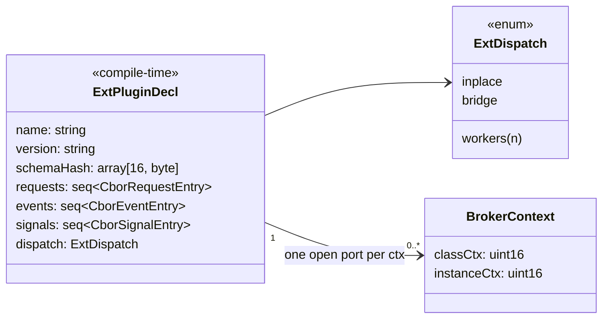

A **port** is keyed by `(plugin, ctx)` and carries the handshake and the impl
callbacks. Within a port, each request / signal broker is wired
**individually** with `provide(port, name)` (§D-3). Opening `storage` on ctx A
and ctx B gives two independent ports; on one ctx, `fetch_blob` may be
provided by the foreign plugin while `store_blob` stays unprovided (Nim callers
get the normal "no provider registered" error) or is provided by Nim itself.

---

## 5. Approach A — runtime design

### 5.1 Components

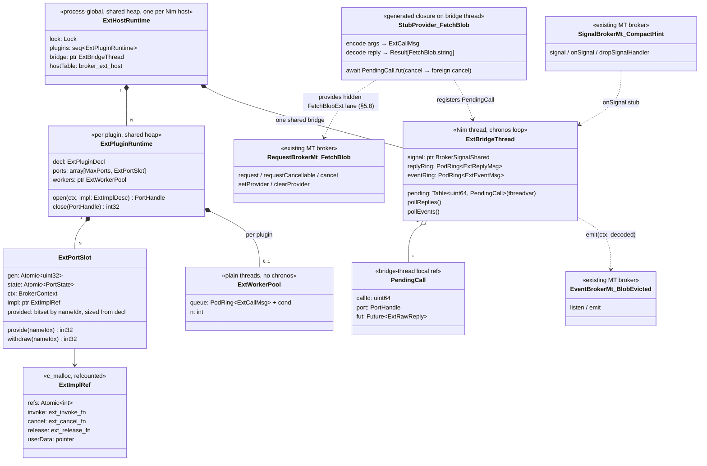

**Bridge thread placement.** Two modes, chosen by deployment:

| Deployment | Bridge thread | Why |
|---|---|---|
| Nim is a library (`registerBrokerLibrary`) | the context's **processing thread** | `(API)` providers there that call EXTAPI requests hit the MT **same-thread fast path** (one hop removed); lifecycle already managed by `_createContext` / `_shutdown` |
| Nim is the executable | **one shared ext bridge thread** for all plugins (§D-4), created on the first `open`, joined at host shutdown | no processing thread exists; one chronos loop + one signal fd regardless of plugin count |

Consequences of the shared bridge (exe mode), and how they are contained:

| Risk | Containment |
|---|---|
| an `bridge` impl of plugin X that does not return promptly stalls every plugin's replies/events | `bridge` is opt-in per plugin; generated C++/Rust wrappers only decode + hand off on the bridge (§7, §8); `provide` refuses a port without `CAP_NONBLOCKING` for `bridge` names. *As built:* no stall watchdog — a blocking `bridge` impl is a contract violation (review D1), not a supervised case |
| blocking impls of plugin X starve plugin Y | `workers(n)` pools are **per plugin**, never shared |
| one plugin floods `emit` | ingress ring is per plugin; full → `BROKER_EXT_AGAIN` to that plugin only |
| decode cost of a large reply/event of X delays Y | accepted: same as any MT provider thread; measure before splitting |

In library mode with several created contexts, each context's processing
thread is the bridge for ports opened on that ctx.

Either way the stub must **never run foreign code on the bridge thread** in
`workers` mode; in `bridge` mode it calls `invoke` directly and relies on the
contract "invoke returns promptly; reply later" (§5.4).

### 5.2 Request — happy path

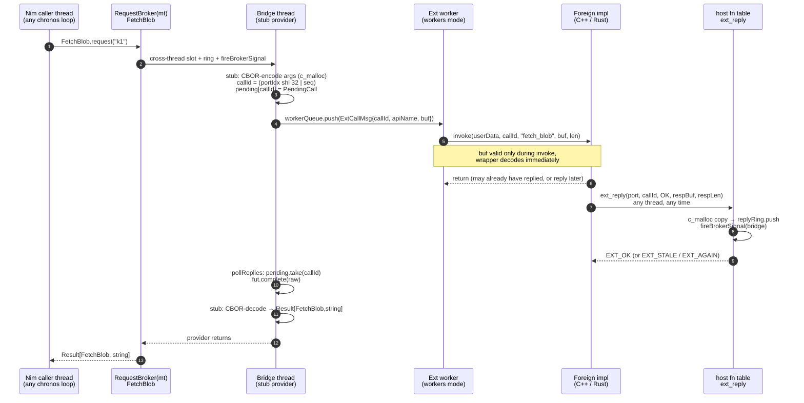

This is the `autoWire` path (§5.8): the bridge owns the public `FetchBlob`
slot with `extProvider`, which reaches the stub on the hidden `FetchBlobExt`
lane via the same-thread fast path, so the picture is unchanged. With an
author-owned slot on thread T, one MT hop T → bridge is added.

In `bridge` mode steps 4–5 collapse: the stub calls `invoke` on the bridge
thread directly.

### 5.3 Request — timeout, cancel, withdraw

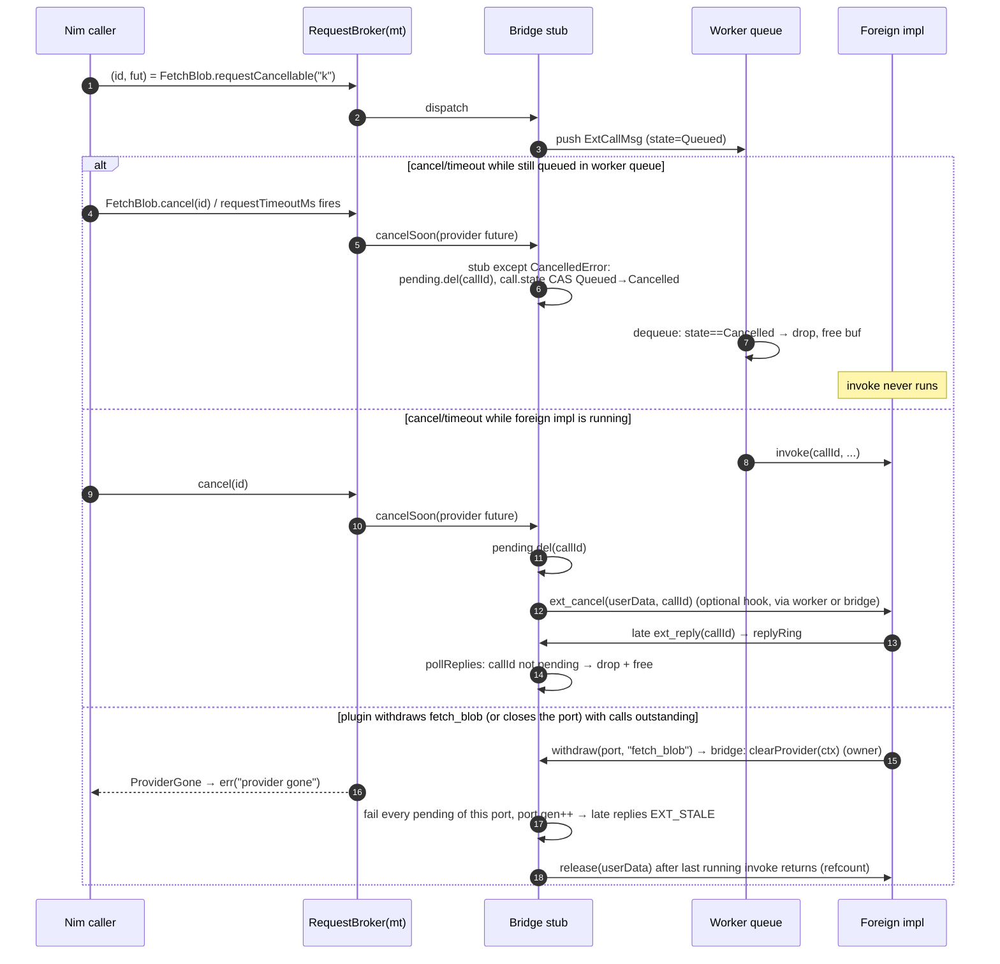

Cancellation crosses the boundary as a **hint**: `ext_cancel` is optional; the
Nim future resolves immediately regardless (R3). A foreign impl stuck in a
blocking call holds its *worker* — never the bridge or caller loop. Worker
starvation is visible: queued calls hit their deadline and are dropped without
running (same contract as nim-ffi's `ReverseWorkerStallMs`, which we can mirror
as a chronicles warn).

### 5.4 Dispatch policy (X5)

Dispatch applies **only to external sources** (foreign plugins, K1 / K2
imports). A Nim implementation has no dispatch mode: it runs where the author
installed its provider (§D3-2, §5.8). For external sources the lib author
decides, in Nim, at declaration: a plugin default in
`registerExtPlugin(p, dispatch = …)` and a per-broker override
`RequestBroker(EXTAPI[p], dispatch = …)`. The foreign side cannot change the
policy. Because policies are per broker while a port is opened once, the port
instead declares its **capabilities** (`broker_ext_impl.caps`, §6.2), and each
`provide(port, name)` is checked against that broker's policy:

| Broker policy | Port must declare | Why |
|---|---|---|
| `inplace` | `CAP_REPLY_INLINE` | the reply must arrive before `invoke` returns |
| `bridge` | `CAP_NONBLOCKING` | `invoke` runs on the shared bridge and must return promptly |
| `workers(n)` | — (anything) | `invoke` may block its worker and reply now or later |

A mismatch fails `provide` with `BROKER_EXT_DISPATCH_MISMATCH` (nothing
installed), naming the broker and its policy in the log.

| Policy | Impl runs on | Hops (caller ≠ bridge) | Impl may block? | Reply | Timeout / cancel | Best for |
|---|---|---|---|---|---|---|
| `inplace` | **the Nim thread that called** `request` / `signal`, synchronously, inside the call | **0** — no MT broker hop, no bridge, no worker | blocks *the caller's* loop for the duration — the author's call | **must** reply before `invoke` returns | none (synchronous) | cheap, thread-safe functions: codecs, hashing, lookups, native C imports (§5.9) |
| `bridge` | bridge thread | 4 | **no** — return promptly, reply later | any thread, any time | full MT semantics | Rust async (spawn on own runtime), C++ impls posting to their executor |
| `workers(n)` | one of `n` plain threads (per plugin) | 4 + queue | yes (holds one worker) | any thread, any time | full MT semantics; queued calls dropped on deadline | blocking C/C++ SDKs, simple sync Rust impls |

#### `inplace` mechanics

`inplace` deliberately **bypasses the MT broker hop** while the public slot
holds the external forwarder (§5.8 `directInplace` flag), so the generated
`request` / `signal` of an `inplace` EXTAPI broker starts with a check:

```nim
# generated, sketch
proc request*(_: typedesc[FetchBlob], ctx: BrokerContext, key: string):
    Future[Result[FetchBlob, string]] {.async: (raises: []).} =
  if FetchBlobDirectInplace(ctx).load(moAcquire):   # slot holds extProvider of an inplace source
    let src = extSourceAcquire(FetchBlobSources, ctx)  # refcounted, nil if withdrawn meanwhile
    if not src.isNil:
      defer: extSourceRelease(src)
      case src.kind
      of eskForeign: return extInvokeInplace(src, encode(key))  # sync, below
      of eskNative:  return src.nativeImpl(key)                 # §5.9 K1, direct C call
  return await FetchBlobMt.request(ctx, key)   # normal MT path: Nim impl, extFallback, or "no provider…"
```

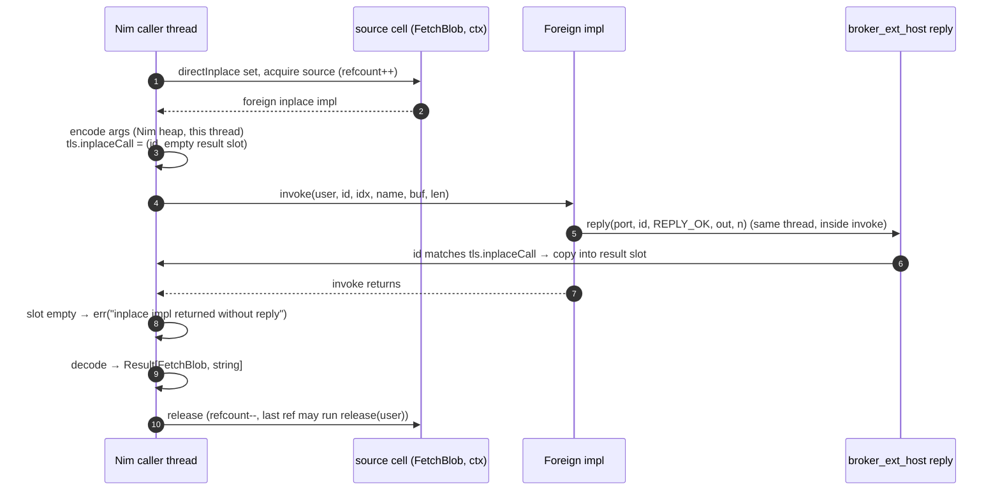

Rules and consequences:

| Concern | `inplace` behaviour | Why |
|---|---|---|
| reply after `invoke` returned, or from another thread | *as built:* `OK` and dropped — the slot's generation CAS rejects it, so it can never reach a later call (review M1); the call already failed with `err("inplace impl returned without reply")` | keeps `inplace` free of any pending table / mailbox (that is Approach B's cost) |
| concurrency | `invoke` may run concurrently on every Nim thread that calls | impl must be thread-safe; documented in the generated header |
| timeout / `cancel(id)` | not applicable to a foreign or native `inplace` call; `requestCancellable` on an `inplace` broker returns id `0` (same as MT same-thread requests today) | the call is synchronous |
| `withdraw` / `close` during a running `inplace` call | allowed; the running call completes; `release(user)` deferred to the last running call (source refcount) | same refcount rule as workers |
| detecting "this is my inplace call" in `reply` | a Nim **threadvar** on the caller thread | the caller *is* a Nim thread here, unlike in `bridge` / `workers` mode |
| refc / ORC | args encoded and result decoded on the caller's own heap; the foreign side sees only a borrowed buffer valid during `invoke` | no cross-thread GC memory at all |
| callers without a chronos loop (`blockingRequest`) | foreign / native `inplace` runs directly on the caller thread | a synchronous call needs no loop |

Generated wrappers make `bridge` safe for async-style impls: the C++/Rust
binding's `invoke` trampoline only decodes and hands off to the user's
executor/runtime (§7, §8), so the user code itself never runs on the bridge.
A wrapper that exposes a *sync* user API declares `CAP_REPLY_INLINE` (it
replies before returning, possibly after blocking) but not `CAP_NONBLOCKING`,
so it can serve `inplace` and `workers` brokers and is refused for `bridge`
brokers at `provide`.

### 5.5 Events — foreign → Nim listeners

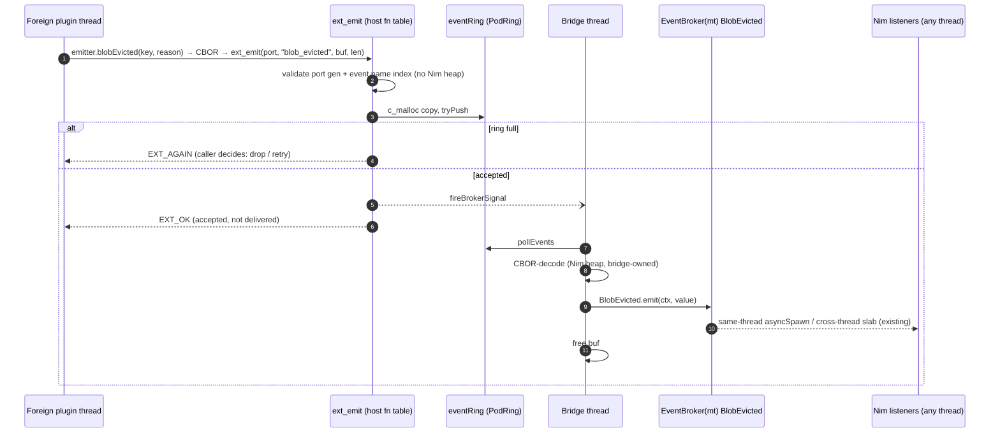

`ext_emit` semantics mirror `SignalBroker`'s acceptance contract: `OK` =
accepted, never "handled". Decode failure on the bridge = chronicles warn,
dropped (same as `api_signal_broker_cbor` adapter).

Optional optimisation: export a per-event listener-present counter so `ext_emit`
can return `EXT_NO_LISTENER` without copying — same idea as
`foreignSubsCount` in the `(API)` event lane. Not v1.

### 5.6 Signals — Nim → foreign, one-way

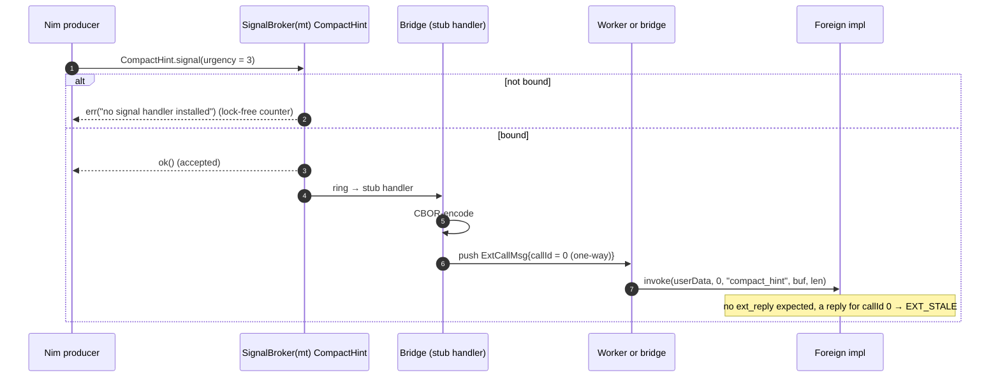

### 5.7 Open / provide / withdraw / close lifecycle (individual binding, §D-3)

Binding is two-level:

| Call | Granularity | Effect |
|---|---|---|
| `open(ctx, impl)` | port = one foreign impl object on one ctx of one plugin | handshake (§6.4), claims a port, installs **nothing**; the port may `emit` any event of the plugin from now on |
| `provide(port, name)` | one request slot or one signal | bridge installs that broker's stub as owner (`setProvider` / `onSignal`) |
| `withdraw(port, name)` | one request slot or one signal | owner `clearProvider` / `dropSignalHandler` → that broker's outstanding requests fail `ProviderGone` |
| `close(port)` | port | withdraws everything the port still provides, invalidates the port (gen++), `release(user)` after the last running `invoke` |

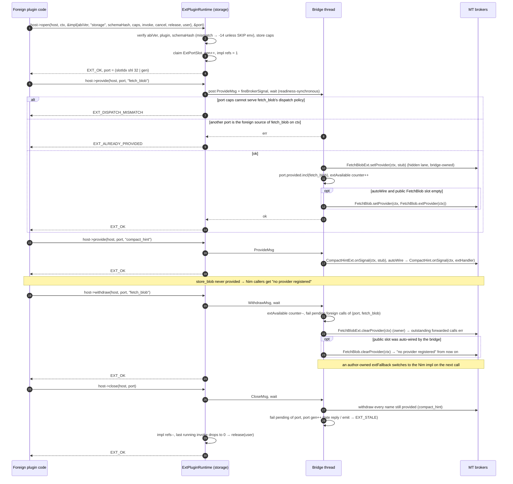

Rules:

- **Ownership.** `provide` installs the stub on the **hidden** `FetchBlobExt`
  lane (bridge-owned); it never competes with Nim for the public `FetchBlob`
  slot. The public slot belongs to whoever the author lets own it (§5.8): the
  bridge via `autoWire`, or a Nim thread. `BROKER_EXT_ALREADY_PROVIDED` means
  only "another port is already the foreign source of this broker on this
  ctx".
- **Several ports per `(plugin, ctx)` are allowed**: two foreign components may
  each provide a disjoint subset of one plugin's brokers on the same ctx.
  Brokers stay exclusive; events may be emitted from any open port.
- **Dual-slot requests** (zero-arg + arg signature) are two wire names, as in
  `(API)`: zero-arg keeps the bare name, the arg slot gets `_arg`
  (`api_request_broker_cbor.nim:531`). Each slot is provided independently,
  matching that the MT broker keeps the two slots independent.
- **Re-entrancy.** `open` / `provide` / `withdraw` / `close` wait for the
  bridge. Called *on* the bridge thread (an `bridge` invoke wiring something),
  they execute directly instead of waiting — detected by comparing the OS
  thread id stored at bridge start (`pthread_self` / `GetCurrentThreadId`),
  not a Nim threadvar, because callers are usually foreign threads.
- **Teardown.** Thread exit of the bridge (exe mode: host shutdown; lib mode:
  `<lib>_shutdown`) goes through `teardownBrokerThread`, which already retires
  providers/handlers the thread owns — every stub is cleared and outstanding
  requests fail fast with no new teardown code. Ports become `STALE`.

### 5.8 Nim implementation and seamless runtime switching (§D3)

The Nim implementation of an EXTAPI broker is **an ordinary MT provider**.
There is no extra arbiter: the public broker's single MT provider slot *is*
the switch, and the existing owner-thread `replaceProvider` is the gapless
switching primitive.

#### Lowering

Each `RequestBroker(EXTAPI[storage], …)` named `FetchBlob` generates:

| Generated | Kind | Provided by | Purpose |
|---|---|---|---|
| `FetchBlob` | public MT RequestBroker, all verbs exported (`setProvider`, `provideIt`, `replaceProvider`, `clearProvider`, `withMockProvider`, `request`, `requestCancellable`, …) | whoever the author installs: a Nim closure, or the external forwarder | what every caller uses |
| `FetchBlobExt` | hidden MT RequestBroker, same signature, not exported | the bridge stub while a foreign port provides `fetch_blob` (§5.7), or the K2 peer adapter (§5.9) | the external lane for `bridge` / `workers` sources |
| `FetchBlob.extProvider(ctx)` | generated provider closure ("forwarder") | — | serves one call from the external source: `inplace` / K1 native → direct call on the thread running it; `bridge` / `workers` → `await FetchBlobExt.requestCancellable(ctx, args)`, cancelling the inner id if the outer call is cancelled |
| `FetchBlob.extFallback(ctx, nimImpl)` | generated provider closure | — | external if available, else `nimImpl` — decided **per call** |
| `FetchBlob.extAvailable(ctx): bool` | lock-free read of a per-(ctx, broker) presence counter (same pattern as `signalHandlerPresent`) | — | observability, and what `extFallback` checks |

`SignalBroker(EXTAPI[…])` lowers the same way (`CompactHint` public handler,
`CompactHintExt` hidden lane, `CompactHint.extHandler(ctx)`,
`CompactHint.extFallback(ctx, nimHandler)`). `EventBroker(EXTAPI[…])` needs no
lowering: foreign `emit` lands on the public EventBroker, and Nim code may emit
the same events (handy for tests).

The forwarder closures capture only `ctx` and POD handles — no GC'd state —
so they can be created and installed on any thread under refc and ORC.

#### Who owns the public slot

| `registerExtPlugin(p, autoWire = …)` (per-broker override on the broker) | Owner of the public `FetchBlob` slot | Runtime switching from Nim |
|---|---|---|
| `autoWire = true` *(default, §D4-1)* | when an external source appears and the slot is empty, the bridge installs `extProvider` (bridge-owned); cleared again when the source goes | no — the owner-only rule keeps the bridge's provider; use for "plugin or nothing" brokers |
| `autoWire = false` | the author: `setProvider` / `provideIt` on the thread they choose (same, main, or a dedicated one) | **yes**, gapless, from that thread |

#### Switching

```nim
proc localFetchBlob(key: string): Future[Result[FetchBlob, string]] {.async: (raises: []).} =
  ok(FetchBlob(data: cache.get(key)))          # closure state is fine: lives on this thread

# on the owning thread T, once
discard FetchBlob.setProvider(ctx, FetchBlob.extFallback(ctx, localFetchBlob))  # plugin, else local

# later, a runtime choice — still on T
discard FetchBlob.replaceProvider(ctx, localFetchBlob)            # force internal
discard FetchBlob.replaceProvider(ctx, FetchBlob.extProvider(ctx)) # force external
discard FetchBlob.replaceProvider(ctx, FetchBlob.extFallback(ctx, localFetchBlob))
```

Why this is gapless (evidence): `replaceProvider` on the owner only swaps the
handler in the owner's thread-local table and leaves the bucket, ring and
response pool untouched (`mt_request_broker.nim:2109-2127`); the poll function
looks the handler up **per message, at dispatch time**
(`mt_request_broker.nim:706-711`). So queued and future calls take the new
provider, running calls finish on the old closure, and no caller ever sees
"no provider" or `ProviderGone` during a switch.

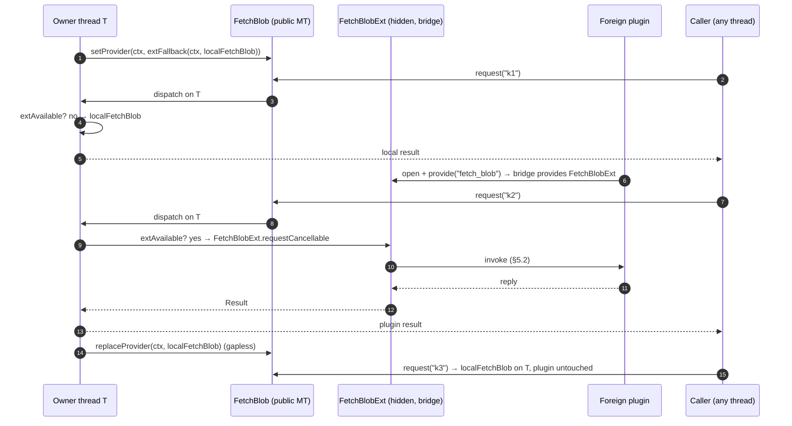

#### Where the code runs

| Public provider | Caller on the owner thread | Caller on another thread |
|---|---|---|
| Nim impl on T | direct (same-thread fast path) | 1 MT hop to T |
| `extProvider` on T, `inplace` / K1 source | direct call of the external source on T | 1 MT hop, then direct on T |
| `extProvider` on T, `bridge` / `workers` source | 1 MT hop T → bridge, then foreign | 2 MT hops, then foreign |
| `autoWire` (bridge owns), `bridge` / `workers` source | — | 1 MT hop to the bridge, same-thread fast path into `FetchBlobExt`, then foreign (= §5.2) |

**`inplace` on the caller's own thread.** When the slot holds `extProvider`
for an `inplace` / K1 source, the generated `request` skips the MT hop
entirely: installing that forwarder (via the generated `setProvider` /
`replaceProvider`) sets a per-ctx atomic `directInplace` flag, and any other
set / replace / clear resets it *before* swapping the handler. `request` checks
the flag first and, if set, calls the source on the calling thread (§5.4). A
caller that read the flag just before a switch still calls a valid external
source — no gap, no use-after-free (the source is refcounted, §5.4).

#### Mocking and tests

Plain MT verbs: with `autoWire = false` (or no plugin wired), the test thread
installs the provider itself and `withMockProvider(ctx, mock): body` works
unchanged, closures with captures included. Signals:
`withMockSignalHandler`. Events: emit from Nim.

#### Memory model

| | refc | ORC |
|---|---|---|
| Nim impl closure | lives in the owner's thread-local handler table, GC-rooted on the owner's heap; cross-thread callers only copy args into the slab | same; no `isolate` needed because the closure never moves |
| `extProvider` / `extFallback` closures | capture `ctx` + POD handles only | same |
| hidden-lane call `T → bridge` | existing MT marshalling (`mt_codec`) | same |

### 5.9 Library imports (§D2-7)

An EXTAPI broker can be served by an **existing shared library** instead of a
plugin that wires itself. Two kinds; both are *external sources* (§5.8), so
`extProvider` / `extFallback` serve them and a Nim impl can replace them at
runtime or in tests.

| | K1 native C function | K2 nim-brokers peer library |
|---|---|---|
| Declared with | `dynlib = "<pattern>"` + `importc` | `importLib = "<lib>"` + `dynlib = "<pattern>"` |
| Wire | native C call, **no CBOR** | CBOR over the peer's `<lib>_callAsync` / `_call` / `_subscribe` |
| Brokers | Request, Signal | Request, Event, Signal |
| External source kind | `import` | `foreign` (a built-in port adapter) |
| Dispatch | all three: `inplace` · `bridge` · `workers(n)` (§D4-3) | `bridge` (non-blocking `_callAsync`); `inplace` allowed via sync `_call` |
| Schema check | none possible (C has no schema) — the Nim declaration *is* the contract | `<lib>_getSchema` descriptors compared per imported name (a subset can't match the whole-lib hash) |
| Cancel / timeout | `bridge` / `workers(n)`: deadline drops queued calls; a running C call can't be interrupted, its result is discarded; `inplace`: synchronous, none | timeout passed as `_callAsync` `timeoutMs`; cancel = drop by id (no `_cancelAsync` yet, FFI_API "drop ≠ cancel") |

**Loading.** Nim's own `{.dynlib.}` pragma loads at program start and aborts
when the library is missing — unacceptable for an optional dependency. EXTAPI
imports are resolved through `std/dynlib` (`loadLibPattern` + `symAddr`) into
`{.global.}` function pointers, at `ExtPlugin(zlib).load()` (author's choice
via `registerExtPlugin(p, load = eager | lazy | manual)`). Failure leaves the
`import` source unregistered and records the reason
(`ExtPlugin(zlib).loadError`), so an installed `extFallback` serves the Nim
impl, and with nothing else the caller gets `"no provider registered…"` (R2).
`ExtPlugin(zlib).unload()` withdraws the source first, then `unloadLib` after
the last running call (source refcount) — never under a running call.

#### K1 — native C function

Short form (`importc = "<symbol>"`, kept per §D4-2): no body; allowed when
every signature argument is C-compatible and the response object has exactly
one field whose type is the C return type (or the response is `void`). Which
argument types are allowed depends on the dispatch mode, because with `bridge`
/ `workers` the C function runs on another thread *after* the arguments were
copied, and a timed-out caller may already have freed what a raw pointer
points to:

| Argument type | `inplace` | `bridge` / `workers(n)` |
|---|---|---|
| `cint`, `culong`, `cdouble`, enums, `{.bycopy.}` objects of those | ✓ | ✓ (copied by value) |
| `cstring` | ✓ (borrowed from the caller) | ✓ — marshalled as `string`, passed as `.cstring` of the worker-owned copy |
| `ptr T`, `pointer`, `openArray` | ✓ (caller memory, valid for the synchronous call) | **compile error** — use the body form, which receives marshalled Nim values (`seq[byte]`, …) owned by the executing thread |

```nim
RequestBroker(EXTAPI[zlib], importc = "crc32",
              dynlib = "libz(.so.1|.dylib|1.dll)", dispatch = inplace):
  type Crc = object
    value: culong
  proc signature*(crc: culong, buf: ptr uint8, len: cuint):
    Future[Result[Crc, string]] {.async.}
# generated provider ≈ ok(Crc(value: crc32Ptr(crc, buf, len)))
```

Body form: the `{.importc.}` prototypes inside the block are rewritten to
lazily resolved pointers, and the `signature` body is the adapter (it is the
`import` source's implementation, so it runs where the dispatch policy says):

```nim
RequestBroker(EXTAPI[zlib], dynlib = "libz(.so.1|.dylib|1.dll)", dispatch = workers(2)):
  type Compressed = object
    data: seq[byte]
  proc compressBound(srcLen: culong): culong {.importc, cdecl.}
  proc compress2(dst: ptr uint8, dstLen: ptr culong, src: ptr uint8,
                 srcLen: culong, level: cint): cint {.importc, cdecl.}
  proc signature*(src: seq[byte], level: int):
      Future[Result[Compressed, string]] {.async.} =
    if src.len == 0: return ok(Compressed())
    var dst = newSeq[byte](int(compressBound(culong(src.len))))
    var dstLen = culong(dst.len)
    let rc = compress2(dst[0].addr, dstLen.addr, src[0].unsafeAddr,
                       culong(src.len), cint(level))
    if rc != 0: return err("zlib compress2 rc=" & $rc)
    dst.setLen(int(dstLen))
    ok(Compressed(data: dst))
```

K1 dispatch (§D4-3 — the author picks per plugin or per broker):

| Policy | Where the C call (short form) / adapter body (body form) runs | Hops from the public provider | Notes |
|---|---|---|---|
| `inplace` | the calling Nim thread (`directInplace` bypass, §5.4/§5.8) | 0 | fast, thread-safe C functions (hashes, codecs, pure math); blocks the caller's loop for the call |
| `bridge` | the bridge thread | 1 MT hop (0 when auto-wired: bridge owns the public slot) | non-blocking C calls only — a blocking one stalls every plugin on the shared bridge |
| `workers(n)` | one of `n` per-plugin **import threads** (Nim threads with a chronos loop) | 1 MT hop | blocking C calls; up to `n` run in parallel; each blocks only its own import thread |

`workers(n)` mechanics. The adapter body is Nim code (it may `await`, it builds
Nim values), so an import worker must be a Nim thread with a chronos loop — a
plain C worker as in the foreign `workers` pool is not enough. The
single-provider-per-ctx rule is satisfied with **one internal BrokerContext
per worker**:

- `ExtPlugin(zlib).load()` starts `n` import threads; thread *i* gets an
  internal context `ctxW[i]` and provides a hidden `<T>Import` MT broker for
  every K1 broker of the plugin on `ctxW[i]` (one bucket per worker).
- `extProvider` (or the auto-wired provider) picks the worker with the lowest
  in-flight count (per-worker `Atomic[int]`, ties round-robin) and does
  `await <T>Import.requestCancellable(ctxW[i], args)`.
- Everything else is existing MT behaviour: argument marshalling via
  `mt_codec`, timeout (`requestTimeoutMs`), `cancel(id)` (queued call
  tombstoned and never executed; running call's future `cancelSoon`-ed, the C
  call itself finishes and its result is dropped), `ProviderGone` on
  `unload()`, thread teardown via `teardownBrokerThread`.
- The pool is per plugin and shared by all its K1 brokers (blocking isolation
  between plugins, as for foreign workers). The C function must be safe to
  call from `n` threads at once; `n = 1` serialises it.

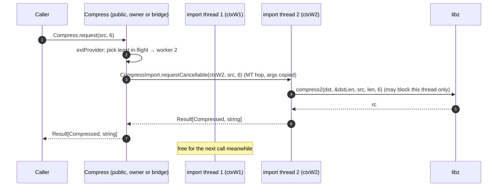

Memory model: C receives pointers into Nim memory only for the duration of
the call and only on the thread that owns that memory — the caller's under
`inplace`, the import thread's / bridge's (marshalled copy) otherwise. The C
side must not retain them. refc's GC is non-moving and ORC frees after the
call, so both are safe for the call's duration. Thread-safety of the C
function is the author's assertion when choosing `inplace` or `workers(n > 1)`.

#### K2 — nim-brokers peer library

```nim
RequestBroker(EXTAPI[devices], importLib = "mylib",
              dynlib = "libmylib.(so|dylib)|mylib.dll"):
  type GetDevice = object
    deviceId: int64
    name: string
  proc signature*(deviceId: int64): Future[Result[GetDevice, string]] {.async.}

EventBroker(EXTAPI[devices], importLib = "mylib"):
  type DeviceStatusChanged = object
    deviceId: int64
    online: bool

registerExtPlugin(devices, load = manual)
# ExtPlugin(devices).load(ctx) → <lib>_initialize (once per process),
#   <lib>_createContext → peerCtx for THIS host ctx (§D4-4), schema compare, subscribe
```

The ext runtime ships one generic **BrokerLibPort** adapter — a foreign
implementation written once, in Nim, against the fixed 13-function ABI, so no
per-library codegen is needed beyond the declarations:

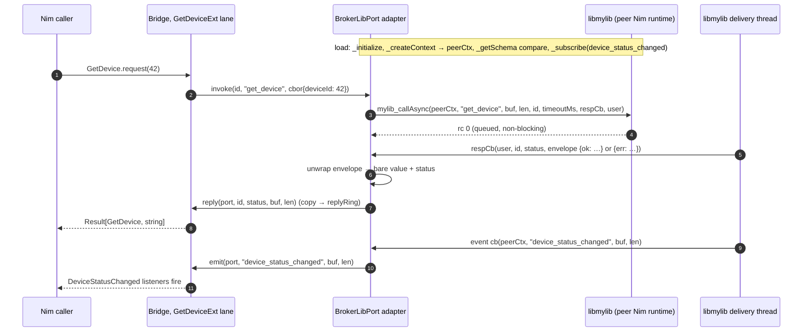

Notes:

- **One peer context per host context** (§D4-4): `load(ctx)` creates a
  `peerCtx` bound to that host ctx; the host ctx's teardown (or
  `unload(ctx)`) calls `<lib>_shutdown(peerCtx)`. Host contexts never share
  peer state — matching the broker isolation they already have. Cost: each
  peer context runs the peer's own delivery + processing threads, so `N` host
  contexts importing one peer library cost `2N` peer threads.
- `-6` (EAGAIN, async window full) from `_callAsync` becomes
  `err("ext: peer busy")`, not a hidden retry loop.
- Two Nim runtimes in one process are already supported by the
  `--nimMainPrefix` rule; only the C ABI is shared, so refc heaps never mix.
- The peer's `InitializeRequest` is itself importable
  (`RequestBroker(EXTAPI[devices], importLib = "mylib")` on
  `InitializeRequest`), so configuration stays in the author's hands.
- `ExtPlugin(devices).unload()` = withdraw sources → `<lib>_unsubscribe` →
  `<lib>_shutdown(peerCtx)` → `unloadLib`. Unloading a Nim runtime's `.so`
  is only safe on platforms/configs where its threads are joined; on doubt the
  library stays mapped (logged), matching the stuck-worker policy.

---

## 6. The C ABI (X3a + X4a)

### 6.1 Why a host function table, not exported symbols

| Deployment | Exported `<host>_ext_*` symbols | Function table passed at entry |
|---|---|---|
| Nim lib hosted by C++/Rust app | works | works |
| Nim exe `dlopen`s plugin `.so` (Linux/macOS) | needs `-rdynamic` / `-undefined dynamic_lookup` | works |
| Nim exe `LoadLibrary`s plugin DLL (Windows) | **does not work** without an import lib of the exe | works |
| Plugin statically linked into Nim exe | works | works |
| Two Nim hosts in one process (two libs) | symbol clash risk | works (table identifies host) |

So the plugin never links against the host; the host hands it a versioned
`BrokerExtHost` table. This is the Vulkan-loader / OBS-plugin pattern.

### 6.2 Generic header (one per *host*, plugin-independent) — `broker_ext.h`

```c
/* broker_ext.h — fixed, hand-written, versioned. Never regenerated per plugin. */
#define BROKER_EXT_ABI_VERSION 1u

typedef uint64_t broker_ext_port;      /* (slotIdx << 32) | gen, 0 = invalid */
typedef uint64_t broker_ext_call_id;   /* 0 = one-way (signal) */

enum {
  BROKER_EXT_OK               =   0,
  BROKER_EXT_BAD_ARG          =  -1,
  BROKER_EXT_UNKNOWN_NAME     =  -4,  /* name not declared by this plugin */
  BROKER_EXT_AGAIN            =  -6,  /* ring full: retry or drop */
  BROKER_EXT_SHUTDOWN         = -11,
  BROKER_EXT_SCHEMA_MISMATCH  = -14,
  BROKER_EXT_STALE            = -15,  /* port closed / callId no longer pending */
  BROKER_EXT_ALREADY_PROVIDED = -16,  /* a Nim provider or another port holds it */
  BROKER_EXT_NOT_PROVIDED     = -17,  /* withdraw of a name this port does not provide */
  BROKER_EXT_DISPATCH_MISMATCH = -18, /* port caps cannot serve this broker's policy (§5.4) */
};
enum {                                 /* broker_ext_impl.caps bit flags */
  BROKER_EXT_CAP_NONBLOCKING  = 1u << 0,  /* invoke returns promptly (may reply later) */
  BROKER_EXT_CAP_REPLY_INLINE = 1u << 1,  /* invoke always replies before returning */
};
enum { BROKER_EXT_REPLY_OK = 0, BROKER_EXT_REPLY_ERR = 1 };  /* reply() status, §6.6.1 */

/* Foreign side, called by Nim. buf valid only during the call. */
typedef void (*broker_ext_invoke_fn)(void* user, broker_ext_call_id id,
                                     uint32_t nameIdx, const char* name,
                                     const uint8_t* buf, size_t len);
typedef void (*broker_ext_cancel_fn)(void* user, broker_ext_call_id id);
typedef void (*broker_ext_release_fn)(void* user);

typedef struct {
  uint32_t abiVersion;                 /* BROKER_EXT_ABI_VERSION */
  const char* plugin;                  /* "storage" */
  const char* schemaHash;              /* 32 hex; NULL = unchecked raw tunnel (§6.6) */
  uint32_t caps;                       /* BROKER_EXT_CAP_*, checked per provide (§5.4) */
  broker_ext_invoke_fn invoke;
  broker_ext_cancel_fn cancel;         /* may be NULL */
  broker_ext_release_fn release;       /* may be NULL */
  void* user;
} broker_ext_impl;

/* Nim side, handed to foreign code. Every entry is callable from ANY thread,
   allocation-free w.r.t. the Nim heap. open/provide/withdraw/close wait for
   the bridge (unbounded but never across a stop: SHUTDOWN then, review D1);
   reply/emit never wait. */
typedef struct broker_ext_host {
  uint32_t abiVersion;
  void* host;                          /* opaque: identifies the Nim host */

  /* wiring */
  int32_t (*open)(void* host, uint32_t ctx, const broker_ext_impl* impl,
                  broker_ext_port* out);
  int32_t (*close)(void* host, broker_ext_port port);
  int32_t (*provide)(void* host, broker_ext_port port, const char* name);
  int32_t (*withdraw)(void* host, broker_ext_port port, const char* name);

  /* traffic: the CBOR tunnel (§6.6). buf is copied before return. */
  int32_t (*reply)(void* host, broker_ext_port port, broker_ext_call_id id,
                   int32_t status, const uint8_t* buf, size_t len);
  int32_t (*emit)(void* host, broker_ext_port port, const char* name,
                  const uint8_t* buf, size_t len);

  /* discovery: CBOR descriptors, buffer owned by the host */
  int32_t (*listApis)(void* host, const char* plugin, uint8_t** out, size_t* outLen);
  int32_t (*getSchema)(void* host, const char* plugin, uint8_t** out, size_t* outLen);
  void    (*freeBuffer)(void* host, uint8_t* buf);
  int32_t (*schemaHash)(void* host, const char* plugin, char hashOut[33]);
} broker_ext_host;

/* How the plugin gets the table:
   - lib mode : const broker_ext_host* <lib>_extHost(void);   (exported by the Nim lib)
   - exe mode : plugin exports
       int32_t broker_ext_plugin_entry(const broker_ext_host* host);
     which the Nim exe calls after dlopen / LoadLibrary
     (Nim side: ExtHost.loadPlugin(path) -> Result[void, string]). */
```

Names are the wire names (snake_case, `_arg` for an arg slot). Inbound,
`invoke` passes both `nameIdx` (index in the plugin's sorted name table, the
ordering the schema hash canonicalises) and `name`: generated wrappers switch
on `nameIdx`, raw implementers may `strcmp` on `name`. Outbound, `provide` /
`withdraw` / `emit` take the name; the host resolves it by binary search in a
compile-time sorted table (no allocation) — negligible next to CBOR encoding,
and it keeps the raw tunnel free of index bookkeeping.

### 6.3 Ownership

| Buffer | Allocated by | Freed by | Lifetime | refc/ORC notes |
|---|---|---|---|---|
| request args `buf` to `invoke` | Nim bridge (c_malloc) | Nim after `invoke` returns | **only during `invoke`** | worker threads never touch it after return |
| `reply` payload | foreign (any allocator) | foreign | only during `reply` call; Nim copies into c_malloc | copy happens on foreign thread — must not use Nim heap: `c_malloc` + `PodRing` + `fireBrokerSignal` only |
| `emit` payload | foreign | foreign | only during `emit`; Nim copies | same |
| ring messages (`ExtReplyMsg`, `ExtEventMsg`, `ExtCallMsg`) | c_malloc | consumer (bridge / worker) | until drained | POD only — no `string`/`seq`/`ref` cross threads, so no refc thread-local heap leakage, no ORC `isolate` needed |
| `PendingCall`, decoded values | bridge Nim heap | bridge GC | bridge thread only | refc: owned by bridge's thread-local heap; never reachable from foreign threads |
| `ExtImplRef` | c_malloc | last ref holder | refcounted: registry 1 + 1 per running invoke | `release` runs on whichever thread drops the last ref (worker, bridge, or `close` caller) — documented, as in nim-ffi |

Why c_malloc and not `allocShared` on foreign threads: foreign threads are not
Nim-registered; under `--mm:refc` the only safe Nim-side work there is
lock-free atomics + libc. Same discipline as `<lib>_verifySchema` (allocation-free,
no threadvars). This also avoids the Windows allocator teardown race class
documented in `doc/design/TEARDOWN_UAF_FINDINGS.md`.

### 6.4 Handshake

`open` checks, in order: `abiVersion`, `plugin` name known, `schemaHash`
(FNV-1a-128 over the plugin's canonical wire shapes — names plus the
structural shape of every argument / payload type, nested objects and enum
ordinals included (`ext_shapes.nim`, review M13); same
`BROKERS_FFI_SKIP_SCHEMA_CHECK` / `<PLUGIN>_SKIP_SCHEMA_CHECK` escape hatch),
then stores `caps` for the per-broker check at `provide` (§5.4). One hash per plugin, so plugins
version independently (R6). `schemaHash = NULL` opts out (raw tunnel, §6.6):
accepted (*as built:* not logged — `open` runs on foreign threads); wire mismatches then surface as CBOR decode
errors on the Nim side (`err("ext decode: …")`), never as UB.

### 6.5 Memory-model / platform matrix

| Concern | macOS | Linux | Windows | refc | ORC |
|---|---|---|---|---|---|
| foreign thread → `reply`/`emit` | ✓ | ✓ | ✓ | ✓ c_malloc + atomics only | ✓ same |
| worker threads (Nim `createThread`, run foreign code) | ✓ | ✓ | ✓ | ✓ never touch GC'd memory beyond POD msg | ✓ |
| exe `dlopen` plugin | ✓ (`dlopen`) | ✓ | ✓ `LoadLibrary`; table avoids exe imports | n/a | n/a |
| bridge = lib processing thread | ✓ | ✓ | ✓ | ✓ teardown via `teardownBrokerThread` (already Windows+refc green) | ✓ |
| foreign impl destroys host from inside `invoke` | must be rejected — *as built:* `ExtHost.stop()` returns `err` on the bridge / a worker thread (review R2.2) — same hazard nim-ffi documents | | | | |
| stuck worker at shutdown | leaked after join timeout + logged (documented, like nim-ffi) | | | | |

### 6.6 Raw CBOR tunnel (§D-6)

Goal: a plugin can be written against the EXTAPI with **nothing but
`broker_ext.h` and any CBOR library** (tinycbor, QCBOR, libcbor, cbor2,
ciborium…) — no generated wrapper. This is the EXTAPI mirror of what
`<lib>_call(ctx, apiName, reqBuf, …)` is for the `(API)` lane: one
name-addressed entry per direction, CBOR in, CBOR out.

It is not a second mechanism: the `broker_ext_host` traffic calls (`invoke`,
`reply`, `emit`) **are** the tunnel. The generated C++/Rust wrappers are a typed
codec layered on it, so raw and typed plugins are indistinguishable to Nim and
can coexist (different ports, even on the same ctx).

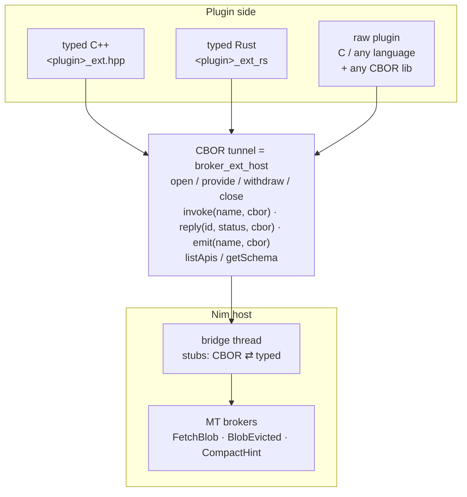

#### 6.6.1 Wire contract

Payload encoding follows the `(API)` wire rules exactly (BrokerCbor flavour:
Nim field / argument names verbatim as map keys, `distinct` transparent,
enum / `Option` / `Table` per `doc/TYPE_SURFACE.md`), so the CDDL and tooling
are shared.

| Direction | Call | `buf` | Notes |
|---|---|---|---|
| Nim → plugin, request | `invoke(user, id ≠ 0, idx, name, buf, len)` | CBOR map keyed by the request's argument names (same body as an `(API)` `_call` request); zero-arg slot → `len = 0` | answer exactly once with `reply(id)`; first reply wins |
| plugin → Nim, success | `reply(port, id, BROKER_EXT_REPLY_OK, buf, len)` | CBOR of the response type `T`, **bare** (no `{ok: …}` envelope) — the full return value, e.g. `{"data": h'…', "etag": "…"}` for a multi-field object, a CBOR array for `seq[T]`; `void` response → `len = 0` | Nim decodes `T` on the bridge; failure → `err("ext decode: …")` |
| plugin → Nim, failure | `reply(port, id, BROKER_EXT_REPLY_ERR, msg, len)` | UTF-8 error text, **not** CBOR | Nim caller gets `err(msg)` |
| Nim → plugin, signal | `invoke(user, 0, idx, name, buf, len)` | CBOR map of the signal object; `void` → `len = 0` | no reply; a reply with `id = 0` → `STALE` |
| plugin → Nim, event | `emit(port, name, buf, len)` | CBOR map of the event object; `void` → `len = 0` | `OK` = accepted, `AGAIN` = ring full |

Why a bare value + status instead of the `(API)` `{ok}/{err}` envelope
(`api_cbor_codec.nim:13`): `_call` has a single out-buffer, so success/failure
must live inside it; `reply` has an explicit `status` argument, which makes the
envelope redundant — and a raw C implementer then never builds a wrapper map
or CBOR-encodes an error string.

#### 6.6.2 Discovery artifacts

| Artifact | When | Content |
|---|---|---|
| `<plugin>_ext.h` | compile time, always with `registerExtPlugin` | `#define STORAGE_EXT_FETCH_BLOB "fetch_blob"` per wire name, `enum storage_ext_name_idx`, `STORAGE_EXT_SCHEMA_HASH` — **no codec**, the raw implementer's header |
| `<plugin>_ext.cddl` | compile time | request bodies, response types, events, signals — same emitter as `api_codegen_cbor_cddl.nim` |
| `host->listApis(plugin)` | runtime | CBOR `{plugin, version, schemaHash, requests:[…], events:[…], signals:[…]}` |
| `host->getSchema(plugin)` | runtime | full descriptor records (reuse `api_cbor_descriptor.nim` types incl. `doc` fields) |

A raw plugin can therefore pin `STORAGE_EXT_SCHEMA_HASH` from the generated
header (checked at `open`), or pass `schemaHash = NULL` and run unchecked
(§6.4).

#### 6.6.3 Raw C plugin (exe mode, `dlopen`ed by the Nim host)

```c
#include "broker_ext.h"
#include "storage_ext.h"       /* names + hash only, optional */
#include <qcbor/qcbor.h>       /* any CBOR library */

static const broker_ext_host* H;
static broker_ext_port P;

static void on_invoke(void* user, broker_ext_call_id id, uint32_t idx,
                      const char* name, const uint8_t* buf, size_t len) {
  if (strcmp(name, STORAGE_EXT_FETCH_BLOB) == 0) {
    char key[256];
    decode_key_map(buf, len, key, sizeof key);         /* {"key": tstr} */
    uint8_t out[4096]; size_t outLen;
    if (!load_blob(key, out, sizeof out, &outLen)) {   /* encodes {"data": bstr} */
      const char* e = "not found";
      H->reply(H->host, P, id, BROKER_EXT_REPLY_ERR, (const uint8_t*)e, strlen(e));
      return;
    }
    H->reply(H->host, P, id, BROKER_EXT_REPLY_OK, out, outLen);
  } else if (strcmp(name, STORAGE_EXT_COMPACT_HINT) == 0) {
    /* one-way: id == 0, decode {"urgency": int}, no reply */
  }
}

int32_t broker_ext_plugin_entry(const broker_ext_host* h) {
  H = h;
  broker_ext_impl impl = {
    BROKER_EXT_ABI_VERSION, "storage", STORAGE_EXT_SCHEMA_HASH,
    BROKER_EXT_CAP_REPLY_INLINE, on_invoke, NULL, NULL, NULL };  /* replies synchronously */
  int32_t rc = h->open(h->host, 0 /* default ctx */, &impl, &P);
  if (rc != BROKER_EXT_OK) return rc;
  h->provide(h->host, P, STORAGE_EXT_FETCH_BLOB);
  return h->provide(h->host, P, STORAGE_EXT_COMPACT_HINT);
}

/* later, from any thread */
void notify_evicted(const uint8_t* cbor, size_t n) {   /* {"key":…, "reason":…} */
  H->emit(H->host, P, STORAGE_EXT_BLOB_EVICTED, cbor, n);
}
```

Nim side for this plugin is unchanged from §4: `await FetchBlob.request("k1")`.

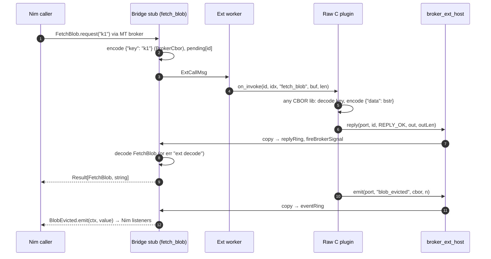

#### 6.6.4 Nim-side raw tunnel (in scope, §D2-4)

Calling an EXTAPI broker from Nim **by name with CBOR bytes**, without its
typed declaration in scope — for generic forwarders, scripting bridges, test
harnesses replaying captured traffic. It reuses the per-broker CBOR adapter the
`(API)` lane already generates (`<Type>CborAdapter(ctx, reqBuf): Future[seq[byte]]`,
`api_request_broker_cbor.nim`): decode → `await <Type>.request(ctx, …)` →
encode. The adapter is generated for EXTAPI brokers too (today only `(API)`
brokers get one). Going through the typed `request` means the call reaches **whatever
the public provider is** (§5.8) — Nim impl, forwarder or fallback alike — and
keeps timeout, cancel and `"no provider registered"`. Cost: one extra decode/encode when the active
source is itself CBOR (foreign), accepted for a generic path.

```nim
let r = await ExtTunnel.call(ctx, "storage", "fetch_blob", cborArgs)  # Result[seq[byte], string]
discard ExtTunnel.signal(ctx, "storage", "compact_hint", cborPayload)
discard ExtTunnel.listen(ctx, "storage", "blob_evicted", proc(b: seq[byte]) {.async: (raises: []).} = …)
```

Names stay restricted to what the plugin declared (unknown →
`err("unknown ext api storage.xyz")`); a fully schema-less plugin is out of
scope. Payloads use the §6.6.1 contract: `call` returns the bare CBOR value on
`ok`, the error string on `err`. `ExtTunnel.listen` installs a typed listener
that re-encodes each event; `ExtTunnel.signal` decodes and calls the typed
`signal`.

---

## 7. C++ wrapper options — `<plugin>_ext.hpp`

Generated separately from `<lib>.hpp`; depends only on `broker_ext.h` +
jsoncons. Types (`FetchBlob`, `BlobEvicted`…) are generated into
`namespace storage_ext` — not shared with any `(API)` wrapper namespace even if
same-named. The typed layer is a codec over the raw tunnel (§6.6): every option
below ends in `host->reply` / `host->emit` with CBOR bytes.

Individual binding (§D-3) surfaces as: `Port::open(...)` does the handshake,
then `provide(Api::X)` / `provideAll()` / `withdraw(Api::X)` per broker;
`enum class Api` is generated from the plugin's wire names.

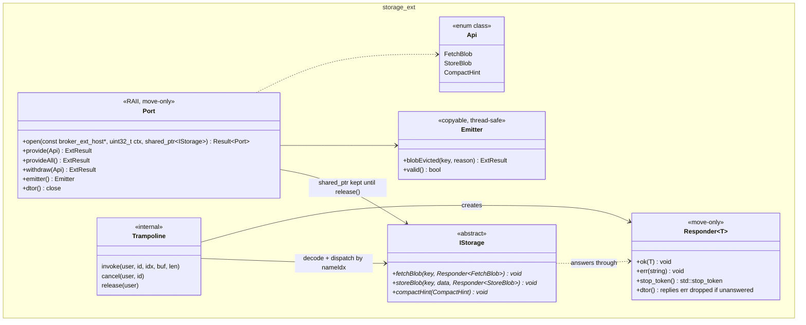

### Option C1 — abstract class + `Responder<T>` + `std::stop_token` *(recommended)*

```cpp
struct MyStorage final : storage_ext::IStorage {
  void fetchBlob(std::string key, storage_ext::Responder<storage_ext::FetchBlob> r) override {
    pool_.post([this, key = std::move(key), r = std::move(r)]() mutable {
      if (r.stop_token().stop_requested()) return;      // Nim cancelled / timed out
      auto bytes = s3_.get(key, r.stop_token());         // cooperative cancel
      if (!bytes) return r.err(bytes.error());
      r.ok({.data = std::move(*bytes)});
    });
  }
  void compactHint(storage_ext::CompactHint h) override { /* one-way */ }
};

auto port = storage_ext::Port::open(mylib_extHost(), ctx, std::make_shared<MyStorage>());
port->provide(storage_ext::Api::FetchBlob);               // individually…
port->provide(storage_ext::Api::CompactHint);             // …store_blob stays unprovided
// or: port->provideAll();
auto em = port->emitter();
em.blobEvicted("k1", "lru");                              // any thread
```

- exactly-once guaranteed by type: move-only, destructor auto-`err("dropped")`.
- the virtual of an unprovided `Api` is never invoked (Nim never routes it), so
  a pure virtual still has to exist — use C3 when only a subset is implemented.
- `ext_cancel` → `std::stop_source::request_stop()` stored per callId in the
  trampoline's small map; C++20 standard, no custom token.
- declares `CAP_NONBLOCKING` (the trampoline only decodes and calls the
  virtual; the user posts to their executor), so it serves `bridge` and
  `workers` brokers; `inplace` brokers need C2.
- exceptions thrown out of a virtual are caught in the trampoline →
  `err(what())`.

### Option C2 — synchronous virtuals

```cpp
struct MyStorage : storage_ext::IStorageSync {
  storage_ext::Result<storage_ext::FetchBlob> fetchBlob(const std::string& key,
                                                        std::stop_token st) override;
};
```

Simplest to implement; return value = reply. Declares `CAP_REPLY_INLINE`, so
it serves `inplace` and `workers` brokers (refused for `bridge` at `provide`). Can be generated as a thin adapter over C1
(`IStorageSync` derives from `IStorage` and calls `r.ok(fetchBlob(...))`), so
both can ship together at near-zero cost.

### Option C3 — per-method registration (`std::function` builder)

```cpp
auto port = storage_ext::Builder{}
  .fetchBlob([](std::string key, auto r) { ... })
  // storeBlob not set → never provided → Nim gets "no provider registered"
  .onCompactHint([](storage_ext::CompactHint h) { ... })
  .open(mylib_extHost(), ctx);                            // provides exactly what is set
```

With individual binding this is the natural fit for partial plugins: the set of
closures *is* the provided set, no "not implemented" fallback needed. Ships
alongside C1.

### Option C4 — C++20 coroutines

```cpp
storage_ext::Task<storage_ext::Result<FetchBlob>> fetchBlob(std::string key) override;
```

Requires shipping (or choosing) a coroutine task type and an executor; the
existing `(API)` C++ wrapper deliberately stays executor-free (callback +
`std::future` only, `doc/design/cpp_async_with_std_future.md`). Possible later
on top of C1 (`Responder` is the completion primitive a coroutine adapter
would resume through).

| | C1 Responder | C2 Sync | C3 Builder | C4 Coroutine |
|---|---|---|---|---|
| Caps → policies served | `NONBLOCKING` → `bridge`, `workers` | `REPLY_INLINE` → `inplace`, `workers` | per closure kind (async → `NONBLOCKING`, sync → `REPLY_INLINE`) | `NONBLOCKING` |
| Cancellation | `stop_token` | `stop_token` param | `stop_token` | coroutine cancel via token |
| Exactly-once enforced | type (move-only + dtor) | return value | type | return |
| Partial impl | via `provide` subset (virtual must still exist) | same | **natural** | same as C1 |
| Dependencies | C++20 std | C++20 std | C++20 std | task/executor choice |
| Recommendation | **primary** | ship as adapter | **ship** (partial plugins) | later |

---

## 8. Rust wrapper options — `<plugin>_ext_rs/`

Separate crate (`storage_ext`), depends only on the `broker_ext` C ABI
(hand-written `extern "C"` types, no bindgen — same as today's Rust codegen),
`ciborium` + `serde`. Runtime-agnostic, matching the Phase-3 decision for the
`(API)` Rust wrapper (`futures_channel`, no tokio). Like C++, the typed layer
sits on a safe `RawPort` over the CBOR tunnel (§6.6), and individual binding
is `Port::open` + `provide(Api::X)` / `provide_all()` / `withdraw(Api::X)`.

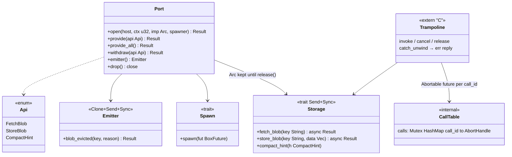

### Option R1 — async trait + `Abortable` *(recommended)*

```rust
struct MyStorage { s3: S3Client }

impl storage_ext::Storage for MyStorage {
    async fn fetch_blob(&self, key: String) -> Result<FetchBlob, String> {
        let data = self.s3.get(&key).await.map_err(|e| e.to_string())?;
        Ok(FetchBlob { data })
    }
    async fn store_blob(&self, key: String, data: Vec<u8>) -> Result<StoreBlob, String> { … }
    fn compact_hint(&self, h: CompactHint) { … }
}

let port = storage_ext::Port::open(
    mylib_ext_host(), ctx, Arc::new(MyStorage { … }),
    move |fut| { rt_handle.spawn(fut); },  // a captured tokio Handle (invoke runs
                                           // on host threads, outside the runtime),
                                           // or async-std, smol, a thread pool…
)?;
port.provide(storage_ext::Api::FetchBlob)?;   // individually, or port.provide_all()?
let em = port.emitter();
em.blob_evicted("k1", "lru")?;            // any thread
```

- **Cancellation is Rust-native: dropping the future.** `invoke` wraps the call
  future in `futures::future::Abortable`, stores the `AbortHandle` by `call_id`;
  `ext_cancel` aborts it → future dropped → `reqwest`/`tokio` I/O inside is
  cancelled by drop semantics. Aborted calls send no reply (Nim already
  resolved).
- Declares `CAP_NONBLOCKING`: the trampoline only decodes + `spawn`s, so it
  serves `bridge` and `workers` brokers; `inplace` brokers need R2.
- AFIT (`async fn` in trait) is stable since 1.75 = our MSRV; the `Send` bound
  on returned futures is expressed with return-position `impl Future + Send`
  in the generated trait (or `#[trait_variant::make]`), so no `async-trait`
  boxing crate is required.
- `catch_unwind` in the trampoline; panic → `err("panic: …")`, process
  survives (nim-ffi does the same).

### Option R2 — sync trait

```rust
impl storage_ext::StorageSync for MyStorage {
    fn fetch_blob(&self, key: String, cancel: &CancelFlag) -> Result<FetchBlob, String> { … }
}
```

Declares `CAP_REPLY_INLINE` (serves `inplace` and `workers` brokers);
`CancelFlag` is an `AtomicBool` set by `ext_cancel`. Generated as a blanket adapter, like C2.

### Option R3 — `Responder<T>` handle

```rust
fn fetch_blob(&self, key: String, r: Responder<FetchBlob>);   // r.ok(v) / r.err(e); Drop → err("dropped")
```

Mirrors C1 exactly; useful for callback-style C SDKs wrapped in Rust. Less
idiomatic than R1 for async Rust code.

### Option R4 — closure builder

```rust
let b = storage_ext::Builder::new()
    .fetch_blob(|key| async move { … })
    .on_compact_hint(|h| { … })
    .open(host, ctx, spawner)?;            // provides exactly the closures set
```

| | R1 async trait | R2 sync trait | R3 Responder | R4 Builder |
|---|---|---|---|---|
| Idiomatic | **most** | yes for blocking code | callback-ish | yes |
| Runtime-agnostic | yes (`Spawn`) | n/a (workers) | yes | yes |
| Cancellation | drop via `Abortable` | `CancelFlag` | `r.is_cancelled()` | drop |
| Partial impl | via `provide` subset (trait methods get default bodies returning `Err("not provided")`, never reached) | same | same | **natural** |
| Caps → policies served | `NONBLOCKING` → `bridge`, `workers` | `REPLY_INLINE` → `inplace`, `workers` | `NONBLOCKING` → `bridge`, `workers` | per closure kind |
| Recommendation | **primary** | adapter | optional | **ship** (partial plugins) |

### Emitter lifetime (both languages)

`Emitter` holds `(host*, port)` by value, never a pointer into Nim state. After
`close` (or host shutdown) every emit returns `STALE` / `Err(Closed)` — the
port generation makes a use-after-close an error code, not UB. Same for a late
`Responder::ok` after cancel: `reply` returns `STALE`, the wrapper swallows it.

### Go / Python (brief, for completeness)

| | Shape |
|---|---|
| Go | `interface Storage { FetchBlob(ctx context.Context, key string) (FetchBlob, error) }`; `ext_cancel` → cancels the per-call `context.Context`; `cgo.Handle` for `user`; one `//export` trampoline. `workers` not needed: the trampoline starts a goroutine (`bridge` policy). |
| Python | `class Storage(Protocol): async def fetch_blob(self, key: str) -> FetchBlob`; trampoline does `asyncio.run_coroutine_threadsafe` onto the user loop, `ext_cancel` → `task.cancel()`; raise → `err`. |

---

## 9. Composition: a plugin that also uses the host's `(API)`

A foreign plugin often needs to call *into* Nim too. That is the existing
`(API)` lane — no new mechanism:

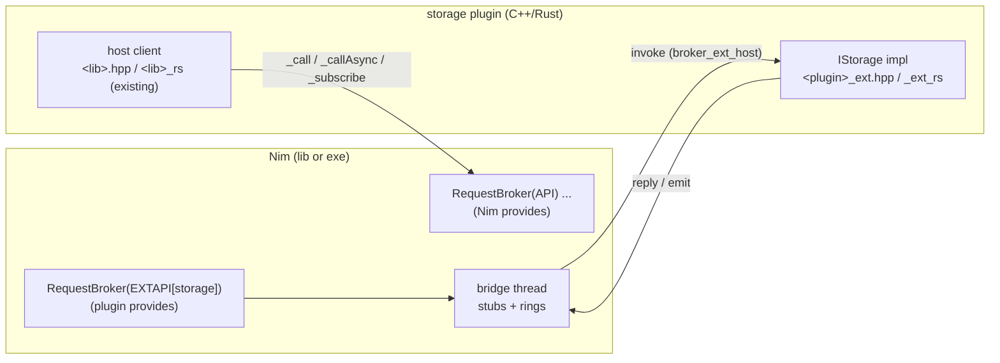

Re-entrancy rule (documented, tested): an `invoke` handler calling back into
the host with **sync** `<lib>_call` is safe only in `workers` mode or when the
bridge is not the thread serving that call; in `bridge` mode with bridge ==
processing thread it would self-deadlock. Wrappers steer users to
`_callAsync` / the async methods from inside impls.

---

## 10. Approach B in detail (for contrast)

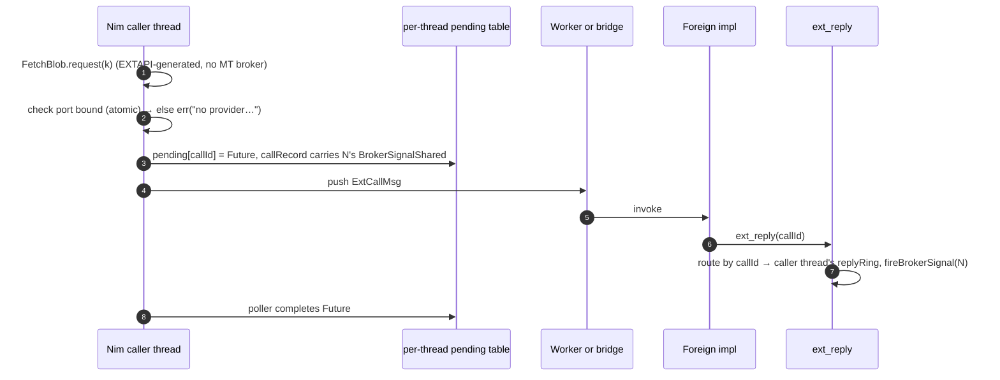

Saves the requester↔bridge hop, but must re-implement: timeout var + kwarg,
`requestCancellable` / `cancel(id)` id scheme, `ProviderGone` fan-out on withdraw
to *every* thread that has pending calls (needs a global registry of per-thread
reply rings with lifetime tied to `teardownBrokerThread`), BrokerScope
overloads, mock/replace trio. That is a second copy of
`MT_REQUEST_CANCELLATION_PLAN.md` + `MT_OWNER_ONLY_CLEAR_PLAN.md` — the two
hardest-won pieces of the MT lane. Hence "optimisation later, if measured".

### 10.1 (deferred) — getting B's latency inside A

If needed: when the caller is on a thread that has no provider and the plugin
policy is `bridge`/`workers`, the generated `request` could short-circuit
directly to the worker queue while still minting an MT response slot on the
bridge's pool, keeping the MT slot protocol as the single source of
cancel/timeout truth. Only worth designing with a benchmark showing the hop
matters.

---

## 11. Failure semantics (Approach A)

| Situation | Nim caller sees | Foreign sees |
|---|---|---|
| Public slot empty (no Nim provider, nothing auto-wired), or `extProvider` installed while no external source is available | `err("…no provider registered for broker context …")` / `err("no signal handler installed")` | — |
| `open` with schema mismatch | — | `BROKER_EXT_SCHEMA_MISMATCH` (`-14`), or OK with skip env / `schemaHash = NULL` |
| `provide` while another port is the foreign source of that broker on that ctx | — | `BROKER_EXT_ALREADY_PROVIDED`, nothing changed |
| `provide` while the author's public provider is a Nim impl | still served by the Nim impl until the owner switches to `extProvider` / `extFallback` | `OK` (hidden lane wired) |
| Some brokers of a plugin provided, others not | unprovided ones: `err("…no provider registered…")` | — |
| Owner `replaceProvider` switch while calls are in flight | running calls finish on the old provider, queued and later calls take the new one; no `ProviderGone` | old foreign calls still get their reply path |
| Non-owner thread tries to switch | `replaceProvider` / `setProvider` → `err`; `clearProvider` logged no-op (existing owner-only rule) | — |
| Nim wants to switch an `autoWire`d broker | `err` (bridge owns the slot) → declare `autoWire = false` for brokers meant to switch | — |
| `withdraw` of a name the port does not provide | — | `BROKER_EXT_NOT_PROVIDED` |
| `provide` of a broker whose dispatch policy the port's `caps` can't serve | — | `BROKER_EXT_DISPATCH_MISMATCH`, nothing installed |
| `provide` / `emit` with an undeclared name | — | `BROKER_EXT_UNKNOWN_NAME` |
| Timeout / `cancel(id)` while queued for a worker | `err` timeout / cancelled | `invoke` never runs |
| Timeout / cancel while impl runs | resolves at once | `cancel(callId)` hint; a later `reply` returns `OK` and is dropped by call id (only the source port can complete a call, review M4) |
| `withdraw` / `close` with calls outstanding | `err` (ProviderGone) | — ; `release(user)` after last running `invoke` returns |
| Reply twice | first wins | second returns `OK` and is dropped (inplace: generation CAS; bridge: call id) |
| Reply with undecodable CBOR | `err("ext decode: …")` | `OK` (accepted) |
| `emit` ring full | — | `BROKER_EXT_AGAIN` |
| `emit` after `close` / host shutdown | — | `BROKER_EXT_STALE` / `BROKER_EXT_SHUTDOWN`; events queued before the close are dropped (review M5) |
| C++ exception / Rust panic in impl | `err("panic: …")` / `err(what())` | process survives |
| Worker blocked > stall threshold | other calls queue, then time out | chronicles warn `ext worker blocked` |
| Host shutdown with stuck worker | outstanding → `err` (teardown); queued calls never run (review R1) | *as built:* `stop` waits for the stuck `invoke` (no join timeout — follow-up) |
| `invoke` calls `withdraw` / `close` on its own port | in-flight call completes or fails normally | allowed (runs directly on the bridge, §5.7); `release` deferred until that `invoke` returns |
| `invoke` triggers host shutdown | — | `ExtHost.stop()` returns `err` on the bridge / a worker thread (review R2.2); do it from another thread |
| `inplace` foreign impl returns without replying | `err("inplace impl returned without reply")` | a later `reply` returns `OK` and is dropped (generation CAS) |
| `inplace` + `requestCancellable` | id `0`, `cancel` is a no-op (synchronous call) | — |
| K1 import: library or symbol missing | `extFallback` → Nim impl; otherwise `"no provider registered…"`; reason in `ExtPlugin(p).loadError` | — |
| K1 import: blocking C call under `inplace` | blocks the caller's loop (author's choice) | — |
| K1 `bridge` / `workers(n)`: deadline while queued / running | queued → dropped, never called; running → resolves at once, C call finishes on its thread and the result is discarded | — |
| K1 short form with `ptr` / `pointer` / `openArray` args under `bridge` / `workers` | compile error → use the body form | — |
| K1 `workers(n)`: all `n` import threads blocked | further calls queue on the least-loaded worker, then hit their deadline | — |
| K2 peer: `_getSchema` mismatch for an imported name | that broker's source is not registered; reason in `loadError` | — |
| K2 peer: `_callAsync` returns `-6` | `err("ext: peer busy")` | — |
| K2 peer: timeout | `err` timeout (peer's `-12`) | late peer response dropped by id |
| `unload()` while calls run | running calls complete; `unloadLib` after the last one | — |
| `ExtTunnel.call` with an undeclared name | `err("unknown ext api …")` | — |

---

## 12. Open questions

Rounds 1–4 are resolved in §D–§D4. Nothing blocks phase 1. Points to settle
during implementation (no decision needed up front):

1. K1 worker selection: least in-flight with round-robin ties (proposed) is
   enough, or does any plugin need affinity (same key → same worker)?
2. Measure the `T → bridge` hop of an author-owned `extProvider` against the
   auto-wired path before considering the §10.1 optimisation.

---

## 13. Phasing (Approach A)

Every phase is gated by the real builds and tests across ORC / refc, debug /
release, and refc + ASAN wherever lifetimes are touched; CI keeps every
existing gate (AGENTS.md "CI expectations") green. A phase that delivers a
wrapper also delivers its **examples** (§14) and the nimble task that runs
them in CI — tests alone do not close a phase (R12).

| Phase | Content | Gate |
|---|---|---|
| 0 | **Prerequisite.** PR #65 (`<lib>_verifySchema`, `api_schema_hash.nim`, `ApiStatusSchemaMismatch`) merged; rebase `feat-extapi-design` on it | master contains `ac98d25` |
| 1a | **Foreign lane core.** `ExtHostRuntime` + shared bridge (exe) / processing-thread bridge (lib); per-plugin port table, worker pools, reply / event rings; `broker_ext.h`; `open / provide / withdraw / close` with `caps` check; `reply` / `emit`; `bridge` / `workers(n)` / `inplace` dispatch; `EXTAPI[p]` tag parsing + `registerExtPlugin`; exe-mode `ExtHost.loadPlugin` (`dlopen` / `LoadLibrary` + `broker_ext_plugin_entry`); `<plugin>_ext.h` + `.cddl`; `listApis` / `getSchema` | `test/test_ext_plugin.nim` driving a **raw C plugin** (§6.6.3) through every row of §11 that concerns ports, replies, events, signals, cancel / timeout, stale / shutdown |
| 1b | **Lowering and switching.** Public MT broker + hidden `<T>Ext` lane, `extProvider` / `extFallback` / `extAvailable`, `autoWire`, `directInplace`, `ExtTunnel` (+ CBOR adapters for EXTAPI brokers) | `test/test_ext_switching.nim`: gapless owner `replaceProvider` under concurrent load (no `"no provider"`, no `ProviderGone` observed), `withMockProvider`, `extFallback` across plugin load / unload, non-owner switch rejected |
| 2 | **Library imports.** K1 native C: lazy `std/dynlib`, short form + body form, `inplace` / `bridge` / `workers(n)` with per-worker internal contexts, pointer-argument rule; K2 `BrokerLibPort` importing the `examples/ffiapi` `mylib`, one peer context per host ctx | `test/test_ext_imports.nim`: libz + a test C library, missing-library fallback, `workers(n)` parallelism and deadline drops, peer schema mismatch, peer `-6`; Windows CI cell |
| 3 | **C++.** `<plugin>_ext.hpp` (C1 + C2 adapter + C3 builder), CMake target | **C++ examples, all of §14** — `nimble runExtExampleCpp` (orc + refc), added to CI |
| 4 | **Rust.** `<plugin>_ext_rs` crate (R1 + R2 adapter + R4 builder) | **Rust examples, all of §14** — `nimble runExtExampleRust` (orc + refc), added to CI, incl. the Windows cell |
| 5 | Go / Python wrappers + their example variants | parity with phases 3–4 |

---

## 14. Example implementations (R12)

Tests prove the contracts; the examples show a user **the whole flow** with
real, idiomatic code they can copy. Same layout conventions as
`examples/ffiapi` and `examples/torpedo` (CMake for C++, Cargo for Rust,
nimble tasks that iterate `--mm:orc` and `--mm:refc`). Each example prints
what happens and **asserts** it, so a CI run fails on a behavioural
regression, not only on a crash.

### 14.1 Layout

```
examples/extapi/
  nimhost/
    storage_host.nim        — Nim exe: EXTAPI[storage] (plugin) + EXTAPI[codec] (C import),
                              Nim impl of storage, runs the scenarios below
    storage_lib.nim         — the same API as a Nim *library* (registerBrokerLibrary) for the
                              in-process (lib-mode) variant of scenario 1
    test_storage_mock.nim   — scenario 3 as a real test file (testutils/unittests)
  cpp_plugin/               — storage plugin in C++ (storage_ext.hpp): C1 class + C3 builder,
                              built as a shared library exporting broker_ext_plugin_entry
  cpp_host_lib/             — C++ app that loads storage_lib and provides the plugin in-process
                              through <lib>_extHost() (lib-mode variant)
  cpp_cimport/              — C++ shared library exporting extern "C" functions for K1
  rust_plugin/              — storage plugin in Rust (storage_ext_rs): R1 async trait + R4 builder,
                              cdylib exporting broker_ext_plugin_entry
  rust_host_lib/            — Rust app, lib-mode variant
  rust_cimport/             — Rust cdylib exporting #[no_mangle] extern "C" functions for K1
```

### 14.2 Scenarios × languages

| # | Scenario | What the example does | C++ | Rust | Asserted outcome |
|---|---|---|---|---|---|
| 1 | **External plugin implementation** | Nim exe loads the plugin (`ExtHost.loadPlugin`), plugin opens a port and provides a subset (`fetch_blob`, `compact_hint`; `store_blob` left unprovided); Nim requests, listens to `BlobEvicted`, signals `CompactHint`, issues a `requestCancellable` and cancels it, and one request with a tight timeout | `cpp_plugin` (C1 class, `stop_token`) | `rust_plugin` (R1 async trait, `Abortable`) | results round-trip; event received; signal accepted; unprovided broker → `"no provider registered…"`; cancel reaches the plugin (`stop_requested()` / future dropped); timeout → `err` |
| 1b | — same, lib mode | the C++ / Rust *app* hosts the Nim library and provides the plugin in-process via `<lib>_extHost()` | `cpp_host_lib` | `rust_host_lib` | as 1, with the bridge on the library's processing thread |
| 2 | **Runtime switching to the internal Nim impl** | `autoWire = false` broker; owner thread installs `extFallback(ctx, localImpl)`; a load generator calls continuously while the host (a) runs without plugin, (b) loads the plugin, (c) `replaceProvider` → Nim impl, (d) back to `extProvider`, (e) unloads the plugin | `cpp_plugin` | `rust_plugin` | every call succeeds; the serving source per phase matches (a) Nim, (b) plugin, (c) Nim, (d) plugin, (e) Nim; zero `"no provider"` / `ProviderGone` during switches |
| 3 | **Mocking** | `test_storage_mock.nim`: `withMockProvider` with a closure capturing test state, no plugin loaded; then with the C++ / Rust plugin loaded and `autoWire = false`, mock wins for the block and the plugin serves again afterwards; events driven by Nim `emit` | uses `cpp_plugin` | uses `rust_plugin` | mock observed inside the block, plugin observed after it; captured counter incremented |
| 4 | **C import** | Nim `EXTAPI[codec]` imports from the C++ / Rust library: short form `crc32`-like pure function with `dispatch = inplace`; body form blocking `compress`-like function with `dispatch = workers(2)`; a missing symbol in an optional third broker | `cpp_cimport` (`extern "C"`) | `rust_cimport` (`#[no_mangle] extern "C"`) | results match a Nim reference; two blocking calls overlap in time with `workers(2)` (measured); missing symbol → `loadError` set and `extFallback` serves the Nim impl |

### 14.3 Running

```bash
nimble runExtExampleCpp
```

```bash
nimble runExtExampleRust
```

Each task builds the Nim host / library, the plugin and the C-import library,
runs scenarios 1, 1b, 2 and 4 from the host, and runs scenario 3 as a test;
`MM=orc` / `MM=refc` select a single memory manager as in the existing tasks.
An ASAN variant (`nimble runExtExampleCppAsan`, refc) covers scenario 2's
switching under load, the lifetime-heaviest path.

### 14.4 Docs

`doc/FFI_API.md` gains an "EXTAPI" chapter walking through these examples
(the generated surfaces, the ownership table, the failure table), and
`README.md` / `USAGEGUIDE.md` link to it — no separate new doc files beyond
this plan.

---

## 15. Implementation status

### Phase 1a — foreign lane core (implemented on `feat-extapi-design`)

| Piece | Where |
|---|---|
| `RequestBroker` / `EventBroker` / `SignalBroker(EXTAPI[p], …)` parsing + lowering | `brokers/{request,event,signal}_broker.nim` (bracket-mode hook), `brokers/internal/ext_brokers.nim` |
| `registerExtPlugin(p, version, dispatch)`, `ExtHost.start/stop/table/loadPlugin` | `brokers/ext_plugin.nim` |
| Runtime: plugin registry, ports, host table, bridge thread, control / reply / event rings, worker pools, inplace slots, caps check | `brokers/internal/ext_runtime.nim` |
| Fixed C ABI | `brokers/broker_ext.h` (copied next to the generated `<plugin>_ext.h` / `.cddl`) |
| Tests | `test/test_ext_plugin.nim` + raw C plugins `test/ext/raw_{storage,calc,echo}_plugin.c` (no generated wrapper) |

Verified: ORC / refc × debug / release, refc + ASAN/UBSan and ORC + ASAN/UBSan
on macOS; 25 consecutive runs per MM without a failure.

Deviations from the sections above, found while implementing:

| Topic | Plan said | Implemented | Reason |
|---|---|---|---|
| Timeout of a running call | MT timeout cancels the provider | `extCall` enforces the broker's own `requestTimeoutMs` and sends the cancel hint itself | an MT timeout only abandons the response slot; it never cancels a running provider (existing MT semantics, unchanged) |
| Second / late `reply` | `STALE` | `OK`, dropped on the bridge by call id | the foreign thread cannot see the bridge's pending table synchronously; `STALE` is still returned for a closed port |
| `inplace` | runs on the caller's thread | phase 1a: on the slot owner's thread; **phase 1b: caller's thread** via the MT inplace hook | — |
| `extProvider` / `extHandler` off the bridge | forwards over the hidden `<T>Ext` lane | phase 1a: `err`; **phase 1b: implemented** (`<T>ExtLane`) | — |
| Worker pool shutdown | join timeout, leak a stuck worker | plain join | a worker stuck in a foreign `invoke` delays `ExtHost.stop()`; follow-up |
| Schema hash scope | full type registry | names, kinds, argument / payload types, inline payload fields | nested external types are identified by name only |
| Limits | — | 32 plugins, 64 ports and 64 names per plugin, 256 concurrent inplace calls, 4096-entry rings | fixed arrays keep foreign-thread paths allocation-free |
| Windows | — | loader test skipped | Windows CI cell is phase 4 |

### Phase 1b — lowering and switching (implemented on `feat-extapi-design`)

| Piece | Where |
|---|---|
| Opt-in MT hook: `MtReqCfg.extInplaceHook` forward-declares per-slot `<T>ExtInplaceTry*` / `Active*` and prepends a check to the keyed `request` / `blockingRequest` / `requestCancellable` / `blockingRequestCancellable`; off for every non-EXTAPI broker (no codegen change) | `brokers/internal/mt_request_broker.nim` (`addExtInplaceHooks`) |
| Hidden `<T>ExtLane` (raw-CBOR MT broker, bridge-provided while any slot of `T` is provided) | `ext_brokers.nim` |
| `T.extProvider[NoArgs](ctx)`: inplace → direct on any thread; on the bridge → `extCall`; elsewhere → lane `requestCancellable` with cancel propagation | `ext_brokers.nim` |
| `T.extFallback[NoArgs](ctx, nimImpl)`, `T.extAvailable[NoArgs](ctx)`; signals: `extHandler`, `extFallback`, `extAvailable` | `ext_brokers.nim` |
| `autoWire` per broker / plugin default (`true`) | `ext_brokers.nim`, `registerExtPlugin` |
| Shared, lock-protected source table → availability, inplace calls and signals work from any thread | `ext_runtime.nim` |
| `ExtTunnel.call / signal / listen` by (plugin, wire name), through the typed broker | `ext_plugin.nim` + per-name adapters |
| Test | `test/test_ext_switching.nim` + `test/ext/raw_kv_plugin.c`; in `testApi`, `testExtSwitchAsan{Orc,Refc}` |

Verified: ORC / refc × debug / release, ORC + ASAN, refc + ASAN; 30
consecutive runs per configuration without a failure; `nimble test` and
`nimble testApi` green.

Findings:

| Topic | Behaviour | Reason |
|---|---|---|
| Owner `replaceProvider` switch under load | no lost call, no `"no provider"`, no `ProviderGone` (test asserts 0 errors over 6 switches) | as designed: the handler is looked up per message |
| Plugin withdraws while `extFallback` already routed a call to it | that call fails (`provider was cleared …`); later calls fall back to the Nim impl | no implicit retry: the plugin may already have acted on the call (at-most-once over at-least-once) |
| `requestCancellable` on an auto-wired `inplace` broker | id `0`, synchronous result | the call never leaves the caller thread |
| Compile-time VM | `let b = a` of an object inside a macro can alias `a`; the lane cfg is parsed afresh | otherwise the lane broker inherited `extInplaceHook` |

### Phase 2 — library imports (implemented on `feat-extapi-design`)

Both import kinds load as a **synthetic port**: a Nim-side `invoke` serves
the names through the same port / provide / source-table machinery as a
foreign plugin, so routing, `workers(n)`, the hidden lane, `extFallback`,
`extAvailable`, withdraw and shutdown are shared, not re-implemented.

| Piece | Where |
|---|---|
| K1 short form `RequestBroker(EXTAPI[p], importc = "sym", dynlib = <pattern or const>)`, body form with `{.importc.}` prototypes + an adapter body; lazy `std/dynlib` resolution into function pointers | `ext_brokers.nim` |
| K1 trampolines (CBOR) + per-plugin dispatcher; zero-CBOR fast path when an `inplace` import is auto-wired (caller's thread) or called through `extProvider` | `ext_brokers.nim`, `registerExtPlugin` |
| K2 `importLib = "<lib>"` on Request / Event / Signal brokers; generic peer adapter: `<lib>_callAsync` + envelope unwrap on the peer's delivery thread, `<lib>_subscribe` → foreign emit, signals via the peer's one-way `<lib>_call`; per-name schema check against the peer's `_getSchema`; one peer context per host ctx | `ext_runtime.nim` |
| `ExtPlugin.load(name, ctx)` / `ExtPlugin.loadError(name)`; `registerExtPlugin(p, load = eager \| manual)` | `ext_plugin.nim` |
| Compile-time rule: K1 short form with raw pointers (`ptr` / `pointer` / `openArray` / `cstring`) only under `inplace` | `registerExtPlugin`, `test/reject/reject_ext_rawptr_workers.nim` |
| Tests | `test/test_ext_imports.nim` (`test/ext/libcodec.c`, peer `test/ext/peerlib.nim` built at test time); in `testApi`, `testExtImportsAsan{Orc,Refc}`, reject in `testSugarRejects` |

Verified: ORC / refc × debug / release, ORC + ASAN, refc + ASAN; 10
consecutive runs per MM without a failure.

Deviations from §5.9:

| Topic | Plan | Implemented | Reason |
|---|---|---|---|
| K1 wire | native C call, no CBOR | no CBOR for `inplace` (direct call); `bridge` / `workers` carry CBOR between forwarder and trampoline | one synthetic-port path instead of a second marshalling lane; the MT lane would marshal anyway |
| K1 `workers(n)` | per-worker Nim threads with a chronos loop + internal contexts | the plugin's plain worker pool runs the adapter | the adapter body is **synchronous** (`await` not allowed — it wraps a C call), so no loop is needed |
| K1 adapter exceptions | — | `CatchableError` → `err(...)` | providers must not raise |
| Unload | `unload()` after the last running call | no unload; libraries stay mapped | foreign threads / callbacks may outlive any unload point (same rule as the plugin loader) |
| `load = lazy` | eager / lazy / manual | eager / manual | lazy loading on first call deferred |
| K1 signals / events | Request, Signal | requests only | no use case yet |
| K2 schema | compare descriptors | per-name canonical `args\|payload` text; the peer's `_getSchema` is JSON (the `(API)` lane's format) | — |
| K2 `inplace` | via the peer's sync `_call` | not supported (port caps `NONBLOCKING`) | deferred |
| K2 cancel | drop by id | drop by id (no `_cancelAsync` yet) | as planned |
| K2 per-ctx unload | `unload(ctx)` | peer contexts shut down at `ExtHost.stop()`, and in lib mode by `<lib>_shutdown(ctx)` for the host context it served | `unload` deferred |

### Phase 3 — C++ wrapper and C++ examples (implemented on `feat-extapi-design`)

| Piece | Where |
|---|---|
| `<plugin>_ext.hpp` generator: C1 `I<Plugin>` + `Responder<T>` (`std::stop_token`, exactly-once, dtor → `err("dropped")`), C2 `I<Plugin>Sync` (`CAP_REPLY_INLINE`), C3 `Builder`, `Port` (RAII), `Emitter`, `Bytes` as CBOR byte string, POD payloads mapped | `brokers/internal/ext_codegen_hpp.nim`, written by `registerExtPlugin` for foreign-implemented plugins only |
| `exportExtHost("<lib>")` — lib mode: exports `<lib>_extHost()`, which starts the bridge on first use | `brokers/ext_plugin.nim` |
| Examples (§14): `examples/extapi/nimhost/{storage_api,storage_host,test_storage_mock}.nim`, `nimlib/storagelib.nim`, `cpp_plugin/` (C1), `cpp_cimport/` (C-ABI lib), `cpp_host_lib/` (lib mode, C3), `CMakeLists.txt` | `examples/extapi/` |
| `nimble runExtExampleCpp` (orc + refc), `nimble runExtExampleCppAsan` (refc + ASAN host); CI step on Linux / macOS | `brokers.nimble`, `.github/workflows/ci.yml` |

Verified on macOS: scenarios 1, 1b, 2, 3, 4 pass under ORC and refc; the
ASAN host run is clean.

Findings while implementing:

| Topic | Finding | Handling |
|---|---|---|
| Lib mode bridge | §5.1 put the bridge on the library's processing thread | the shared bridge thread also serves lib mode (started by `<lib>_extHost()`); one extra MT hop for `(API)` providers that call EXTAPI brokers; processing-thread bridge left as an optimisation |
| Plugin registration in a library | the module initialiser ran twice in lib mode, registering the plugin twice; the forwarder then pointed at an unreachable second copy | `extRegisterPlugin` is idempotent per plugin name; the double init itself is an `(API)`-lane observation worth its own look |
| Provider types across modules | `<T>ProviderWithArgs` is not exported by the MT codegen | examples pass plain `proc`s / closures; no change |
| Windows | C++ examples not yet run on Windows | CI step gated to Linux / macOS until the phase-4 Windows cell |

### Phase 4 — Rust wrapper and Rust examples (implemented on `feat-extapi-design`)

| Piece | Where |
|---|---|
| `<plugin>_ext_rs/` crate generator (`-d:BrokerFfiApiGenRust`): `ffi` mirror of `broker_ext.h`, `Host`, R1 `<Plugin>` trait (`fn … -> impl Future + Send`, futures run on a caller-supplied `Spawn`, Nim cancel / deadline drops the future via `Abortable`), R2 `<Plugin>Sync` (`CancelFlag`, `CAP_REPLY_INLINE`), R4 `Builder` (closures, provides exactly what is set; default spawner = thread per call), `Port` (`Drop` closes), `Emitter`; panics become `Err` replies | `brokers/internal/ext_codegen_rust.nim`, written by `registerExtPlugin` for foreign-implemented plugins only |
| Examples: `rust_plugin/` (R1, cdylib, no async runtime), `rust_cimport/` (C-ABI lib), `rust_host_lib/` (lib mode, R4 + the generated `storagelib_rs`) | `examples/extapi/` |
| `nimble runExtExampleRust` (orc + refc); CI step on Linux / macOS | `brokers.nimble`, `.github/workflows/ci.yml` |

Verified on macOS: scenarios 1, 1b, 2, 3, 4 pass with the Rust plugin and
Rust codec under ORC and refc; the ASAN (refc) host run with the Rust plugin
is clean.

| Topic | Finding | Handling |
|---|---|---|
| Runtime | R1 must not force tokio | `Spawn` is any `Fn(BoxFuture)`; crate depends on `futures` only |
| R2 | compiled and type-checked, not exercised at runtime by the examples (no `inplace` / `workers` foreign broker in `storage`) | follow-up: a raw-kv-style test plugin in Rust |
| Table keys | non-`String` keys need the `(API)` lane's `cbor_strkey_map` adapter | rejected at compile time for EXTAPI v1 |
| Windows | Rust and C++ examples not yet run on Windows | CI steps gated to Linux / macOS; Windows cell still open |

### Phase 5 — Go and Python wrappers and examples (implemented on `feat-extapi-design`)

| Piece | Where |
|---|---|
| `<plugin>_ext_go/` module (`-d:BrokerFfiApiGenGo`): `<Plugin>` interface (requests take `context.Context`, cancelled by a Nim cancel / deadline; one goroutine per request, port caps `NONBLOCKING`), `Funcs` + `OpenFuncs` (provides exactly the non-nil funcs), `Port`, `Emitter`; `cgo.Handle` as `user`, `//export` trampolines in their own file, C helpers in the main preamble; panics become error replies | `brokers/internal/ext_codegen_go.nim` |
| `<plugin>_ext.py` (`-d:BrokerFfiApiGenPy`): ctypes mirror of `broker_ext.h`, dataclasses, `<Plugin>` base class (`async def` → `run_coroutine_threadsafe` on the given loop, Nim cancel → `future.cancel()`; plain `def` replies inline), `Builder`, `Port` (kept alive until the host's `release`), `Emitter`; exceptions become error replies | `brokers/internal/ext_codegen_py.nim` |
| Go examples: `go_plugin/` (c-shared, scenarios 1–3), `go_cimport/` (c-shared C-ABI lib, scenario 4), `go_host_lib/` (lib mode, `OpenFuncs` + the generated `storagelib_go`) | `examples/extapi/` |
| Python example: `python_host_lib/main.py` (lib mode: `Builder` with a sync function, then a subclass with an `async def` on a loop thread) | `examples/extapi/` |
| `nimble runExtExampleGo`, `nimble runExtExamplePy` (orc + refc); CI steps on Linux / macOS | `brokers.nimble`, `.github/workflows/ci.yml` |

Verified on macOS: Go scenarios 1, 1b, 2, 3, 4 and Python 1b pass under ORC
and refc; the ASAN (refc) host run with the Go plugin is clean.

| Topic | Finding | Handling |
|---|---|---|
| Python scope | a Python plugin cannot be a `dlopen`-able library, so exe mode (scenarios 1–4) needs an embedding host | Python covers lib mode (1b) only |
| Two Go runtimes | `go_plugin` and `go_cimport` are separate c-shared libraries loaded into one process; Go does not promise this works | works on macOS (examples green); revisit if Linux CI disagrees — fallback is one c-shared library exporting both |
| Python cancel | `future.cancel()` path compiled and wired, not exercised (`notes` has no slow request) | follow-up together with the Rust R2 runtime test |
| gofmt | generated Go is `go vet`-clean; `gofmt` would only re-align struct fields / consts | left as is |
| Windows | Go / Python examples not yet run on Windows | CI steps gated to Linux / macOS, like C++ / Rust |

### Review fixes (doc/design/EXTAPI_REVIEW_FIXES_PLAN.md)

The peer review in `build/EXTAPI_REVIEW.md` (on `099a391`) was worked off in
nine commits, F1–F9, each with regression tests that fail without the fix
(stated per commit where that was verified):

| Group | Findings | What changed |
|---|---|---|
| F1 | R1, R2 | queued worker calls never run after their caller got an error; control calls cannot hang across a stop; `ExtHost.stop()` returns `Result` and refuses on bridge / worker threads; start / stop CAS state machine with rollback; refcounted K2 peer users; stop order bridge → pools → peers |
| F2 | H1–H4 | dual-slot re-provide; idempotent `ExtPlugin.load` per (plugin, ctx); K1 short-form C-ABI type check; C++ exceptions reach Nim as `err(what())` |
| F3 | M1, M2, M4–M7, M9 | inplace (gen, state) slot protocol; foreign-thread procs without Nim frames / raises (checked by `testExtForeignPath`); replies bound to their port; events of closed ports dropped; lane timeout set once; inplace `idOut`; indices read per call |
| F4 | M8, M10, M11, low | compile-time limits, body-form raw-pointer check, inplace + timeout warning, event / signal `dynlib` error |
| F5 | M13, M14 | structural schema hash (`brokers-ext:2`) and K2 peer comparison via `ext_shapes`; skip-schema env vars |
| F6 | M3, M12 | `bridge` signals invoked on the bridge; `autoWire` ownership documented and tested (and K1 raw-pointer `extProvider` fast path fixed) |
| F7 | W1–W8 | C++ / Rust / Python wrapper fixes; `testExtRustWrapper`, `testExtPyWrapper` |
| F8 | low | EXTAPI runtime imported only under `-d:BrokerFfiApi`; allocation checks; `ExtTunnel.unlisten`; one source lookup per inplace call; GC registration once per foreign thread |
| F9 | drift, §11 | docs aligned with the code; §11 failure rows asserted in `test_ext_lifecycle`; EXTAPI ASAN tasks in `allAsan` |

Not done here: the Windows CI cells for the EXTAPI example steps (gated to
Linux / macOS until a push lets them run), a worker join timeout at stop,
and the lib-mode double module initialisation (own follow-ups).

### Lib-mode teardown

Before this, nothing in lib mode stopped the host: `<lib>_shutdown(ctx)`
joined only the context's own threads, so the bridge, the worker pools, the
ports opened on the context and the providers the bridge auto-wired there
outlived it until process exit.

| Piece | Where |
|---|---|
| Two `nimcall` hooks `gApiLibCtxCloseHook(ctx)` / `gApiLibIdleHook()`; `api_library` has no EXTAPI dependency, the EXTAPI runtime sets them from its module initialiser | `brokers/internal/mt_broker_common.nim` |
| `<lib>_shutdown`: close hook after the `shutdownRequest` hook, before `shutdownFlag` / the joins; idle hook once the library has no live context | `brokers/api_library.nim` |
| `ecoCloseCtx` control op: the bridge closes every port bound to the ctx (`bridgeClose`: withdraw + uninstall auto-wired, fail pending); then the ctx's K2 peer contexts are shut down (`ExtPeerUser.hostCtx`) | `brokers/internal/ext_runtime.nim` (`extLibCtxClose`) |
| `<lib>_extHost()` → `extLibHostStart()` marks the host library-owned; the idle hook stops only such a host (`extLibIdle`), and a later `_extHost()` restarts it | `ext_runtime.nim`, `brokers/ext_plugin.nim` |
| Test: two contexts, ports on both, first `_shutdown` closes only its port, last one joins bridge + 2 workers, restart cycle | `test/test_api_ext_lib_teardown.nim`, `test/extteardownlib/`, `testApi` (orc + refc) |

Decisions:

| Topic | Chosen | Alternative | Reason |
|---|---|---|---|
| When the host stops | last live library context, any context | refcount of contexts that touched EXTAPI | `_extHost()` takes no ctx, so "touched" is unknowable; a sibling context may open ports later |
| Explicit `<lib>_extShutdown()` | not added | extra ABI function | the last-context rule covers the leak; no extra surface for the wrappers |
| Per-ctx close vs. `shutdownRequest` hook | after the hook | before the in-flight drain | the hook may still flush through a plugin; cost: a call stuck in a plugin waits out the 5 s drain |
| Host started by `ExtHost.start()` in a library | per-ctx close only, no stop | stop it too | whoever started it owns its stop |
